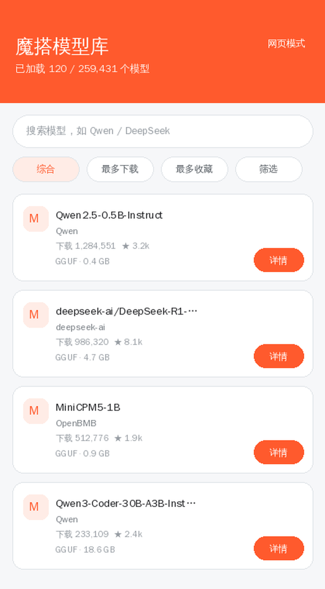
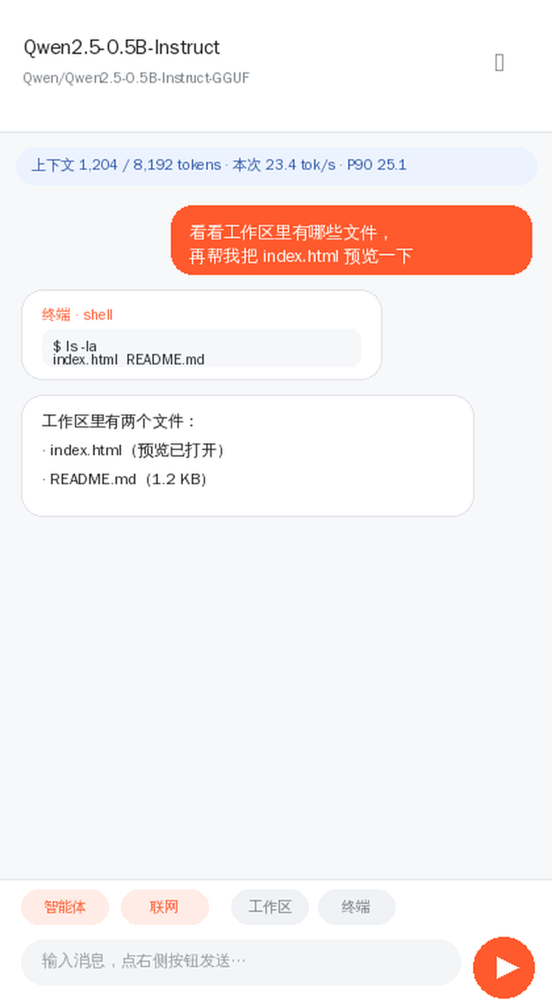
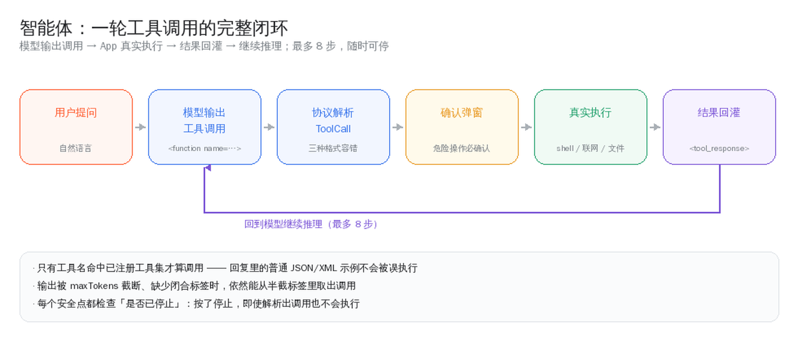

<div align="center">

# ModelScopeBrowser · 魔搭模型库

**Browse every LLM on ModelScope · download GGUF to your phone · chat offline with a built-in llama.cpp · let the model run shell commands, search the web and touch files**

*浏览魔搭全部大模型 · 把 GGUF 下载到手机 · 内置 llama.cpp 离线对话 · 模型可自主调用终端与联网*

[](https://github.com/ice-wocker/ModelScopeBrowser/releases)
[](https://github.com/ice-wocker/ModelScopeBrowser/actions/workflows/android.yml)
[](https://github.com/ice-wocker/ModelScopeBrowser/stargazers)
[](LICENSE)
[-3DDC84?logo=android&logoColor=white)](#)
[](#)
[](#internationalisation)
[](#)

[中文](README.md) · [Install](#install) · [Features](#features) · [Usage](#usage) · [How it works](#how-it-works) · [Docs](#documentation) · [Build](#build)

</div>

---

A lightweight Android app that browses **every model** on [ModelScope](https://www.modelscope.cn/models)
(paging, search, sorting, faceted filters, detail pages and file downloads), downloads `.gguf` files to the
phone, and **chats with them offline using a built-in llama.cpp**.

The chat screen is not a toy. It is an **agent that can act**: the model may call the on-device terminal,
search the web, read and write workspace files and preview web pages — then keep reasoning from the real
results it gets back.

> **Current release v2.6.0** (versionCode 14) · multi-variant arm64 CPU backends · pure CPU offline inference · data never leaves the device


---

## Internationalisation

The app ships with **full English and Chinese** — not a translated README with a Chinese-only UI.

| Layer | English | Chinese | Where it lives |
|---|---|---|---|
| UI strings | `values/strings.xml` (default) | `values-zh/strings.xml` | 216 keys each, placeholder-for-placeholder identical |
| In-app language switch | Follow system / English / 中文 | same | “About” → **Language**, applied per Activity via `LocaleManager` |
| Model prompts | English defaults | Chinese defaults | `core/PromptTemplate` — 4 presets × 2 languages |
| Tool descriptions & results | English | Chinese | `agent/AgentTools`, `agent/WebSearch` — the model answers in the UI language |
| Errors & advisories | English | Chinese | `core/Validators`, `core/StorageGuard`, `core/PerfStats`, `core/MemoryBudget` |
| Number formatting | `1.2K` / `1.0M` | `1.2万` / `1.0亿` | `Format.count` — units switch, not just symbols |

Two rules keep this honest:

1. **`values/` is English.** Anything not covered by a `values-xx` folder falls back to the default, so a
   Chinese default means the whole world sees Chinese. Chinese lives in `values-zh`.
2. **`MissingTranslation` and `ExtraTranslation` are on** (they used to be disabled). A missing or orphaned key
   fails `lintDebug`, and CI fails with it.

Code-side text (prompts, tool output, errors) cannot live in resources — it has no `Context` — so it goes
through `i18n/Lang`. Each Activity pins the language in `attachBaseContext`, which sets both the resource
`Configuration` and `Lang`, so the UI and the model always agree.

---

## Features

| | |
|---|---|
| **Model browsing** | Paginated loading of **all** ModelScope models (~**259,000**), infinite scroll, keyword search, sorting by relevance / downloads / stars / updated, and filtering by **license / library / tag / language / architecture / domain** (facets come live from the API). |
| **Model details** | Metadata, **file list** with sizes and LFS markers, **Markdown-rendered** description; one-tap download for `.gguf`. |
| **In-app download** | Saved to app-private storage (**no storage permission**), progress and cancel, **resumable**, **foreground-service notification**, resumes automatically after the process is killed. On completion it validates the byte count and sniffs the `GGUF` magic to reject error pages and truncated files. Before starting it runs a **storage check** and tells you how much will be left — or exactly how much you are short. |
| **Offline chat** | Built-in **llama.cpp**, streaming tokens, stop at any time, **Markdown rendering** (headings, lists, tables, code), long-press to copy / regenerate / edit-and-resend / continue / delete, export a chat, and a status bar with context usage plus decode speed (last / mean / P90). The context window is **sized from device memory** on first run instead of a hard-coded number. |
| **Agent** | Model emits a tool call → app really executes it → result is fed back → the model continues, up to **8 steps**, interruptible. Tools: `shell` (real `/system/bin/sh`, cwd = workspace), `web_search` / `fetch_url` (public http/https only), `read_file` / `write_file` / `list_files` / `delete_file` (atomic writes, path-escaped), `open_preview`. `shell`, `write_file` and `delete_file` ask for confirmation first. |
| **Workspace** | App-private `filesDir/workspace`: paths are forced inside the root, writes are atomic. Browse / create / view / share / delete; tap an `.html` file for an in-app WebView preview (JS, CSS and relative assets work; toggle desktop mode or hand off to the system browser). |
| **Terminal** | A **real shell**, cwd pinned to the workspace, 60-second timeout, truncated output, runs off the UI thread. Sandboxed by Android: app-private directories only, no root. |
| **Chat history** | Multiple sessions per model, persisted on every change; the most recent 50 are kept per model. |
| **Local library** | Downloaded models with sizes and free space; open or delete in one tap. Entering the screen **cross-checks index against disk** and reports orphan files, ghost entries and zero-byte shells once. |
| **Everything else** | Pull to refresh, loading / empty / error states with retry, Material 3 cards, **automatic dark mode**, and a “Web mode” escape hatch that opens modelscope.cn in a WebView. |

**Long output**: 4096 tokens per turn by default (up to 8192), 8192 context by default (up to 32768);
long-press a reply to **continue generating** even after hitting the cap.

| | |
|---|---|
|  |  |
| Model list | Chat with tool cards and a live performance bar |

> These are diagrams drawn from the real layout parameters, not device screenshots — so the picture cannot
> drift away from the code.

---

## Install

| Channel | Notes |
|---|---|
| **[Releases](https://github.com/ice-wocker/ModelScopeBrowser/releases)** | Recommended. Latest **v2.6.0** `ModelScope-Models-2.6.0.apk`, built by CI and properly signed (~**8.2 MB**) |
| **[Actions artifacts](https://github.com/ice-wocker/ModelScopeBrowser/actions)** | Every push produces an `apk` artifact containing both debug and release builds |

- Requires **Android 7.0 (API 24)** or newer; allow “install unknown apps” for the first install
- Recommended: **arm64 device with ≥4 GB RAM**; prefer `Q4_K_M` / `Q4_0` quantisations, **0.5B–3B works best**
- Any release since **v1.0** can be installed over another (same signing key)

> [!WARNING]
> **Do not install the v2.1 build.** R8 was configured without keep rules for the JNI callbacks, so every model
> failed to load (`no non-static method "...onToken(Ljava/lang/String;)V"`). Fixed in v2.1.1 — use v2.1.1 or later.
> The v1.2 release was also **debug-signed**; uninstall it before installing a newer build.

---

## Usage

**1. Download a model** — tap “Download” on a `.gguf` file, then “Chat now”.

**2. Just ask, in plain language** — make sure **Agent · on** and **Web · on** are shown at the top:

| You say | It does |
|---|---|
| “What's in the workspace?” | calls `list_files` |
| “Run `ls -la` in the terminal” | confirmation dialog → real command → reads the output back |
| “Search today's tech news and summarise it” | `web_search` (plus `fetch_url` for full text) → summary with sources |
| “Write an index.html into the workspace and preview it” | `write_file` → `open_preview` |

Every step becomes a **tool card** in the conversation showing the real output; the send button turns into
stop while a turn is running.

**3. Slash commands** (type `/` in the input box)

```text
/search <keywords>  search the web and summarise
/web on|off         allow / block AI web access
/run <command>      run a command in the real terminal
/ls [dir]           list a workspace directory
/cat <file>         show a file
/preview <file>     preview a web page
/files              open the workspace
/help               all commands
```

Anything else is executed as a real command, e.g. `/pwd` or `/grep foo *.txt`.

> **Tip**: tool calling depends on instruction following. MiniCPM5 uses its native XML format, Qwen3-Coder
> another one — both are parsed. If a model refuses to act, try its instruct variant. Models ≤2.5B
> automatically receive a compressed prompt, which they follow far more reliably.

### Screen flow

```text
Launch → Model list (paging / search / sorting / facets)
          ├── tap an item → Details (file list, Markdown description)
          │                   ├── .gguf  → in-app download → “Chat now” → Chat
          │                   └── other  → system browser download
          ├── top-right “Chat” → Local models (space used / delete / open)
          │                        └── Chat (streaming Markdown / history / long-press actions)
          │                               ├── “Agent”   → model calls tools autonomously (tool cards)
          │                               ├── “Web”     → allow web access
          │                               ├── “Workspace” → workspace → tap .html to preview
          │                               ├── “Terminal”  → real shell
          │                               └── leading /   → slash commands
          └── top-right “Web mode” → modelscope.cn in a WebView (fallback)
```

---

## How it works

### Agent: a tool loop that actually closes

Local GGUF models rarely ship a function-call template, so instead of relying on the model's native support,
every format models commonly emit is parsed:

| Format | Example |
|---|---|
| MiniCPM5 native | `<function name="shell"><param name="command">ls</param></function>` |
| Qwen3-Coder | `<function=shell><parameter=command>ls</parameter></function>` |
| Generic | ```` ```tool {"name": "shell", "arguments": {...}} ``` ```` / `<tool_call>{...}</tool_call>` / `TOOL_CALL: {...}` |



The sharp edges that follow from this are all covered by unit tests:

- **Special tokens**: MiniCPM5 makes `<function>` / `<param>` special tokens, and `llama_token_to_piece` with
  `special=false` **returns an empty string** for them — the tags vanish and the call degrades into broken text.
  Using `special=true` fixes it.
- **Truncation tolerance**: a call is still recovered when output is cut off mid-tag by `maxTokens`.
- **CDATA arguments**: values containing `</param>` are wrapped in `<![CDATA[...]]>` and unwrapped on parse.
- **No false positives**: only names in the registered tool set count as calls, so ordinary JSON/XML examples in
  a reply are never executed.
- **Thinking blocks** are stripped, never shown as the answer.
- **Results are fed back** inside `<tool_response>`, matching the MiniCPM5 / Qwen templates.

### arm64 multi-variant CPU backends

Instead of one build for all devices, `GGML_CPU_ALL_VARIANTS` produces several CPU backends for Android arm64:

| Backend | ISA | Typical silicon |
|---|---|---|
| `android_armv8.0_1` | baseline armv8-a | every arm64 device (never SIGILLs) |
| `android_armv8.2_1/2` | dotprod / +fp16 | post-2018 processors |
| `android_armv8.6_1` | **+i8mm** | Snapdragon 8 Gen 1+, Dimensity 9000+, Cortex-X3/A715+ |
| `android_armv9.0_1` | +SVE2 | Dimensity 9200+, … |
| `android_armv9.2_1/2` | +SVE / +SME | latest flagships |

At runtime `ggml_backend_score()` scores them from `HWCAP` and **only the best variant is loaded**.
Verified by disassembly: `android_armv8.0_1` contains zero `sdot` / `smmla`, `armv8.6_1` has 747 `sdot` and
**174 `smmla`**, `armv9.0_1` has **308 `smmla`** — i8mm devices really do take the int8 matmul kernels.
A side benefit: the baseline fallback removed the old dotprod+fp16 hard requirement, so older arm64 chips are
no longer rejected.


### Memory and storage: say it plainly

v2.5.0 added a `core/` layer of pure logic (no Android dependencies, so it is unit-testable) that replaces
guessed defaults:

| Problem | Before | Now |
|---|---|---|
| How big a context? | hard-coded 8192 | reads `/proc/meminfo`, weighs model size, suggests a value |
| Is there space? | free vs file size | safety margin and resume offset included, conclusion in plain words |
| Bad sampling params | crashes or degenerate output | `Validators` clamps them and explains *why* each value changed |
| Index vs disk drift | unknown | cross-check on entering the library, reported once |
| Sudden slowdown | guesswork | mean / P90 in the status bar, with advice when it degrades |

### Other sharp edges already sanded down

| Item | Approach |
|---|---|
| **KV prefix reuse** | reuse the shared prefix across turns, decode only new tokens; three-turn prefill 173 → 59 tokens (34%), output byte-identical to a full recompute |
| **KV quantisation + FlashAttention** | KV in `q8_0`, halving attention traffic and KV memory; FlashAttention enabled when supported |
| **Threads** | real core count from `Cpus_allowed_list` in `/proc/self/status`. Oversubscribing makes ggml barrier-spin and pushes a decode from 28 ms to **3952 ms** — eliminated |
| **Physical batch** | `n_ubatch` 512 → 128: compute buffer ~311 MB → ~78 MB, decode 35.8 ms → 24.1 ms |
| **JNI lifetime** | live-session table plus refcounts, removing use-after-free and double-free in `nativeCancel` / `nativeFree` |
| **Resumable download** | pending tasks persisted to `downloads.json`, resumed after a kill; the index is written via temp file + atomic rename so a half-written index cannot make every local model disappear |
| **Native library extraction** | arm64 backends are separate `.so` files and must exist in `nativeLibraryDir` for `ggml_backend_load_all_from_path` |
| **Preview isolation** | `allowUniversalAccessFromFileURLs` off, so model-generated HTML cannot `fetch('file:///…')` the chat history |

---

## How it compares

| Approach | Setup cost | Where data goes | Model size | What we do differently |
|---|---|---|---|---|
| Online API clients | low | everything to a server | unlimited | fully offline; the trade-off is small models only |
| PC + adb push a GGUF | high (command line) | on device | PC-bound | three taps on the phone, no computer |
| `llama-cli` in Termux | very high | on device | small | GUI, graphical downloads, chat history |
| Other local apps | low | on device | small | a **closing tool loop**: really runs commands, searches, writes files |

## Measured results

Same armv8.6 device / Qwen2.5-0.5B `Q4_K_M` / context 8192:

| Variant | Decode | vs baseline |
|---|---|---|
| armv8.0 baseline | 15.2 tok/s | 1.0× |
| armv8.2 dotprod | 19.4 tok/s | 1.28× |
| **armv8.6 i8mm** | **24.1 tok/s** | **1.59×** |
| armv9.0 SVE2 | 25.8 tok/s | 1.70× |

Three-turn cumulative prefill: **655 → 328 tokens** with prefix reuse, still byte-identical output.
Method and disassembly checks: [benchmarks](docs/BENCHMARKS.en.md).

## Security boundaries

Model output turns into commands, paths and URLs, so every entry point has a gate:

| Entry | Risk | Measure |
|---|---|---|
| File paths | `../../shared_prefs/x.xml` escapes | canonical-path prefix check, symlink traversal included |
| Writes | half-written file breaks the index | temp file → fsync → atomic rename |
| shell | arbitrary command execution | confirmation dialog, pinned cwd, 60 s timeout, truncated output |
| Web fetch | probing local services | public http/https only; localhost / private ranges / `.local` rejected |
| Preview | `fetch('file:///…/chats.json')` exfiltration | `allowUniversalAccessFromFileURLs` off |
| Downloads | an error page treated as a model | byte count plus `GGUF` magic sniff |

## FAQ

**Why did loading a model fail?** Read the message shown in the UI. “Backend not registered” means the
multi-variant `.so` files were not extracted to `nativeLibraryDir` — `useLegacyPackaging` must not be disabled.
See [troubleshooting](docs/TROUBLESHOOTING.en.md).

**The model won't act.** Use the instruct variant, or verify the terminal path with `/run ls` first.
Models ≤2.5B receive a compressed prompt automatically, which they follow much more reliably.

**Why no GPU?** Vulkan / OpenCL needs `glslc` and friends, which the build environment does not have.
Pure CPU is the pragmatic choice today.

**Can it download non-GGUF files?** Only `.gguf` is handled in-app; everything else goes to the system browser —
only GGUF can be loaded by the built-in engine.

More in the [full manual](docs/README.en.md).

---

## Documentation

The README stays at the “thirty seconds” level. For depth:

**All 10 long-form documents are bilingual** — every page has a language switch at the top.

| Document | English | 中文 |
|---|---|---|
| Complete handbook (features / architecture / engine / agent / memory / security / CI / FAQ / cheat sheet / API) | [README.en](docs/README.en.md) | [README](docs/README.md) |
| Module deep dive (19 modules: what problem, how, where it goes wrong) | [MODULES.en](docs/MODULES.en.md) | [MODULES](docs/MODULES.md) |
| Architecture and data flow (layers, dependency direction, one tap → one answer, JNI, extension points) | [ARCHITECTURE.en](docs/ARCHITECTURE.en.md) | [ARCHITECTURE](docs/ARCHITECTURE.md) |
| Developer guide (environment, first build, changing code, adding tools, releasing, PRs) | [DEVELOPING.en](docs/DEVELOPING.en.md) | [DEVELOPING](docs/DEVELOPING.md) |
| Deep Q&A (38 questions you only ask after using it) | [FAQ.en](docs/FAQ.en.md) | [FAQ](docs/FAQ.md) |
| Troubleshooting (symptom-indexed, 14 categories) | [TROUBLESHOOTING.en](docs/TROUBLESHOOTING.en.md) | [TROUBLESHOOTING](docs/TROUBLESHOOTING.md) |
| Benchmark data (tiers with disassembly, prefix reuse, memory estimates) | [BENCHMARKS.en](docs/BENCHMARKS.en.md) | [BENCHMARKS](docs/BENCHMARKS.md) |
| Diagrams and flows (state machines, sequences, decision trees, dependencies) | [DIAGRAMS.en](docs/DIAGRAMS.en.md) | [DIAGRAMS](docs/DIAGRAMS.md) |
| Changelog (v1.0 to now) | [CHANGELOG.en](docs/CHANGELOG.en.md) | [CHANGELOG](docs/CHANGELOG.md) |
| Poster (single offline file, images embedded) | [POSTER](docs/POSTER.md) | — |

---

## Build

```bash
# JDK 17, Android SDK (platform 36 + build-tools 36 + ndk 27.2.12479018 + cmake 3.22.1)
export JAVA_HOME=/path/to/jdk17
echo "sdk.dir=/path/to/android-sdk" > local.properties

# First build fetches llama.cpp (~50 MB); point at a local checkout to skip that
./gradlew assembleDebug   -PllamaCppDir=/path/to/llama.cpp
./gradlew assembleRelease -PllamaCppDir=/path/to/llama.cpp

# Tests and lint (also run by CI)
./gradlew testDebugUnitTest
./gradlew lintDebug
```

**Native libs**: `armeabi-v7a` is a single static build (everything inside `libmscope_llama.so`); `arm64-v8a`
is a dynamic build (`libllama.so` / `libggml.so` / `libggml-base.so` plus 7 `libggml-cpu-android_*.so` variants).

Release builds enable **R8 and resource shrinking** (rules in
[`app/proguard-rules.pro`](app/proguard-rules.pro)); the APK is about **8.2 MB**, with the CPU backends stored
compressed and extracted to `nativeLibraryDir` at install time. Versions are centralised in
[`gradle/libs.versions.toml`](gradle/libs.versions.toml).

**Release signing**: create `keystore.properties` in the project root (already git-ignored):

```properties
storeFile=/absolute/path/to/release.keystore
storePassword=******
keyAlias=mscope
keyPassword=******
```

Without it, release builds fall back to debug signing so any environment can still produce an APK.

---

## CI / releases

[`.github/workflows/android.yml`](.github/workflows/android.yml) has two jobs:

1. **verify** — unit tests (99) and Lint, uploading both reports;
2. **build** (`needs: verify`) — install SDK, cache the native build, configure signing,
   `assembleDebug` + `assembleRelease`, **verify artifacts** (`apksigner` prints the certificate, `aapt2` prints
   ABI and version; tags refuse debug signing), upload the `apk` artifact, and on `v*` tags create a Release with
   the APK attached.

To sign in CI, add these repository secrets (**Settings → Secrets and variables → Actions**):

| Secret | Meaning |
|---|---|
| `KEYSTORE_BASE64` | output of `base64 -w0 release.keystore` |
| `KEYSTORE_PASSWORD` | storePassword |
| `KEY_ALIAS` | key alias |
| `KEY_PASSWORD` | keyPassword |

Without them, branch and PR builds fall back to debug signing, but **pushing a `v*` tag fails loudly** instead of
shipping a debug-signed build to users.

---

## Known limitations

- **The terminal is a real shell but sandboxed**: without root Android restricts it to app-private directories;
  no `/sdcard`, no `/system`. Commands time out at 60 s and output is truncated.
- **Tool calling depends on instruction following**: small models may not follow the format; the instruct variant
  usually does. At most 8 steps per turn.
- **No GPU offload**: Vulkan / OpenCL need `glslc` (Vulkan SDK) and friends. Inference is **pure CPU**.
- **Multi-variant backends cover arm64 only**; `armeabi-v7a` is single-variant, and the speed-up varies by chip.
- The list API requires `PUT`, which some corporate gateways block; the app then falls back to the first-page
  payload, and “Web mode” always works.
- Facets come from API aggregation and do not include task type (the server ignores it).
- **In-app download handles `.gguf` only**; resumption depends on the server honouring `Range`.
- A foreground notification is shown while downloading; Android 13+ without notification permission simply hides
  it, downloads continue.
- **Web search** scrapes DuckDuckGo / Bing result pages (no API key) and can occasionally fail behind anti-bot
  measures.
- Auto-save only applies to fenced code blocks or `html` blocks with a file name; duplicates get a numeric suffix.
- Release builds are minified with R8; reproduce suspected obfuscation bugs with `./gradlew assembleDebug`.
- Local inference speed depends on the device; 30B+ models are not practical — 0.5B–4B is the sweet spot.
- No login, so models that require an account are not shown in full.

---

## Author

**ice-wocker** — putting LLMs on phones so offline inference is actually usable, not a demo.

- GitHub: [@ice-wocker](https://github.com/ice-wocker)

**About this project**: it started as a way to browse ModelScope and get GGUF files onto a phone without a
computer or an account. llama.cpp came next, then the workspace, the terminal and web access — and it turned into
an agent that can actually do work on the device. Issues and PRs are welcome.

If it is useful to you, a **Star** is the best encouragement ⭐

---

## Disclaimer

A third-party client, not affiliated with ModelScope / Alibaba; for learning and research. Model data and
content belong to their original authors and to ModelScope — follow their terms of service.

---

## Star History

[](https://www.star-history.com/#ice-wocker/ModelScopeBrowser&Date)
