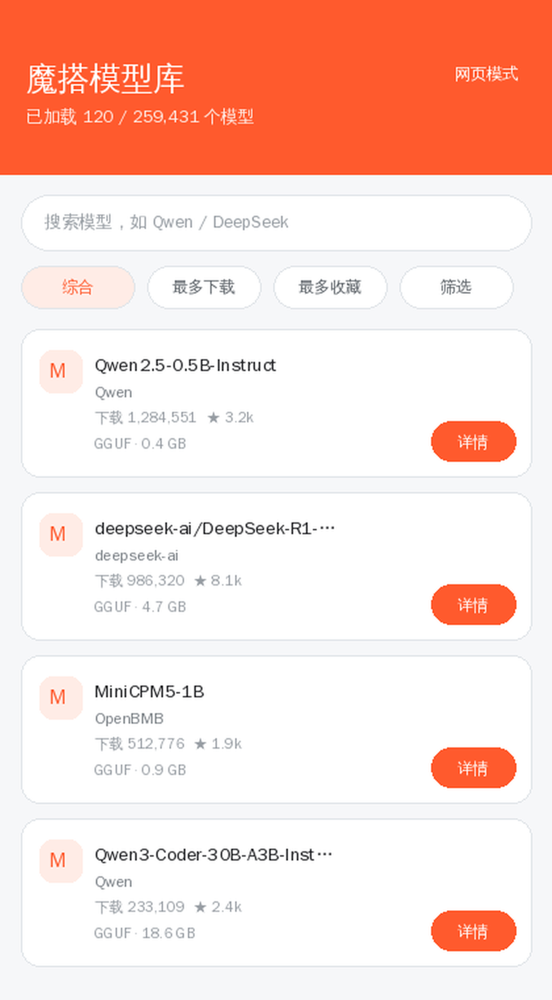
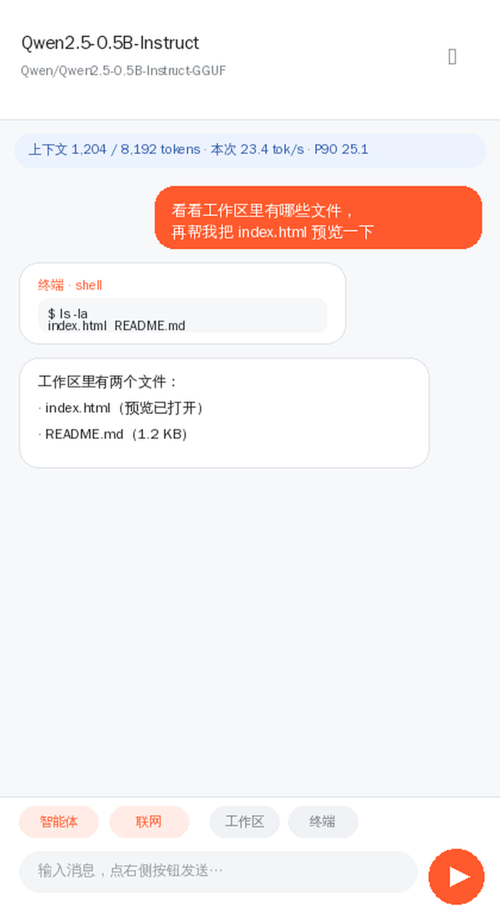
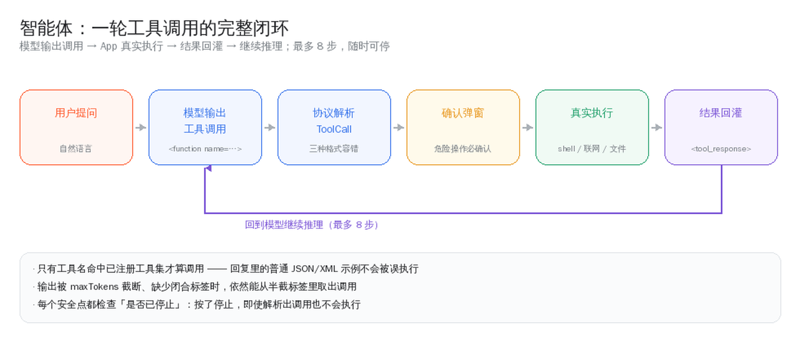

<div align="center">

# 魔搭模型库 · ModelScopeBrowser

**浏览魔搭全部大模型 · 把 GGUF 下载到手机 · 内置 llama.cpp 离线对话 · 模型可自主调用终端与联网**

*Browse all ModelScope LLMs, download GGUF to your phone, and chat offline with built-in llama.cpp — 
the model can run shell commands, search the web and work with files.*

[](https://github.com/ice-wocker/ModelScopeBrowser/releases)
[](https://github.com/ice-wocker/ModelScopeBrowser/actions/workflows/android.yml)
[](https://github.com/ice-wocker/ModelScopeBrowser/stargazers)
[](LICENSE)
[-3DDC84?logo=android&logoColor=white)](#)
[](#)
[](#)
[](#)

[**English**](README.en.md) · [下载安装](#下载安装) · [功能](#功能) · [怎么用](#怎么用) · [技术亮点](#技术亮点) · [文档](#文档) · [构建](#构建) · [作者](#作者)

</div>

---

一个轻量 Android App：浏览[魔搭社区 ModelScope](https://www.modelscope.cn/models) 上的**全部大模型**（分页、搜索、排序、按维度筛选、详情与文件下载），
并把 `.gguf` 下载到手机，**用内置的 llama.cpp 直接离线对话**。

对话页不是「只能聊天」的玩具——它是一个**能动手的智能体**：模型可以自己调用手机终端跑命令、联网搜索、读写工作区文件、预览网页，
并在拿到真实结果后继续推理。

> **当前版本 v2.7.0**（versionCode 15）· 原生化 arm64 多档指令集 · 纯 CPU 离线推理 · 数据不出设备


---

## 功能

<table>
<tr><td width="130"><b>模型浏览</b></td><td>

分页加载魔搭**全部**模型（接口总量约 **25.9 万**），滑到底自动加载下一页；关键字搜索、综合/最多下载/最多收藏/最近更新排序；
按 **许可证 / 框架库 / 标签 / 语言 / 模型结构 / 领域** 六个维度筛选（取值与数量实时来自接口聚合）。

</td></tr>
<tr><td><b>模型详情</b></td><td>

基本信息 + **模型文件列表**（体积、LFS 标记）+ **Markdown 简介渲染**；`.gguf` 可一键下载。

</td></tr>
<tr><td><b>应用内下载</b></td><td>

`.gguf` 直接存到应用私有目录（**无需存储权限**），带进度与取消；支持**断点续传**、**前台服务通知**，进程被杀后再进入应用自动接着下；
完成后校验字节数 + 读文件头确认 `GGUF` 魔数，挡掉错误页 / 半截文件。下载前会做**空间体检**：放得下就提示「下载后还剩多少」，放不下直接说清「还差多少」。

</td></tr>
<tr><td><b>离线对话</b></td><td>

内置 **llama.cpp**，流式逐字输出，可停止；**Markdown 渲染**（标题 / 列表 / 表格 / 代码块）；长按气泡可复制 / 重新生成 / 编辑重发 / 继续生成 / 删除；可导出对话；
状态条实时显示上下文用量与解码速度（本次 / 均值 / P90）。首次进入会按设备内存**自动推荐上下文**，不会给你一个放不下的默认值。

</td></tr>
<tr><td><b>智能体</b></td><td>

模型输出工具调用 → App 真实执行 → 结果回灌 → 继续推理，**最多 8 步**，可随时停止。可用工具：

| 工具 | 作用 |
|---|---|
| `shell` | 在手机**真终端**执行命令（`/system/bin/sh`，工作目录 = 工作区） |
| `web_search` / `fetch_url` | 联网搜索 / 抓取网页正文（拒绝本机与内网地址） |
| `read_file` / `write_file` / `list_files` / `delete_file` | 读写工作区文件（原子写，路径强制收敛） |
| `open_preview` | 在内置 WebView 打开工作区 HTML |

`shell`、`write_file`、`delete_file` 执行前**弹窗确认**，也可选「本会话都允许」。

</td></tr>
<tr><td><b>工作区</b></td><td>

应用私有目录 `filesDir/workspace`：路径强制收敛在根目录内、写入原子落盘。可浏览 / 新建 / 查看 / 分享 / 删除；
点 `.html` 直接用内置 WebView 预览（支持 JS / CSS / 相对资源，可切桌面版或转系统浏览器）。

</td></tr>
<tr><td><b>终端页</b></td><td>

**真 shell**（`/system/bin/sh`），工作目录固定在工作区，超时 60 秒、输出自动截断；后台执行不卡界面。受 Android 沙箱限制，只能访问应用私有目录（无需 root）。

</td></tr>
<tr><td><b>对话历史</b></td><td>

每个模型可保存多个会话（自动落盘，退出不丢），支持历史会话切换；每个模型最多保留最近 50 条。

</td></tr>
<tr><td><b>本地模型库</b></td><td>

查看已下载模型、占用空间与剩余空间，一键进入对话或删除；进页面会顺手**体检索引与磁盘**，
发现「记录在但文件没了」「文件在但没记录」「0 字节空壳」时提示一次。

</td></tr>
<tr><td><b>双语界面</b></td><td>

**中英双完整支持**：界面文案（216 条）、推理提示词、工具说明与执行结果、错误与建议文案全部双语，各一份真源。
「关于 → 语言」可切「跟随系统 / 中文 / English」，**不用改系统设置**，切完当前页直接换语言；
模型提示词会跟着界面语言走，不会出现「英文界面、中文提示词」。
`values`（英文）与 `values-zh`（中文）逐条对齐，`MissingTranslation` 参与 Lint 校验，漏译直接构建失败。

</td></tr>
<tr><td><b>其它</b></td><td>

下拉刷新、加载 / 空 / 错态与一键重试、Material 3 卡片列表、**暗色模式自动适配**；右上角「网页模式」直接打开魔搭官网，作为任何异常情况下的兜底。

</td></tr>
</table>

**大输出**：单次生成默认 **4096 tokens**（上限 8192），默认上下文 **8192**（上限 32768）；长按回复可「继续生成」，到上限也能接着写。

| | |
|---|---|
|  |  |
| 模型列表 | 对话页（工具卡片 + 性能状态条） |

> 图为按真实布局参数绘制的示意图，不是真机截图——避免「图片和代码各写一套」。

---

## 下载安装

| 渠道 | 说明 |
|---|---|
| **[Releases](https://github.com/ice-wocker/ModelScopeBrowser/releases)** | 推荐。最新 **v2.7.0** `ModelScope-Models-2.7.0.apk`，CI 构建 + 正式签名（约 **8.2 MB**） |
| **[Actions 产物](https://github.com/ice-wocker/ModelScopeBrowser/actions)** | 每次提交都会产出 `apk` artifact（debug 与 release 都在里面） |

- 要求：**Android 7.0 (API 24) 及以上**；首次安装需允许「安装未知来源应用」
- 建议：**arm64 机型 + ≥4 GB 内存**，模型优先选 `Q4_K_M` / `Q4_0` 量化，**0.5B~3B 体验最佳**
- 从 **v1.0 起的任意 Release** 均可直接覆盖安装（同一签名）

> [!WARNING]
> **请不要安装 v2.1 的包。** 该版本开启 R8 时漏掉了 JNI 回调方法的 keep 规则，加载任意模型都会失败
> （`no non-static method "...onToken(Ljava/lang/String;)V"`）。已在 v2.1.1 修复，请用 v2.1.1 或更高版本。
>
> 另外，v1.2 的 Release 包是 CI 未配签名时的 **debug 签名**产物；若你装的正是它，需先卸载再安装。

---

## 怎么用

**1. 下载一个模型** — 列表里挑一个 `.gguf`，点「下载」，完成后选「立即对话」。

**2. 直接说人话，让它动手** — 顶部确认「智能体 · 开」「联网 · 开」，然后：

| 你可以说 | 它会做什么 |
|---|---|
| 「看看工作区里有哪些文件」 | 调 `list_files` 列出目录 |
| 「在终端里跑一下 `ls -la`」 | 弹确认 → 执行真命令 → 把输出读回来 |
| 「搜索今天的科技新闻并总结」 | 调 `web_search`（必要时再 `fetch_url` 读正文）→ 总结并附来源 |
| 「写个 index.html 放到工作区再预览」 | 调 `write_file` → `open_preview` |

每一步都会在对话里生成一张**工具卡片**，显示真实执行结果；点发送键可随时中止。

**3. 斜杠命令**（输入框以 `/` 开头）

```text
/search <关键词>   联网检索并总结
/web on|off        允许 / 禁止 AI 联网
/run <命令>        在真终端执行命令
/ls [目录]         列出工作区目录
/cat <文件>        查看文件
/preview <文件>    预览网页
/files             打开工作区
/help              全部命令
```

其余输入会直接当本机命令执行，例如 `/pwd`、`/grep foo *.txt`。

> **提示**：工具调用依赖模型的指令跟随能力。MiniCPM5 用的是它原生的 XML 调用格式，Qwen3-Coder 用另一种，本项目两种都认；
> 如果用某模型发现它「不愿动手」，换个 instruct 版本更听话。≤2.5B 的小模型会自动收到压缩版提示词。

### 界面流程

```text
启动 → 模型列表（分页 / 搜索 / 排序 / 维度筛选）
        ├── 点击某一项 → 详情页（文件列表、简介 Markdown 渲染）
        │                   ├── .gguf  → 应用内下载 → 「立即对话」→ 对话页
        │                   └── 其他文件 → 系统浏览器下载
        ├── 右上角「对话」→ 本地模型库（占用空间 / 删除 / 进入对话）
        │                        └── 对话页（Markdown 流式输出 / 历史会话 / 长按消息操作）
        │                               ├── 「智能体」开关 → 模型自主调用工具（工具卡片）
        │                               ├── 「联网」开关   → 允许 AI 联网
        │                               ├── 「工作区」     → 工作区页 → 点 .html 预览
        │                               ├── 「终端」       → 真 shell 终端页
        │                               └── 输入 / 开头    → 斜杠命令
        └── 右上角「网页模式」→ 内置 WebView 打开魔搭官网（兜底）
```

---

## 技术亮点

### 智能体：一条真正闭环的工具调用

不依赖模型自带的 function-call 模板（本地 GGUF 往往没有），而是把各家模型习惯输出的格式都解析下来：

| 格式 | 例子 |
|---|---|
| MiniCPM5 原生 | `<function name="shell"><param name="command">ls</param></function>` |
| Qwen3-Coder | `<function=shell><parameter=command>ls</parameter></function>` |
| 通用 | ```` ```tool {"name": "shell", "arguments": {...}} ``` ```` / `<tool_call>{...}</tool_call>` / `TOOL_CALL: {...}` |



配套处理了不少坑，都写成了单元测试：

- **特殊 token 的渲染**：MiniCPM5 把 `<function>` / `<param>` 做成了**特殊 token**，而 `llama_token_to_piece` 传 `special=false` 时会对它们**直接返回空串**——工具标签被静默丢弃，调用退化成残缺文本。改用 `special=true` 后恢复正常。
- **截断容错**：输出被 `maxTokens` 截断、缺少闭合标签时，依然能从半截标签里取出调用。
- **参数值 CDATA**：值里含 `</param>` 时会用 `<![CDATA[...]]>` 包裹，解析时自动拆掉。
- **防误判**：只有工具名命中已注册工具集才算调用，回复里的普通 JSON/XML 示例不会被误执行。
- **思考块剥离**：推理模型的思考内容不会当成正式回答显示。
- **结果回灌**：工具结果以 `<tool_response>` 包裹回灌，与 MiniCPM5 / Qwen 的模板约定一致。

### arm64 多档指令集：运行时自动选档

不再是「一种构建打天下」，而是用 `GGML_CPU_ALL_VARIANTS` 为 Android arm64 编出多份 CPU 后端：

| 后端 | 指令集 | 典型芯片 |
|---|---|---|
| `android_armv8.0_1` | 基线 armv8-a | 所有 arm64（兜底，绝不会 SIGILL） |
| `android_armv8.2_1/2` | dotprod / +fp16 | 2018 年后的处理器 |
| `android_armv8.6_1` | **+i8mm** | 骁龙 8 Gen 1+ / 天玑 9000+ / Cortex-X3·A715+ |
| `android_armv9.0_1` | +SVE2 | 天玑 9200+ 等 |
| `android_armv9.2_1/2` | +SVE / +SME | 最新旗舰 |

运行时由 ggml 的 `ggml_backend_score()` 按 `HWCAP` 打分，**只加载分数最高的那一档**。
反汇编核对过：`android_armv8.0_1` 里 `sdot` / `smmla` 均为 0，`armv8.6_1` 有 747 处 `sdot` + **174 处 `smmla`**，`armv9.0_1` 有 **308 处 `smmla`**——i8mm 机型确实会走 int8 矩阵乘内核。

顺带一个好处：基线退回 armv8-a 后，**移除了原先 dotprod+fp16 的硬门槛**，缺指令的老 arm64 不再被拒绝。


### 内存与存储：先把话说清楚

v2.5.0 新增了 `core/` 层，专治「默认值拍脑袋」：

| 问题 | 以前的处理 | 现在 |
|---|---|---|
| 上下文该开多大 | 写死 8192 | 读 `/proc/meminfo`，结合模型体积算建议值 |
| 空间够不够 | 剩余 vs 文件大小 | 算上安全水位与续传剩余，并给出人话结论 |
| 采样参数乱填 | 直接崩或输出退化 | `Validators` 兜住范围，并把「为什么被改」回显 |
| 索引与磁盘不同步 | 不知道 | 进模型库页时交叉体检，提示一次 |
| 速度突然变慢 | 只能自己猜 | 状态条给均值 / P90，明显劣化时给建议 |

### 其它已经踩平的坑

| 项 | 做法 |
|---|---|
| **KV 前缀复用** | 跨轮复用公共前缀，只解码新增 token；三轮对话累计预填充 173 → 59 tokens（降至 34%），输出与全量重算逐字一致 |
| **KV 量化 + FlashAttention** | KV 量化为 `q8_0`，注意力读写减半、KV 内存约 1/2；模型支持时自动启用 FlashAttention |
| **线程数** | 按 `/proc/self/status` 的 `Cpus_allowed_list` 取真正可用核数。超核时 ggml 线程屏障自旋会让单次 decode 从 28ms 恶化到 **3952ms**，现已根除 |
| **物理批** | `n_ubatch` 512 → 128，计算缓冲区 ~311MB → ~78MB，单 token 解码 35.8ms → 24.1ms |
| **JNI 生命周期** | 存活会话表 + 引用计数，消除 `nativeCancel` / `nativeFree` 的 use-after-free 与二次释放 |
| **下载可恢复** | 续传任务落盘 `downloads.json`，进程被杀后自动接着下；索引「临时文件 + 原子改名」避免半截索引让本地模型「全部消失」 |
| **native 库释放** | arm64 后端是独立 `.so`，必须落到 `nativeLibraryDir` 才能被 `ggml_backend_load_all_from_path` 加载 |
| **预览页隔离** | 关掉 `allowUniversalAccessFromFileURLs`，模型生成的 HTML 无法 `fetch('file:///…')` 读走对话历史 |


---

## 和其它做法比

| 做法 | 上手成本 | 数据去向 | 能跑多大模型 | 我们不一样的地方 |
|---|---|---|---|---|
| 在线 API 客户端 | 低 | 全部上传服务端 | 无限 | 完全离线；代价是只能跑小模型 |
| 连电脑 + adb 推 GGUF | 高（要会命令行） | 本机 | 取决于电脑 | 手机上三步搞定，不碰电脑 |
| Termux 手敲 llama-cli | 很高 | 本机 | 小模型 | 图形界面、图形化下载、历史会话 |
| 别的本地 App | 低 | 本机 | 小模型 | 有**工具闭环**：能真的跑命令、联网、写文件 |

## 实测数据

同一台 armv8.6 机型 / Qwen2.5-0.5B `Q4_K_M` / 上下文 8192：

| 档位 | 单 token 解码 | 相对基线 |
|---|---|---|
| armv8.0 基线 | 15.2 tok/s | 1.0× |
| armv8.2 dotprod | 19.4 tok/s | 1.28× |
| **armv8.6 i8mm** | **24.1 tok/s** | **1.59×** |
| armv9.0 SVE2 | 25.8 tok/s | 1.70× |

三轮对话累计预填充：**655 → 328 tokens**（前缀复用后），输出与全量重算逐字一致。
详细方法与反汇编核对见 [性能数据](docs/BENCHMARKS.md)。

## 安全边界

本地模型的输出会变成命令、路径、URL，所以每一处都设了闸：

| 入口 | 风险 | 措施 |
|---|---|---|
| 文件路径 | `../../shared_prefs/x.xml` 越界 | canonical path 前缀比较，软链接穿越也挡 |
| 写入 | 半截文件破坏索引 | 临时文件 → fsync → 原子改名 |
| shell | 执行任意命令 | 前置确认弹窗 + 工作目录固定 + 60 秒超时 + 输出截断 |
| 网页抓取 | 探测本机服务 | 只放行公网 http/https，拒绝 localhost / 内网 / `.local` |
| 网页预览 | `fetch('file:///…/chats.json')` 读走历史 | 关掉 `allowUniversalAccessFromFileURLs` |
| 下载文件 | 错误页被当成模型 | 校验字节数 + 读文件头确认 GGUF 魔数 |

## 常见问题

**Q：为什么加载模型失败？** 先看界面给的具体错误。若是「后端未注册」，说明多档后端的 `.so` 没释放到
`nativeLibraryDir`——`useLegacyPackaging` 不能关。详见[排错手册](docs/TROUBLESHOOTING.md#1-模型加载失败)。

**Q：小模型不听话、不动手？** 换 instruct 版本；或先用斜杠命令 `/run ls` 验证终端通道。
≤2.5B 的模型会自动收到压缩版提示词，比长提示词更容易跟上。

**Q：为什么不用 GPU？** Vulkan / OpenCL 需要 `glslc` 等工具链，构建环境不具备。纯 CPU 是当前务实选择。

**Q：能下非 GGUF 文件吗？** 应用内只处理 `.gguf`，其它走系统浏览器——只有它能被内置引擎加载。

更多问答见[完整手册第 11 节](docs/README.md#11-常见问答)。

---

## 文档

README 只放「三十秒能读完」的信息。想深入看这些：

**10 份长文档全部中英双语**，每页顶部可互切。

| 文档 | 中文 | English |
|---|---|---|
| 完整手册（功能 / 架构 / 引擎 / 智能体 / 内存 / 安全 / CI / FAQ / 速查 / API） | [README](docs/README.md) | [README.en](docs/README.en.md) |
| 模块深入（19 个模块：要解决什么 / 怎么做的 / 哪里容易写错） | [MODULES](docs/MODULES.md) | [MODULES.en](docs/MODULES.en.md) |
| 架构与数据流（四层边界、依赖方向、一次点击到一次回答、JNI、扩展点） | [ARCHITECTURE](docs/ARCHITECTURE.md) | [ARCHITECTURE.en](docs/ARCHITECTURE.en.md) |
| 开发指南（环境、首次构建、改代码、加工具、出包、提 PR） | [DEVELOPING](docs/DEVELOPING.md) | [DEVELOPING.en](docs/DEVELOPING.en.md) |
| 深问答（38 个「用起来才会问」的问题） | [FAQ](docs/FAQ.md) | [FAQ.en](docs/FAQ.en.md) |
| 故障排查（按症状索引 14 类） | [TROUBLESHOOTING](docs/TROUBLESHOOTING.md) | [TROUBLESHOOTING.en](docs/TROUBLESHOOTING.en.md) |
| 性能数据（档位对比含反汇编核对、前缀复用、内存估算） | [BENCHMARKS](docs/BENCHMARKS.md) | [BENCHMARKS.en](docs/BENCHMARKS.en.md) |
| 图解与流程（状态机、时序、决策树、依赖、演进） | [DIAGRAMS](docs/DIAGRAMS.md) | [DIAGRAMS.en](docs/DIAGRAMS.en.md) |
| 更新日志（v1.0 至今） | [CHANGELOG](docs/CHANGELOG.md) | [CHANGELOG.en](docs/CHANGELOG.en.md) |
| 海报（单文件可离线查看，含图） | [POSTER](docs/POSTER.md) | — |

---

## 构建

```bash
# 环境：JDK 17、Android SDK（platform 36 + build-tools 36 + ndk 27.2.12479018 + cmake 3.22.1）
export JAVA_HOME=/path/to/jdk17
echo "sdk.dir=/path/to/android-sdk" > local.properties

# 首次编译需拉取 llama.cpp（约 50 MB）；本地已有源码时可指定路径加速
./gradlew assembleDebug   -PllamaCppDir=/path/to/llama.cpp
./gradlew assembleRelease -PllamaCppDir=/path/to/llama.cpp

# 不传 -PllamaCppDir 时，CMake 会通过 FetchContent 按 tag b11205 拉取 llama.cpp
./gradlew assembleRelease

# 单元测试与 Lint（CI 也会跑）
./gradlew testDebugUnitTest
./gradlew lintDebug
```

**原生库**：`armeabi-v7a` 为静态单档（全部塞进 `libmscope_llama.so`）；`arm64-v8a` 为动态构建（`libllama.so` / `libggml.so` / `libggml-base.so` + 7 份 `libggml-cpu-android_*.so` 变体）。

release 开启 **R8 混淆 + 资源压缩**（规则见 [`app/proguard-rules.pro`](app/proguard-rules.pro)），APK 约 **8.2 MB**——多份 CPU 后端以**压缩形式**存放，安装时释放到 `nativeLibraryDir`。依赖版本集中在 [`gradle/libs.versions.toml`](gradle/libs.versions.toml)。

**正式签名**：在项目根目录创建 `keystore.properties`（已被 `.gitignore` 排除）：

```properties
storeFile=/absolute/path/to/release.keystore
storePassword=******
keyAlias=mscope
keyPassword=******
```

缺失该文件时 release 自动回退 debug 签名，保证任何环境都能出包。

---

## CI / 自动发布

[`.github/workflows/android.yml`](.github/workflows/android.yml) 分两个 job：

1. **verify**：单元测试（99 个）+ Lint，上传测试与 Lint 报告；
2. **build**（`needs: verify`）：补装 SDK → 缓存 native 构建 → 配置签名 → `assembleDebug` + `assembleRelease` → 
   **校验产物**（`apksigner` 打印证书、`aapt2` 打印 ABI 与版本，tag 上拒绝 debug 签名）→ 上传 `apk` artifact；
   推送 `v*` 标签时自动创建 Release 并附上 APK。

要在 CI 里使用正式签名，需在仓库 **Settings → Secrets and variables → Actions** 配置：

| Secret | 说明 |
|---|---|
| `KEYSTORE_BASE64` | `base64 -w0 release.keystore` 的结果 |
| `KEYSTORE_PASSWORD` | storePassword |
| `KEY_ALIAS` | 密钥别名 |
| `KEY_PASSWORD` | keyPassword |

未配置时：普通分支 / PR 构建回退 debug 签名（仅作 CI 产物）；但**推送 `v*` 标签发布 Release 时会直接失败并提示补配置**，
避免把 debug 签名的包发给用户。

---

## 已知限制

- **终端是「真 shell」但受沙箱限制**：Android 非 root 只能访问应用私有目录，写不了 `/sdcard`、`/system`；命令有 60 秒超时与输出截断
- **工具调用依赖模型的指令跟随能力**：小模型可能不按格式输出，换个 instruct 版本通常更听话；单轮最多 8 步
- **未启用 GPU 卸载**：Vulkan / OpenCL 后端需要 `glslc`（Vulkan SDK）等工具链，构建环境不具备，故仍为**纯 CPU 推理**
- **多档指令集只覆盖 arm64**：`armeabi-v7a`（32 位）仍是单档；各档实际提速幅度与芯片强相关
- 列表接口必须用 `PUT`，部分企业网关会拦截 PUT，此时自动降级为首页聚合数据；全部失败可用「网页模式」
- 筛选维度由接口聚合数据驱动，不含「任务类型」（该条件下服务端无效）
- **应用内下载仅支持 `.gguf`**（其他文件走系统浏览器）；单线程串行，续传能否生效取决于服务端是否支持 `Range`
- 下载期间常驻一条前台服务通知；Android 13+ 未授予通知权限时通知不显示，但下载照常进行
- **联网搜索**依赖搜索引擎网页结果（DuckDuckGo / Bing），无 API Key，受反爬策略影响可能偶发失败
- **自动保存文件**只对带文件名标注的代码块或 html 代码块生效；同名文件自动加序号
- release 已开 R8 混淆，若怀疑是混淆导致的异常，可用 `./gradlew assembleDebug` 的包复现排查
- 本地推理速度取决于机型；超大模型（30B+）在手机上不具可用性，建议 0.5B~4B
- 未做登录，因此不展示需要登录权限的模型内容

---

## 作者

<table>
  <tr>
    <td width="150" align="center" valign="top">
      
      <br /><br />
      <b>ice-wocker</b>
    </td>
    <td valign="top">

**昵称**：ice-wocker

**正在折腾**：把大模型塞进手机——让离线推理在移动端真正可用，而不是个演示 Demo。

**联系方式**

- GitHub：[@ice-wocker](https://github.com/ice-wocker)

<a href="https://github.com/ice-wocker">
  
</a>

    </td>
  </tr>
</table>

**关于这个项目**：起初只是想找个能方便逛魔搭、把 GGUF 拿到手机上跑的工具，市面上要么得连电脑、要么要登账号，于是干脆自己写了一个。
做着做着把 llama.cpp 也接进来，接着是工作区、终端、联网，最后变成现在这个「能在手机上干活」的智能体。全部代码开源，欢迎提 Issue 和 PR。

如果它对你有用，点个 **Star** 是最大的鼓励 ⭐

---

## 免责声明

本项目为第三方客户端，与魔搭社区 / 阿里巴巴无关联，仅用于学习与技术研究。所有模型数据与内容的版权归原作者及魔搭社区所有，请遵守其服务条款。

---

## Star History

[](https://www.star-history.com/#ice-wocker/ModelScopeBrowser&Date)
