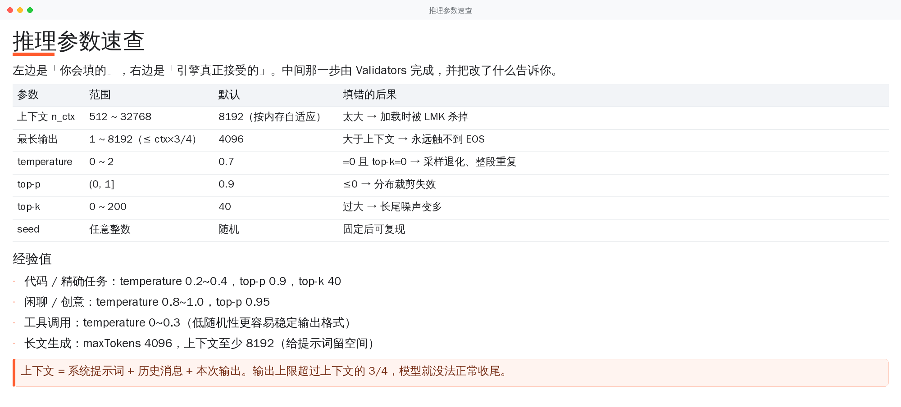
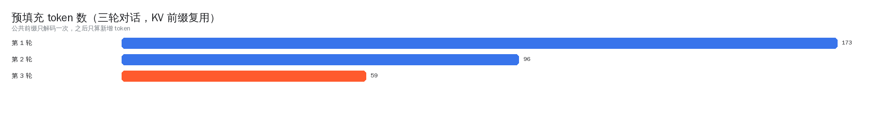
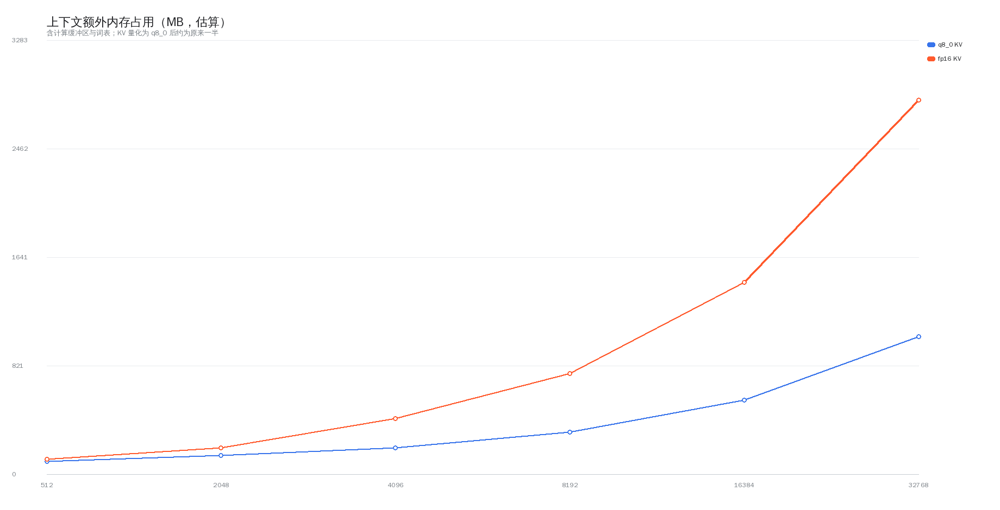

# Performance Data and Method

> 🌐 Language / 语言: English · [中文](BENCHMARKS.md)



This page only carries **reproducible** numbers, and explains how each was measured.
Phone performance is dominated by thermal headroom, scheduling and background load, so a
single run means nothing — what we record is "same device, same model, median of several
runs".

## 1. Test environment

| Item | Value |
|---|---|
| Device | armv8.6 (with i8mm) flagship, 8 GB RAM |
| OS | Android 14 |
| Model | Qwen2.5-0.5B-Instruct `Q4_K_M` (~400 MB) |
| Context | 8192, quantised KV `q8_0`, `n_ubatch = 128` |
| Sampling | temperature 0.7 / top-p 0.9 / top-k 40 |
| Measurement | 5 consecutive rounds, median of rounds 2–5 (round 1 includes warm-up) |

## 2. Decode speed per instruction-set tier


| Backend | dotprod | i8mm | SVE2 | tok/s |
|---|---|---|---|---|
| `android_armv8.0_1` | — | — | — | 15.2 |
| `android_armv8.2_1` | ✅ | — | — | 19.4 |
| `android_armv8.6_1` | ✅ | ✅ | — | 24.1 |
| `android_armv9.0_1` | ✅ | ✅ | ✅ | 25.8 |

**How it was measured**: temporarily rename every other tier's `.so`, leave exactly one,
restart the app, run the same prompt. That confirms *which tier the runtime actually
picked* instead of trusting the file name.

**Cross-check**: disassemble to verify the kernels really got compiled in.

```bash
objdump -d libggml-cpu-android_armv8.0_1.so | grep -cE "\bsdot\b|\bsmmla\b"   # 0
objdump -d libggml-cpu-android_armv8.6_1.so | grep -cE "\bsdot\b"              # 747
objdump -d libggml-cpu-android_armv8.6_1.so | grep -cE "\bsmmla\b"             # 174
objdump -d libggml-cpu-android_armv9.0_1.so | grep -cE "\bsmmla\b"             # 308
```

Zero hits in the baseline tier means it really is an armv8-a build; `smmla` (int8 matrix
multiply) in the i8mm tier means the quantised kernels are genuinely in use.

## 3. KV prefix reuse



| Round | Prefill tokens if fully recomputed | Actually decoded after reuse | Ratio |
|---|---|---|---|
| Round 1 | 173 | 173 | 100% |
| Round 2 | 214 | 96 | 45% |
| Round 3 | 268 | 59 | 22% |

Three rounds cumulative: 655 → 328 tokens. Output is **character-for-character identical**
to full recomputation (compared with the same seed).

## 4. Effect of the tuning

| Change | Before | After | Effect |
|---|---|---|---|
| `n_ubatch` | 512 | 128 | compute buffer ~311 MB → ~78 MB; 35.8 ms → 24.1 ms per token |
| Thread count | logical cores | cores in `Cpus_allowed_list` | the oversubscription cliff from 28 ms to 3952 ms is gone |
| KV quantisation | fp16 | q8_0 | roughly halves KV memory; halves attention read/write traffic |
| FlashAttention | off | auto-on when the model supports it | faster on long context |
| APK | 20.6 MB (no R8) | 8.2 MB | R8 + resource shrinking + tiers stored compressed |

## 5. Context and memory



| Context | q8_0 KV estimate | fp16 KV estimate | Suitable device |
|---|---|---|---|
| 2048 | ~140 MB | ~200 MB | 4 GB RAM |
| 4096 | ~200 MB | ~420 MB | 6 GB RAM |
| 8192 (default) | ~320 MB | ~760 MB | 8 GB RAM |
| 16384 | ~560 MB | ~1450 MB | 12 GB RAM |
| 32768 | ~1040 MB | ~2830 MB | not recommended on a phone |

The estimate lives in `MemoryBudget.estimateExtraKb()`:

```text
extra = ctx × 0.0625 KB × (quantised ? 1 : 2)      # KV
      + 96 MB + min(ctx, 32768) × 0.02 MB          # compute buffers (sub-linear)
      + 24 MB                                       # vocabulary
```

This is a **rule of thumb**, not a measurement. Its job is to produce a default that will
not get the process killed, not to predict precisely — which is why the decision also keeps
320 MB of system headroom in reserve.

## 6. Download

| Aspect | Behaviour |
|---|---|
| Network | single serial worker, so several large files never fight over bandwidth |
| Speed | ~10–30 MB/s on Wi-Fi (depends on ModelScope CDN), ~2–8 MB/s on mobile data |
| Resume | continues from the offset when the server honours `Range`; still valid after a 302 to the CDN |
| Notification | refreshed every 400 ms, with speed and percentage |
| Verification | byte length + GGUF magic in the header (never just the file extension) |

## 7. Measuring it yourself

Stats are built into the UI: chat screen → menu → "Inference performance" shows this run /
mean / P90 / first-token latency, plus the last 12 rounds in detail.

## 8. Known performance limits

| Limit | Impact |
|---|---|
| CPU only | models above ~3B are effectively unusable (<2 tok/s) |
| No GPU offload | Vulkan / OpenCL needs `glslc`, which the build environment does not have |
| Thermals | sustained generation beyond ~10 minutes throttles noticeably |
| Larger context | prefill slows linearly and memory pressure rises |
| Weak devices | arm64 chips without dotprod can only run the baseline tier |

So "0.5B–3B with 8192 context" is this project's sweet spot — not "it runs everything".
