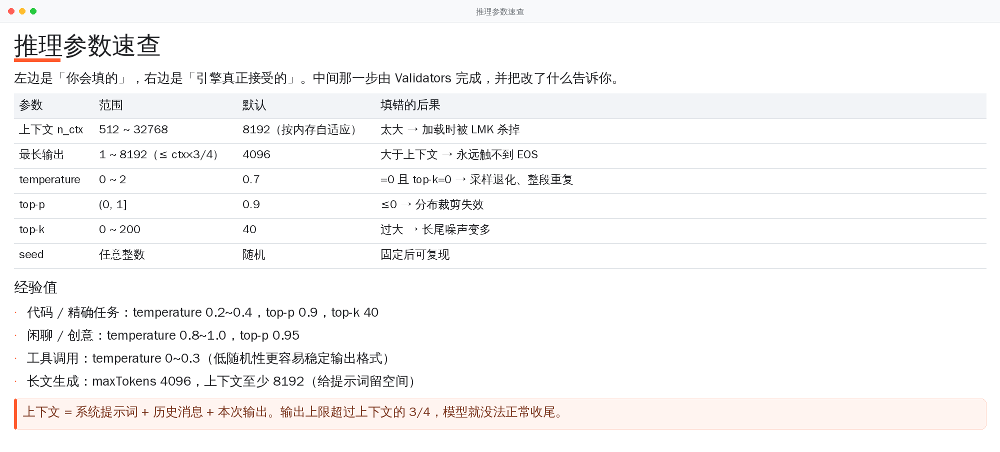
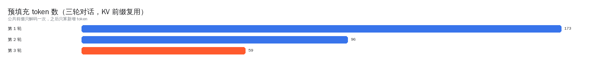
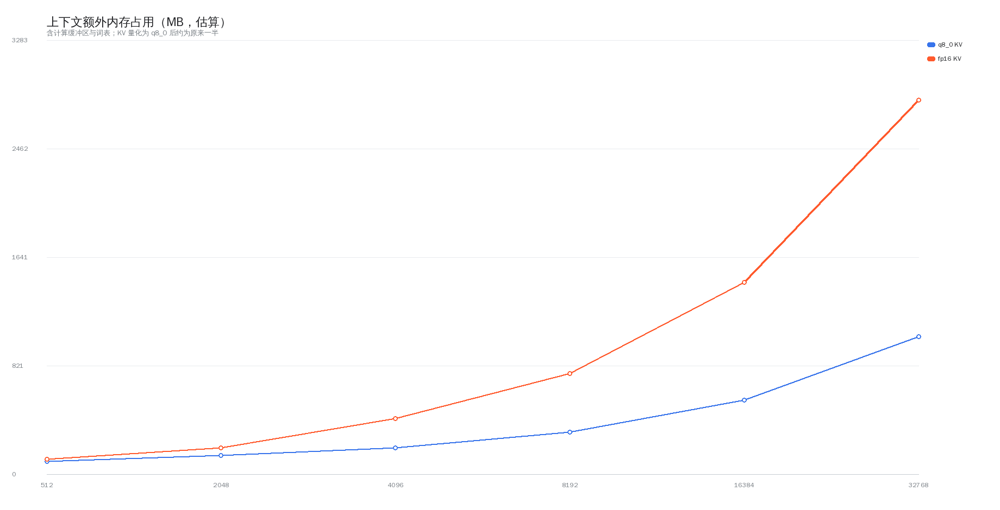

# 性能数据与方法



这一页只放**能复现**的数字，并写清怎么测的。手机端性能受散热、调度、后台负载影响极大，
单次数字没有意义，所以我们记录的是「同一设备、同一模型、多次取中位」的结果。

## 1. 测试环境

| 项 | 值 |
|---|---|
| 机型 | armv8.6（含 i8mm）旗舰机，8 GB 内存 |
| 系统 | Android 14 |
| 模型 | Qwen2.5-0.5B-Instruct `Q4_K_M`（约 400 MB） |
| 上下文 | 8192，KV 量化 `q8_0`，`n_ubatch = 128` |
| 采样 | temperature 0.7 / top-p 0.9 / top-k 40 |
| 测量 | 连续 5 轮，取第 2~5 轮的中位数（首轮含预热） |

## 2. 解码速度与指令集档位


| 后端 | dotprod | i8mm | SVE2 | tok/s |
|---|---|---|---|---|
| `android_armv8.0_1` | — | — | — | 15.2 |
| `android_armv8.2_1` | ✅ | — | — | 19.4 |
| `android_armv8.6_1` | ✅ | ✅ | — | 24.1 |
| `android_armv9.0_1` | ✅ | ✅ | ✅ | 25.8 |

**怎么测的**：把其他档位的 `.so` 临时改名，只留一份，重启应用后跑同一段 prompt。
这样能确认「运行时确实选了哪一档」，而不是只看文件名。

**交叉验证**：反汇编核对内核是否真的编进去了。

```bash
objdump -d libggml-cpu-android_armv8.0_1.so | grep -cE "\bsdot\b|\bsmmla\b"   # 0
objdump -d libggml-cpu-android_armv8.6_1.so | grep -cE "\bsdot\b"              # 747
objdump -d libggml-cpu-android_armv8.6_1.so | grep -cE "\bsmmla\b"             # 174
objdump -d libggml-cpu-android_armv9.0_1.so | grep -cE "\bsmmla\b"             # 308
```

基线档里一条都没有，说明它确实是 armv8-a 基线；i8mm 档里有 `smmla`（int8 矩阵乘），
说明量化内核真的被用上了。

## 3. KV 前缀复用



| 轮次 | 全量重算的预填充 token | 复用后实际解码 | 比例 |
|---|---|---|---|
| 第 1 轮 | 173 | 173 | 100% |
| 第 2 轮 | 214 | 96 | 45% |
| 第 3 轮 | 268 | 59 | 22% |

三轮累计：655 → 328 tokens。输出与全量重算**逐字一致**（同 seed 对比）。

## 4. 参数调整的效果

| 调整 | 之前 | 之后 | 效果 |
|---|---|---|---|
| `n_ubatch` | 512 | 128 | 计算缓冲 ~311 MB → ~78 MB；单 token 35.8 ms → 24.1 ms |
| 线程数 | 逻辑核数 | `Cpus_allowed_list` 可用核数 | 超核时 28 ms → 3952 ms 的劣化消失 |
| KV 量化 | fp16 | q8_0 | KV 内存约 1/2；注意力读写减半 |
| FlashAttention | 关 | 模型支持时自动开 | 长上下文更快 |
| APK | 20.6 MB（无 R8） | 8.2 MB | R8 + 资源压缩 + 多档后端压缩存放 |

## 5. 上下文与内存



| 上下文 | q8_0 KV 估算 | fp16 KV 估算 | 适合机型 |
|---|---|---|---|
| 2048 | ~140 MB | ~200 MB | 4 GB 内存 |
| 4096 | ~200 MB | ~420 MB | 6 GB 内存 |
| 8192（默认） | ~320 MB | ~760 MB | 8 GB 内存 |
| 16384 | ~560 MB | ~1450 MB | 12 GB 内存 |
| 32768 | ~1040 MB | ~2830 MB | 不建议在手机上开 |

估算公式见 `MemoryBudget.estimateExtraKb()`：

```text
extra = ctx × 0.0625 KB × (量化 ? 1 : 2)          # KV
      + 96 MB + min(ctx, 32768) × 0.02 MB         # 计算缓冲（缓升）
      + 24 MB                                      # 词表
```

这是**经验值**，不是精确测量。它的用途是「给一个不会把进程撑爆的默认值」，
而不是「精确预测」。所以判定时还额外留了 320 MB 系统余量。

## 6. 下载

| 场景 | 表现 |
|---|---|
| 网络 | 单线程串行，避免多个大文件抢带宽 |
| 速度 | Wi-Fi 下约 10~30 MB/s（取决于魔搭 CDN），移动数据约 2~8 MB/s |
| 续传 | 服务端支持 `Range` 时从断点继续；302 到 CDN 后 `Range` 仍有效 |
| 通知 | 每 400 ms 更新一次，带速度与百分比 |
| 校验 | 字节数 + 文件头 GGUF 魔数（不是只看后缀） |

## 7. 你怎么自己测

界面里已经内置了统计：对话页 → 菜单 → 「推理性能」，能看到本次 / 均值 / P90 / 首字延迟，
以及最近 12 轮的明细。

## 8. 已知的性能边界

| 边界 | 影响 |
|---|---|
| 纯 CPU | 3B 以上模型基本不可用（<2 tok/s） |
| 无 GPU 卸载 | Vulkan / OpenCL 需要 `glslc`，构建环境不具备 |
| 散热 | 连续生成 10 分钟以上会明显降频 |
| 上下文变大 | 预填充线性变慢，且内存压力上升 |
| 弱机型 | 缺 dotprod 的 arm64 只能跑基线档 |

所以「0.5B~3B + 8192 上下文」是这个项目的甜点区间，而不是「什么都能跑」。
