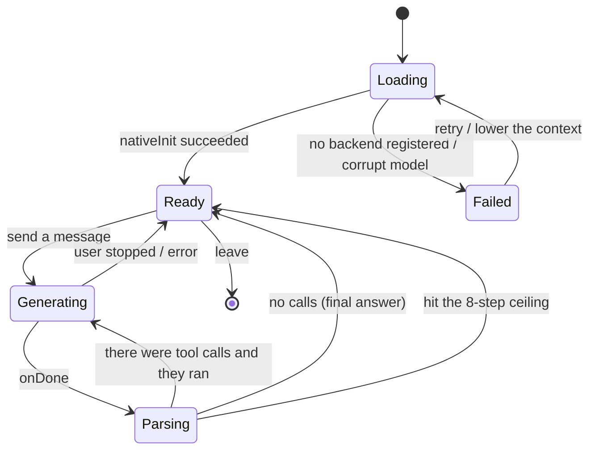
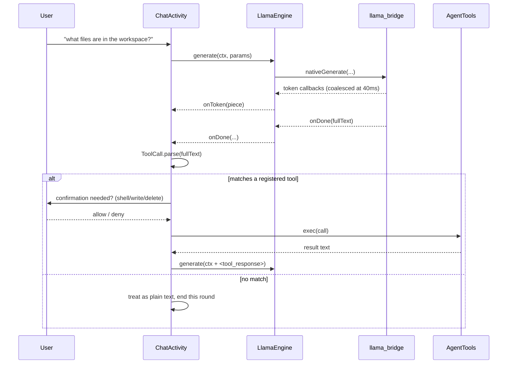
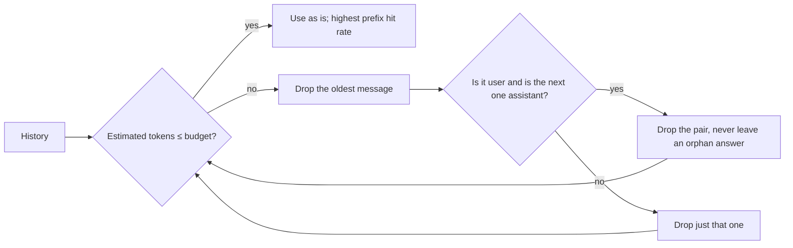
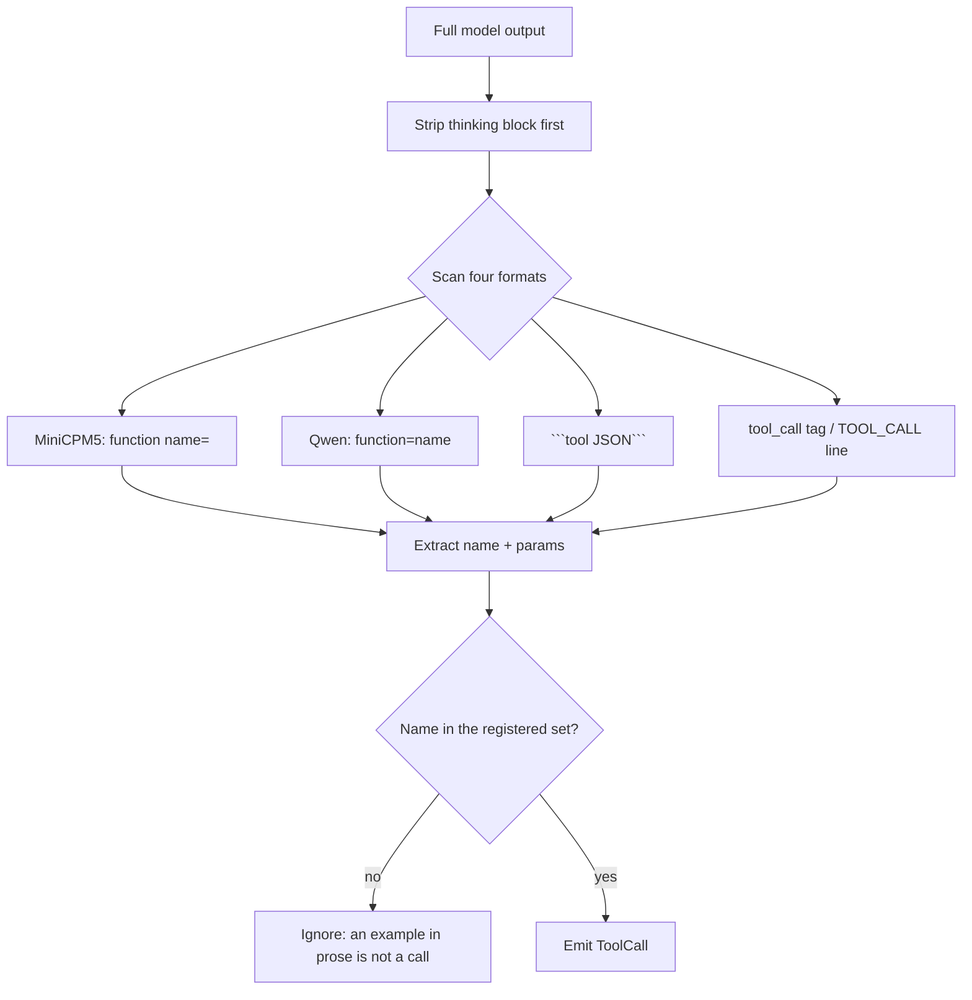
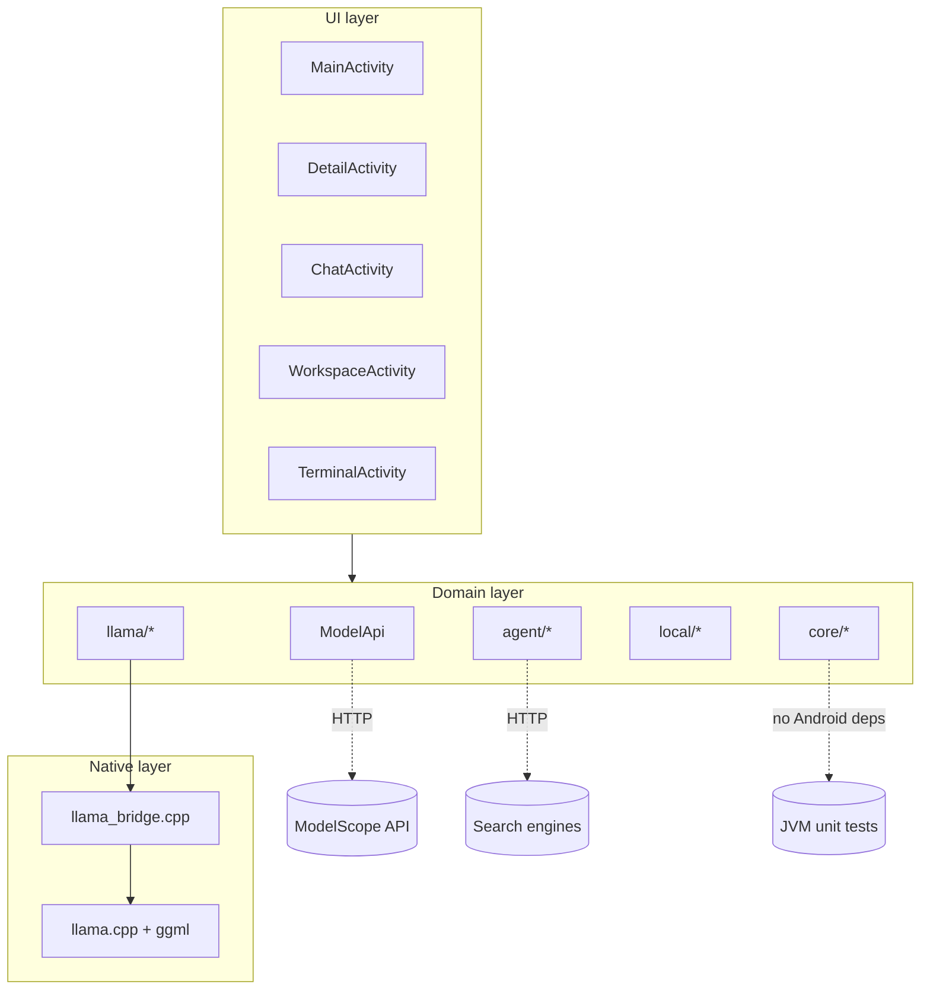
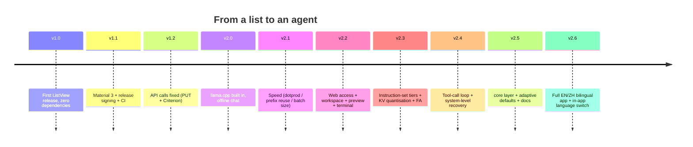

# Diagrams and Flows

> 🌐 Language / 语言: English · [中文](DIAGRAMS.md)

This page collects the things that are easier to draw than to describe: state machines,
sequence diagrams, decision trees, structure charts. Everything is Mermaid, which GitHub
renders directly; the illustrations are PNG.

## 1. Chat screen state machine



Key point: **stopping is asynchronous**. Tapping stop only sets a flag and calls
`nativeCancel`; the actual transition happens at the next safe-point check. That is why the
UI shows an intermediate "stopping…" state.

## 2. Sequence of one tool call



## 3. Download decision tree

```mermaid
flowchart TD
    A[Tap download] --> B{A .part already exists?}
    B -- yes --> C[Resume with a Range header]
    B -- no --> D[Download from scratch]
    C --> E{Server returns 206?}
    E -- no --> D
    E -- yes --> F[Space check]
    D --> F
    F --> G{Enough room?}
    G -- no --> H[Refuse and say how much is missing]
    G -- yes --> I[Write into .part]
    I --> J{Length matches?}
    J -- no --> K[Error, keep .part for resume]
    J -- yes --> L{GGUF magic?}
    L -- no --> M[Delete, report "not a valid GGUF"]
    L -- yes --> N[Atomic rename to .gguf]
    N --> O[Write index.json]
    O --> P[Clear downloads.json]
```

## 4. Context trimming strategy



Why not truncate by token down in the native layer: that would invalidate the shared prefix
wholesale, forcing a full recompute every round and pushing warm-up from 0.5 s to well over
ten seconds. **The granularity of trimming decides whether the cache is worth anything.**

## 5. Recognising tool-call formats



## 6. Picking an instruction-set tier

```mermaid
flowchart LR
    A[Process starts] --> B[ggml_backend_load_all_from_path]
    B --> C[Enumerate CPU backends in nativeLibraryDir]
    C --> D[Call ggml_backend_score on each]
    D --> E[Score against HWCAP]
    E --> F[Register only the highest-scoring tier]
    F --> G[Model loads]
    B -.-> H{Nothing registered?}
    H -.-> I[Report "backend not registered": the .so files were not extracted]
```

## 7. Module dependencies



## 8. Version history


