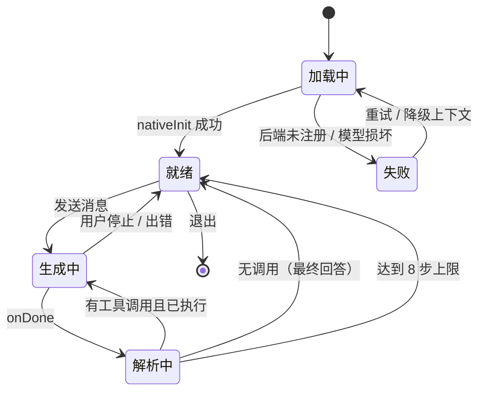
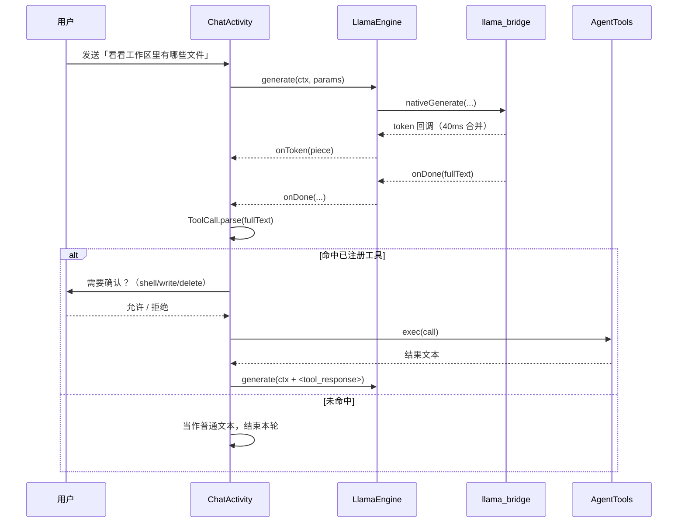
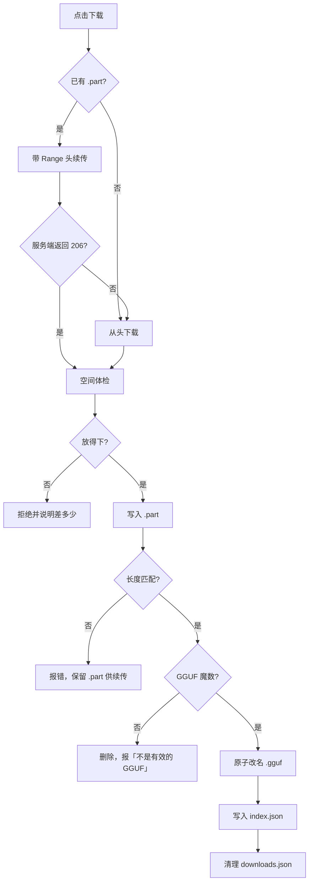
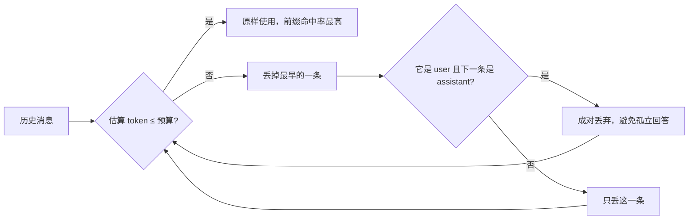
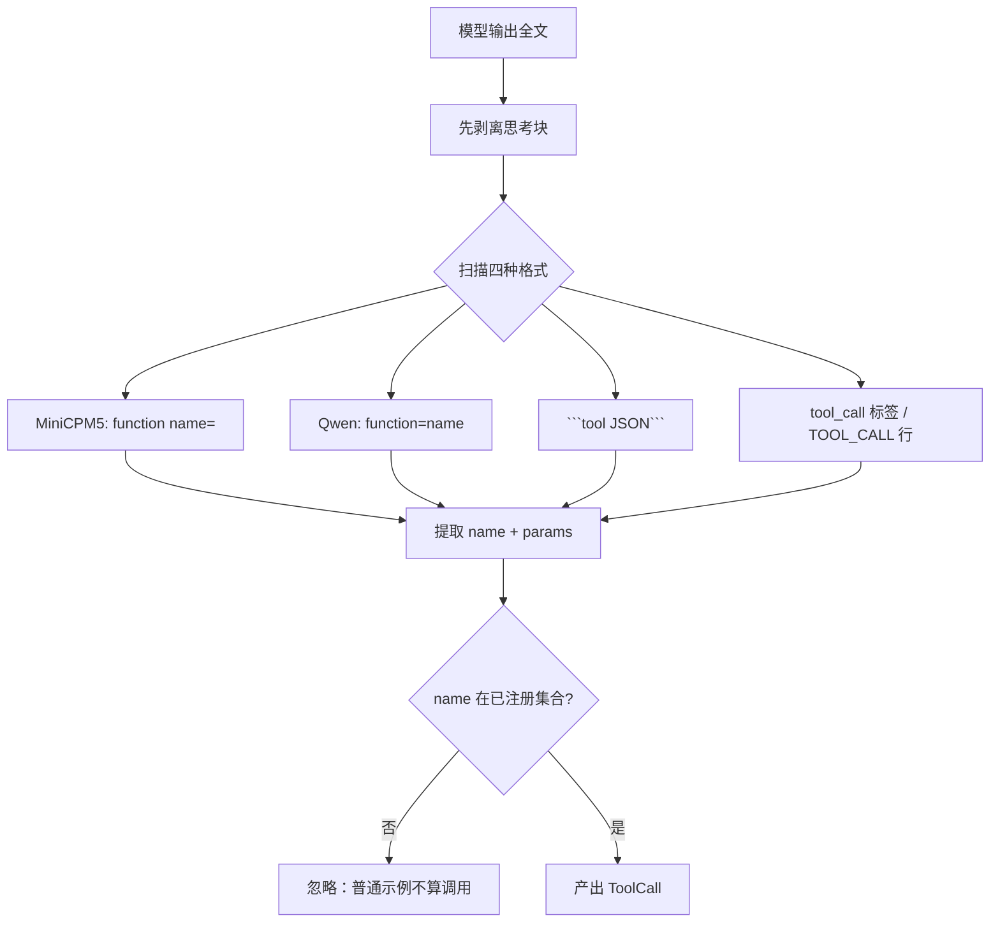
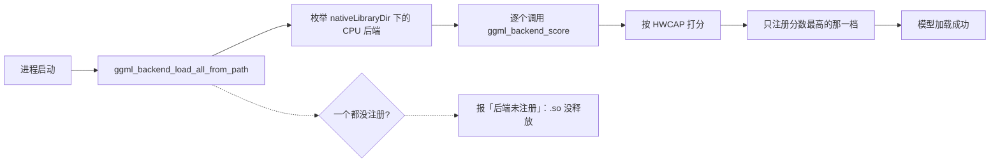
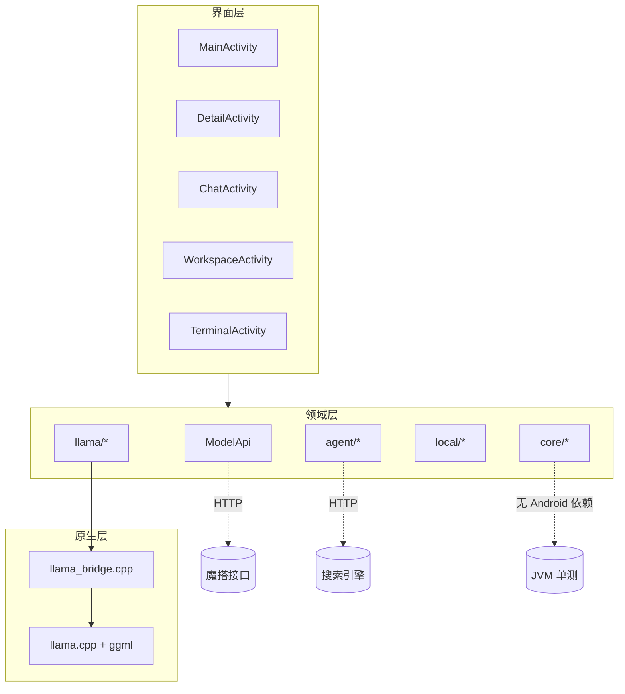
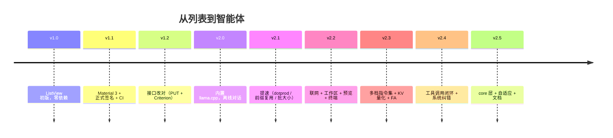

# 图解与流程图

> 🌐 语言 / Language: 中文 · [English](DIAGRAMS.en.md)

这一页是「图比其他文字省事」的那些东西：状态机、时序、决策树、结构图。
全部用 Mermaid 写，GitHub 直接渲染；配图是 PNG。

## 1. 对话页状态机

要点：**停止是异步生效的**。点停止只是置标志位并 `nativeCancel`，
真正的状态切换发生在下一次安全点检查时。所以界面上有「正在停止…」这个中间态。

## 2. 一次工具调用的时序

## 3. 下载决策树

## 4. 上下文裁剪策略

为什么不在 native 层按 token 截断：那会让公共前缀整体作废，每轮都要全量重算，
预热时间从 0.5 秒涨到十几秒。**裁剪的粒度决定了缓存的有效性**。

## 5. 工具调用格式识别

## 6. 多档后端选择

## 7. 模块依赖

## 8. 版本演进

