# ModelScope Browser · Complete Handbook

> 🌐 Language / 语言: English · [中文](README.md)

> **Documentation navigation**
> [Handbook (ZH)](README.md) · [Modules (EN)](MODULES.en.md) · [Architecture (EN)](ARCHITECTURE.en.md) ·
> [Developing (EN)](DEVELOPING.en.md) · [Troubleshooting (EN)](TROUBLESHOOTING.en.md) · [FAQ (EN)](FAQ.en.md) ·
> [Benchmarks (EN)](BENCHMARKS.en.md) · [Diagrams (EN)](DIAGRAMS.en.md) · [Changelog](CHANGELOG.md) ·
> [Poster (embedded images)](POSTER.md)

> This is the long version of `README.md`. That one is the shopfront: thirty seconds and you know
> what this thing is. This one is the handbook: change the code, understand why a behaviour is the
> way it is, cut your own build — start here.

**Contents**
[1 What this is](#1-what-this-is) · [2 Screens and interaction](#2-screens-and-interaction) · [3 Architecture](#3-architecture) · [4 The data layer](#4-the-data-layer-why-modelscope) · [5 Inference engine](#5-inference-engine) · [6 The agent](#6-the-agent) · [7 Memory and storage](#7-memory-and-storage) · [8 Security model](#8-security-model) · [9 Engineering and CI](#9-engineering-and-ci) · [10 This upgrade](#10-this-upgrade-v250) · [11 Frequently asked questions](#11-frequently-asked-questions) · [12 Cheat sheet](#12-cheat-sheet) · [Appendix A · API](#appendix-a--api-cheat-sheet) · [Appendix B · Glossary](#appendix-b--glossary)


---

## 1 What this is

An Android app that does three things:

1. **Browse**: make the ~259,000 models on ModelScope browsable on a phone. Paging, search,
   sorting, six-dimensional facets; the detail screen shows the file list and a Markdown description.
2. **Fetch**: download `.gguf` quantised models into the app-private directory. Resumable, with a
   foreground notification, automatic continuation after the process is killed, and verification of
   both byte length and the GGUF magic afterwards.
3. **Use**: llama.cpp built in, CPU-only offline inference. The chat screen is not a chat toy — it
   can treat model output as instructions and act on them: run a real shell, search the web, read
   and write workspace files, open a web preview, then feed the real result back. Up to 8 steps.

Together these three form one chain: **discover a model → get it locally → make it work on your
phone**. No server in the middle; inference data never leaves the device.

### 1.1 Why it exists

"LLM client" apps are not scarce, but the vast majority **forward requests to somebody else's
server**. Running a local model on a phone for real usually means: connect to a PC, install adb,
push files, open termux, type a long `llama-cli` command line. For someone who just wants to try a
model, that road is too long.

This project compresses it to three steps: find, tap download, tap chat. The price is CPU-only and
small quantised models only — an honest boundary, stated in section 11 under "known limitations"
rather than hidden.

### 1.2 Who it is for

| You are | You get |
|---|---|
| Someone who wants AI offline | works once installed, chats in airplane mode; records stay on your phone |
| Someone who wants to try models | 0.5B–3B instruct models feel best, download and go, no PC involved |
| Someone who wants to change the code | 7k+ lines of Java plus one CMake bridge, no magic, readable end to end |
| Someone learning llama.cpp | `llama_bridge.cpp` keeps templating, tokenising, sampling, KV reuse and streaming callbacks in one place |

### 1.3 Version and status

| Item | Value |
|---|---|
| Current version | **v2.7.0** (versionCode 15) |
| Supported OS | Android 7.0 (API 24) – Android 16 (API 36) |
| ABI | arm64-v8a (instruction-set tiers), armeabi-v7a (single static build) |
| Inference backend | llama.cpp `b11205`, CPU only |
| APK size | ~8.2 MB (the extra CPU backends are stored compressed) |
| Unit tests | 99 cases (`./gradlew testDebugUnitTest`) |
| Languages | English and Chinese, switchable inside the app |
| Licence | MIT |

## 2 Screens and interaction

### 2.1 Five screens, one spine

```text
Launch → model list (paging / search / sorting / facets)
        ├── tap an item → detail (file list, Markdown description)
        │                ├── .gguf  → in-app download → "Chat now" → chat screen
        │                └── other files → system browser download
        ├── "Chat" in the top bar → local model library (size / delete / open chat)
        │                        └── chat screen (streaming Markdown / history / long-press actions)
        │                               ├── "Agent" toggle  → the model calls tools on its own
        │                               ├── "Web" toggle    → allow the AI online access
        │                               ├── "Workspace"     → workspace screen → tap .html to preview
        │                               ├── "Terminal"      → real shell screen
        │                               └── input starting with / → slash commands
        └── "Web mode" in the top bar → built-in WebView on modelscope.cn (last-resort fallback)
```

| 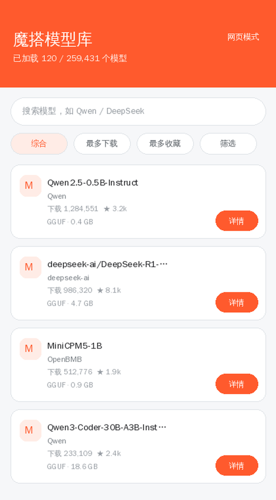 | 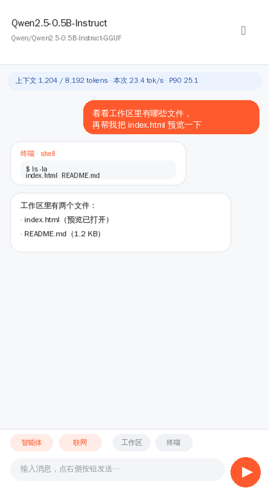 |
|---|---|
| Model list: cards, pull to refresh, loading / empty / error states | Chat: status bar shows context and speed, tool calls render as cards |

> These are illustrations drawn from the real layout parameters (the repo keeps no PNG screenshots,
> to avoid images drifting away from the code). Real device screenshots are welcome as a PR.

### 2.2 The model list

- **Paging**: reaching the bottom loads the next page; the page number lives in `nextPage` internally
  so fast scrolling cannot skip pages.
- **Search**: `reqSeq` guards the race — a later request always wins, so "search A, see B's results"
  cannot happen.
- **Sorting**: relevance / most downloaded / most favourited / recently updated, mapped onto the
  `SortBy` field.
- **Facets**: licence / framework library / tag / language / architecture / domain, with values and
  counts taken from the API aggregate (`Data.FiledAgg`), so every condition in the UI is genuinely
  supported server-side.
- **Degradation**: requests try "full parameters → no facets → no sorting → homepage aggregate" in
  turn, and the `sortApplied` / `filterApplied` / `fallback` markers report back what actually took
  effect instead of failing silently.

### 2.3 The chat screen

The chat screen is the most complex piece of the project. It handles streaming output, Markdown
rendering, tool cards, stop and continue, context trimming and history persistence at the same time.

| Element | Behaviour |
|---|---|
| Status bar | idle: "context x / y tokens · this run N tok/s · mean · P90"; generating: step or searching |
| Long-press a bubble | copy / regenerate / edit and resend / continue / delete |
| Tool card | tool name, parameters, the real result; confirming dialog first for dangerous operations |
| Top chips | agent toggle, web toggle, workspace entry, terminal entry |
| Top-right menu | new chat / history / workspace / terminal / inference parameters / system prompt / outline / performance / export |

A few unobtrusive but crucial decisions:

- **Tags get stripped during streaming too.** If raw tokens go straight to screen,
  `<function name=...>` and `<think>` leak out and are then replaced wholesale by the "body only"
  version, which looks like the answer was swallowed. Stripping happens in the streaming phase now.
- **Callbacks coalesce over 40 ms.** Per-token callbacks make the UI and inference fight over the
  CPU; 40 ms batches keep the "typing" feel without saturating the main thread.
- **Continuing must carry context.** "Continue generating" has to put the text already written into
  the context, otherwise the model does not know where to resume and rewrites the beginning, stacking
  a duplicate on top.
- **Long replies get an outline.** Scrolling back to find a section in a 2500-word reply on a phone
  is painful; when the reply has two or more headings, the menu gains "outline of this reply".

### 2.4 Slash commands

When the input starts with `/` it goes down the command channel and never reaches the model:

```text
/search <keywords>   search the web and summarise
/web on|off          allow / forbid AI web access
/run <command>       execute a command in the real terminal
/ls [dir]            list a workspace directory
/cat <file>          show a file
/preview <file>      preview a page in the built-in WebView
/files               open the workspace
/help                all commands
```

Anything else is executed directly as a local command, e.g. `/pwd`, `/grep foo *.txt`.
This fallback channel exists so work can still get done when the model misbehaves — small models
are not reliable at following instructions.

## 3 Architecture

### 3.1 Four layers

```text
┌────────────────────── UI layer (Activity / Adapter) ─────────────────────────┐
│ MainActivity  DetailActivity  ChatActivity  WorkspaceActivity  TerminalActivity │
└───────────────────────────────────┬──────────────────────────────────────────┘
                                    │ method calls only, never objects across layers
┌────────────────────── Domain layer (pure Java, unit testable) ───────────────┐
│ ModelApi   agent/   llama/   local/   core/   Workspace                      │
└───────────────────────────────────┬──────────────────────────────────────────┘
                                    │ JNI (only llama/ reaches it)
┌────────────────────── Native layer (C++ / CMake) ────────────────────────────┐
│ llama_bridge.cpp  →  llama.cpp b11205  →  ggml-cpu-android_*.so × 7          │
└──────────────────────────────────────────────────────────────────────────────┘
```

What the split buys: `core/` imports nothing from `android.*`, so it runs on a plain JVM and
`./gradlew testDebugUnitTest` returns in seconds. Logic in the UI layer that can sink, sinks into `core/`.

### 3.2 Directory and file responsibilities

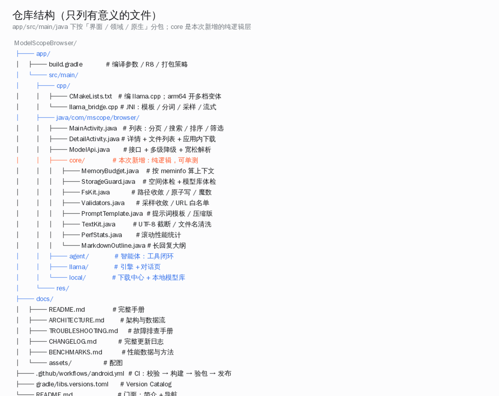

### 3.3 The full request path (one chat turn)

```text
User taps send
  │
  ├─ ChatActivity.onSendClicked()
  │     ├─ start the agent loop (tools single-thread pool; generation on the engine worker)
  │     └─ buildSystemPrompt()
  │           ├─ PromptTemplate.compose()  ← template + tool docs (compressed for small models)
  │           └─ AgentTools.describe()     ← tool list, same source as the executable set
  │
  ├─ LlamaEngine.generate(messages, params, listener)
  │     ├─ fitMessages()                   ← message-level trimming, so the prefix stays valid
  │     ├─ LlamaBridge.nativeGenerate()    ← into native
  │     │     ├─ apply chat template → tokenise → decode (KV prefix reuse)
  │     │     ├─ sampler chain: top-k → top-p → temp → dist
  │     │     └─ per-token callback into Java (UTF-8 pieces cut on whole characters)
  │     └─ coalesced over 40 ms, then posted to the main thread
  │
  ├─ ToolCall.parse(fullText)              ← three formats + truncation tolerance
  │     ├─ matched a registered tool → confirm first if dangerous
  │     └─ AgentTools.exec() → real execution
  │
  └─ result fed back as <tool_response>, back to "generate" — at most 8 rounds
```

### 3.4 Thread model

What goes wrong on a phone is rarely the logic; it is the threading. The conventions here:

| Thread | Responsibility | Constraint |
|---|---|---|
| `LlamaEngine.worker` | serial generation, single thread | one generation at a time; check-and-set of `generating` inside the lock |
| `ChatActivity.tools` | the agent loop: parse, confirm, execute tools | advances serially with generation, never concurrently |
| `DownloadCenter.pool` | serial downloads, single thread | several large files must not fight over bandwidth |
| `LocalModelsActivity.executor` | reading the index, counting space | disk IO never on the main thread |
| Main thread | UI only | every callback ends with `ui.post` |

The race between `nativeFree` and the generating thread is solved with **reference counting**:
`nativeFree` removes the session from the live table and drops its own reference, and whichever
holder is last destroys it. Previously it was "take a lock, check liveness → release → grab the
session lock", and that gap was long enough for another thread to free it.

## 4 The data layer: why ModelScope

### 4.1 The API was discovered, not guessed

ModelScope's public API has no official docs, and guessing parameter names earns
`404 page not found`. The actual method was to watch the site's own requests and check each field:

| Finding | How |
|---|---|
| The list endpoint requires **`PUT`** | `POST` / `GET` both 404; only `PUT` returns 200 |
| The filter parameter is **`Criterion`** | `SingleCriterion` is silently ignored (everything is returned) |
| Facet values come from the response | only fields in `Data.FiledAgg` are genuinely supported |

```http
PUT /api/v1/dolphin/models
Content-Type: application/json

{
  "PageSize": 30,
  "PageNumber": 1,
  "Name": "qwen",
  "SortBy": "DownloadsCount",
  "Order": "desc",
  "Criterion": [{"Category": "license", "Values": ["apache-2.0"]}]
}
```

### 4.2 Other endpoints

| Purpose | Endpoint |
|---|---|
| List (fallback) | `GET /api/v1/dolphin/agg/homepage` |
| Model detail | `GET /api/v1/models/{namespace}/{name}` |
| File list | `GET /api/v1/models/{ns}/{name}/repo/files?Revision=master&Recursive=true` |
| File download | `GET /api/v1/models/{ns}/{name}/repo?Revision=master&FilePath={path}` |

### 4.3 Lenient parsing

It does not depend on a fixed response depth: it looks for the field that most looks like an array
of models and prefers the `TotalCount` next to it. When the shape shifts (twice so far) the UI does
not go blank.

```json
{"Data": {"Model": {"Models": [...], "TotalCount": 259431}, "FiledAgg": {...}}}
```

The parser tries `Data.Model.Models` first, then descends through `Data` looking for an array. The
cost is a little speed; what it buys is not having to ship a release the moment the API changes.

## 5 Inference engine

### 5.1 What the bridge does

`llama_bridge.cpp` is the only channel between Java and llama.cpp, responsible for:

1. loading the GGUF (`llama_model_load_from_file`) and applying the model's own chat template;
2. building the context: context length, thread count, KV quantisation, FlashAttention with
   fallbacks;
3. assembling the prompt (system / user / assistant alternating plus `<tool_response>`),
   tokenising, counting;
4. the sampler chain (top-k → top-p → temp → dist) and per-token streaming callbacks;
5. **UTF-8 slicing**: token boundaries routinely cut Chinese or emoji in half, so pieces are cut on
   whole characters before conversion to UTF-16;
6. **KV prefix reuse**: across turns, decode only the newly added tokens.

```cpp
// the critical line: special=true. With false, llama.cpp returns an empty string for tokens
// attributed CONTROL/UNKNOWN, and MiniCPM5 makes <function> / <param> special tokens -- so the
// tool tags get silently dropped.
const char * piece = llama_token_to_piece(vocab, token, buf, len, 0, /*special=*/true);
```

### 5.2 How KV prefix reuse is computed

In multi-turn chat, adjacent prompts share a long common prefix. The naive approach re-decodes the
whole prompt each round; the right one reuses the KV already computed and decodes only what is new.

Two traps in the implementation:

- **Positions must be realigned.** After a round finishes, the KV still holds the *previous round's
  output* tokens while the bookkeeping only records the prompt. Matching a prefix against that
  sequence lands at the wrong offset, `llama_memory_seq_rm` removes the wrong range, and decode
  positions stop agreeing with the actual KV contents — which shows up as answers drifting and
  occasional crashes. The fix is to rebuild a position-aligned sequence from the common prefix
  before doing a position-aware removal.
- **Trimming must be at message granularity.** Truncating by token down in native invalidates the
  shared prefix wholesale and forces a full recompute every round. So trimming lives in Java's
  `fitMessages()`, dropping from the oldest message, discarding a user message and its reply as a pair.

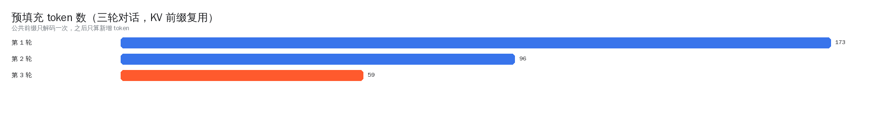

### 5.3 Instruction-set tiers

There is no "one build rules them all" on Android: old chips lack i8mm, and newer chips waste SVE2
if you do not use it. `GGML_CPU_ALL_VARIANTS` compiles several CPU backends for arm64; each exports
`ggml_backend_score()` and at runtime ggml scores them against `HWCAP` and loads only the winner.

| Backend | Instruction set | Typical chips |
|---|---|---|
| `android_armv8.0_1` | baseline armv8-a | every arm64 (the floor, never SIGILLs) |
| `android_armv8.2_1/2` | dotprod / +fp16 | processors from 2018 on |
| `android_armv8.6_1` | +i8mm | Snapdragon 8 Gen 1+ / Dimensity 9000+ |
| `android_armv9.0_1` | +SVE2 | Dimensity 9200+ and similar |
| `android_armv9.2_1/2` | +SVE / +SME | the newest flagships |


Verified by disassembly: `sdot` / `smmla` are both zero in `armv8.0_1`; `armv8.6_1` has 747 `sdot`
and 174 `smmla`; `armv9.0_1` has 308 `smmla`. In other words, i8mm devices really do run the int8
matrix-multiply kernels rather than "a variant was merely compiled".

> One easy trap: these backends are separate `.so` files and must reach `nativeLibraryDir` for
> `ggml_backend_load_all_from_path` to find them. With `useLegacyPackaging = false` (equivalent to
> `extractNativeLibs=false`) they exist only inside the APK, nothing gets registered, and model
> loading **always** fails. Hit in v2.3.0, fixed in v2.3.1, now pinned with a comment in `build.gradle`.

## 6 The agent

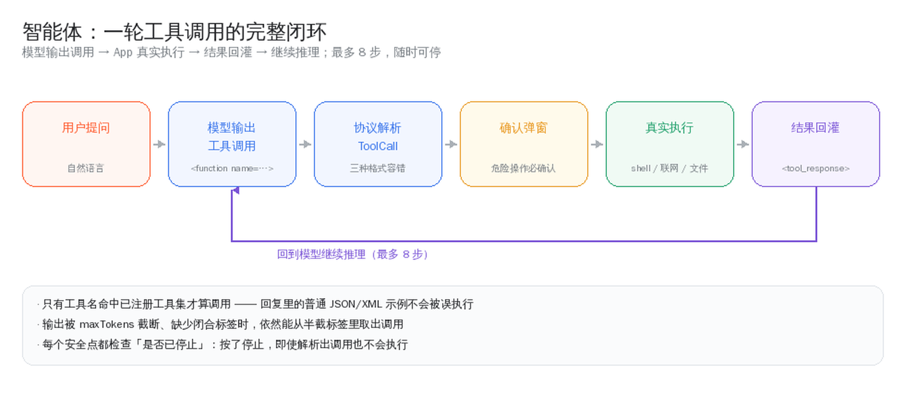

### 6.1 Why parse it ourselves

Local GGUF models often have no function-call template, so relying on native tool support is
unrealistic. Instead, every shape models habitually emit is recognised:

| Format | Example |
|---|---|
| MiniCPM5 native | `<function name="shell"><param name="command">ls</param></function>` |
| Qwen3-Coder | `<function=shell><parameter=command>ls</parameter></function>` |
| JSON block | ```` ```tool {"name": "shell", "arguments": {...}} ``` ```` |
| Tag / line | `<tool_call>{...}</tool_call>`, `TOOL_CALL: {...}` |

### 6.2 Fault-tolerance list

| Problem | Handling |
|---|---|
| Output truncated by `maxTokens`, closing tag missing | extract the call from the partial tag (a missing `</function>` still matches) |
| A parameter value contains `</param>` | CDATA wrapping is supported and unwrapped during parsing |
| A JSON example appears in the reply | only names in the registered set count as calls |
| The thinking block of a reasoning model | `<think>` is stripped (including the truncated, unclosed case) |
| Several calls in one output | all are parsed and executed in order |
| The user pressed stop | checked at every safe point; already-parsed calls do not run either |

### 6.3 Tool list

| Tool | Parameters | Dangerous | Notes |
|---|---|---|---|
| `shell` | `command` | ✅ confirm | `/system/bin/sh`, cwd = workspace, 60 s timeout |
| `web_search` | `query` | — | DuckDuckGo → Bing fallback, no API key |
| `fetch_url` | `url` | — | fetch page text; public http/https only |
| `read_file` | `path` | — | read a workspace file, truncated past 6000 characters |
| `write_file` | `path` `content` | ✅ confirm | atomic write, path forced inside the root |
| `list_files` | `path` | — | list a directory |
| `delete_file` | `path` | ✅ confirm | irreversible |
| `open_preview` | `path` | — | open workspace HTML in the built-in WebView |

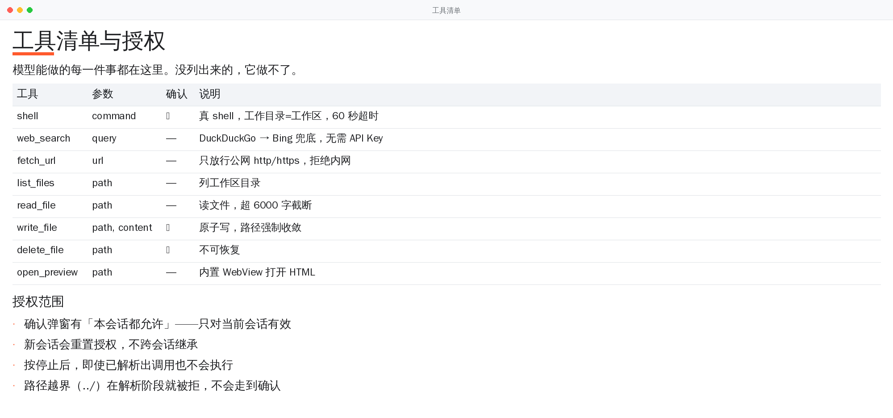

The confirmation dialog offers "allow for this session", but **a new session resets it** — on
purpose: authorisation should not be inherited across sessions.

## 7 Memory and storage

### 7.1 How large a context fits

Running llama.cpp on a phone, the expensive part is not the weights but the KV cache: it grows
linearly with "context length × layers × head dimension" and must be resident in one piece. Offering
a 32768 input box without telling the user whether it fits ends with the process killed by the
low-memory killer — and you do not even see an error.

Since v2.5.0 the chat screen reads `/proc/meminfo` on entry and estimates a suggestion that is
"as large as safe" for the model size:

```java
MemoryBudget.Snapshot mem = MemoryBudget.read();          // read /proc/meminfo
int autoCtx = MemoryBudget.suggestCtx(mem, modelBytes, /*kvQuantized=*/true, 8192);
```

Two lines are enforced together: the weights aside, `estimateExtraKb()` has to fit; and 320 MB must
be left for the system and the UI. The candidate tiers are
512 / 1024 / 2048 / 3072 / 4096 / 6144 / 8192 / 12288 / 16384 / 24576 / 32768 — never something
like 12345 that looks untrustworthy at a glance.

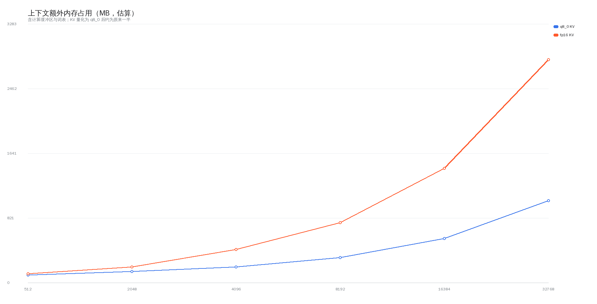

### 7.2 Space check before downloading

The most common download failure is not the network but **downloading successfully into a full
disk**: once the partition fills up, the atomic rename, the index write and the KV allocation fail
one after another, surfacing as a string of bizarre errors.

`StorageGuard.check(free, need, alreadyHave)` returns four verdicts:

| Verdict | Condition | Behaviour |
|---|---|---|
| `OK` | still above the 256 MB waterline afterwards | start normally |
| `TIGHT` | fits, but drops below the waterline | start, but warn "only X left afterwards" |
| `INSUFFICIENT` | does not fit | refuse outright and say exactly how much is short |
| `CRITICAL` | free space below the 128 MB floor | refuse and suggest deleting a model first |

### 7.3 Model library health check

The index and the disk drift apart — concurrent writes in older versions left three kinds of junk:

| Kind | Symptom |
|---|---|
| ghost entry | in the index, not on disk: tapping reports "file not found" |
| orphan file | on disk, not in the index: wasted space that cannot be deleted |
| empty file | zero bytes: leftover from an interrupted download |

`StorageGuard.audit()` cross-checks; the model library screen runs it on entry and only reports when
the findings changed since last time.

### 7.4 Atomic writes

Every write to disk follows one pattern: **temp file → flush → fsync → atomic rename**. It does not
prevent every problem, but it guarantees a killed process or a power loss never leaves half a file —
either the old version or the new one.

## 8 Security model

A local model is an **untrusted input source**: its output becomes commands, paths and URLs. So
every entry point gets a valve.

| Entry | Risk | Measure |
|---|---|---|
| File paths | `../../shared_prefs/x.xml` escapes | `FsKit.resolveInside`: canonical-path prefix check, symlink escapes included |
| Writes | a half-written file corrupts the index | atomic write + fsync |
| shell | arbitrary command execution | confirmation dialog first + fixed cwd + 60 s timeout + output truncation |
| Web fetching | probing local services (SSRF) | `Validators.safeUrl` allows http/https only; `isPrivateHost` rejects localhost / intranet / `.local` |
| Web preview | `fetch('file:///…/chats.json')` reads chat history | `allowUniversalAccessFromFileURLs` off; relative assets still work |
| Downloaded files | an error page treated as a model | verify byte length + read the header for the GGUF magic (never just the extension) |
| R8 obfuscation | JNI looks methods up by name and crashes when renamed | `proguard-rules.pro` explicitly keeps `TokenCallback` and `onToken` on every implementation |

The R8 line deserves its own paragraph: **it cannot be verified at compile time**. A passing
`assembleRelease` says nothing about runtime. v2.1 crashed in production because of it
(`no non-static method "...onToken(Ljava/lang/String;)V"`). CI now verifies signatures and
artifacts, but JNI symbols still need a human check — documented under "known limitations".

## 9 Engineering and CI

### 9.1 Pipeline

```text
push / PR / tag
   │
   ├─ job verify (fast)
   │     ├─ ./gradlew testDebugUnitTest
   │     └─ ./gradlew lintDebug
   │     └─ upload test and Lint reports
   │
   └─ job build (slow, needs: verify)
         ├─ install SDK: platform 36 / build-tools 36 / ndk 27.2 / cmake 3.22.1
         ├─ cache app/.cxx and CMake output
         ├─ configure signing (no secrets and it is a tag → fail, never emit a debug-signed build)
         ├─ assembleDebug + assembleRelease
         ├─ verify the APKs: apksigner prints the cert, aapt2 prints ABI and version
         ├─ upload artifact: apk
         └─ tag only: rename + create the Release with the APK attached
```

Splitting `verify` and `build` is a practical decision: native compilation takes 20–40 minutes, and a
typo should not take that long to surface.

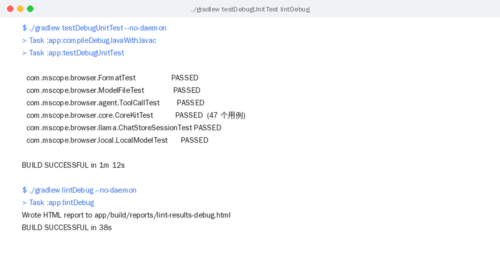

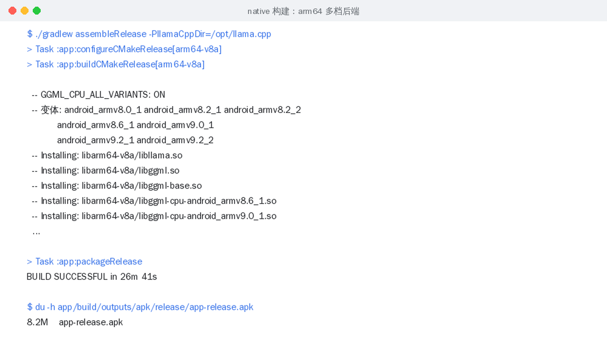

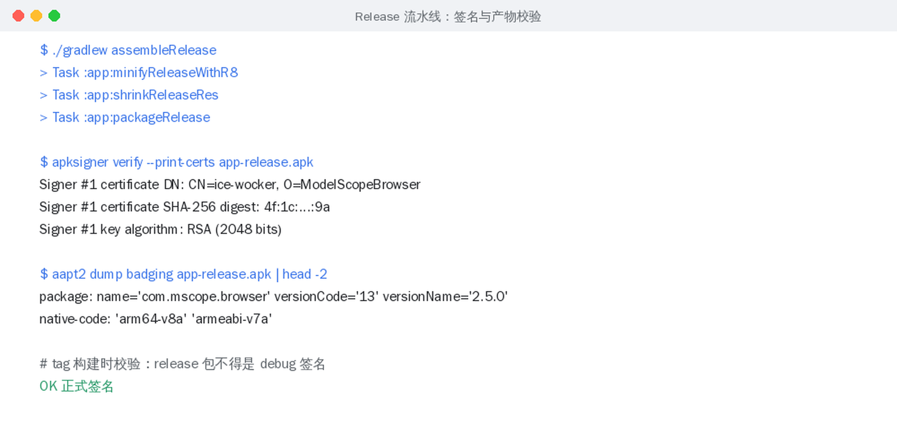

### 9.2 A signing lesson

The v1.2 release APK was silently built with a **debug signature** because CI had no signing secrets,
and users could not install it over the old version. The rule now: **a tag build without secrets fails
outright**, and the error says where to configure them.

| Secret | Contents |
|---|---|
| `KEYSTORE_BASE64` | the output of `base64 -w0 release.keystore` |
| `KEYSTORE_PASSWORD` | storePassword |
| `KEY_ALIAS` | key alias |
| `KEY_PASSWORD` | keyPassword |

### 9.3 Building locally

```bash
# environment: JDK 17, Android SDK (platform 36 / build-tools 36 / ndk 27.2.12479018 / cmake 3.22.1)
export JAVA_HOME=/path/to/jdk17
echo "sdk.dir=/path/to/android-sdk" > local.properties

# the first build fetches llama.cpp (~50 MB); point at a local checkout to speed it up
./gradlew assembleDebug   -PllamaCppDir=/path/to/llama.cpp
./gradlew assembleRelease -PllamaCppDir=/path/to/llama.cpp

# unit tests and Lint
./gradlew testDebugUnitTest
./gradlew lintDebug
```

A few settings in `app/build.gradle` that must not be changed casually:

| Setting | Value | Reason |
|---|---|---|
| `useLegacyPackaging` | `true` | the tiered backends must be extracted to `nativeLibraryDir` to be dlopen'ed |
| `minSdk` | 24 | some APIs (`File#toPath`) are unavailable below 24, and real-world coverage is negligible |
| `abiFilters` | arm64-v8a, armeabi-v7a | only the ABIs real devices have; controls size and build time |
| `minifyEnabled` / `shrinkResources` | `true` | since v2.1: APK 20.6 MB → 11.6 MB |
| `cppFlags` | `-O3` | the bridge only calls APIs and holds no SIMD kernels, so no `-march` on purpose |

## 10 This upgrade (v2.5.0)

v2.4.2 was "nail down what looked fine but occasionally was not"; v2.5.0 is "add what should have
been there all along".

### 10.1 The new `core/` pure-logic layer

| File | What it solves |
|---|---|
| `MemoryBudget` | context size decided by device memory instead of a hard-coded 8192 that gets low-memory devices killed by the LMK |
| `StorageGuard` | turn "will it fit" into one plain sentence; plus a health check for the model library |
| `FsKit` | path convergence, atomic writes, magic sniffing, directory stats, all in one place |
| `Validators` | sampling-parameter convergence, lenient number parsing, URL whitelist, intranet detection |
| `PromptTemplate` | prompts become templates, with the compact tool docs selected automatically for small models |
| `TextKit` | UTF-8-safe truncation, file-name sanitising, rough token estimates, sentence splitting |
| `PerfStats` | rolling mean / P90, with an actionable sentence when performance clearly degrades |
| `MarkdownOutline` | heading outline for long replies |

None of them imports `android.*`, so they are unit-testable on the JVM — 47 new cases, 99 in total after v2.6.0 added 12 localisation cases.

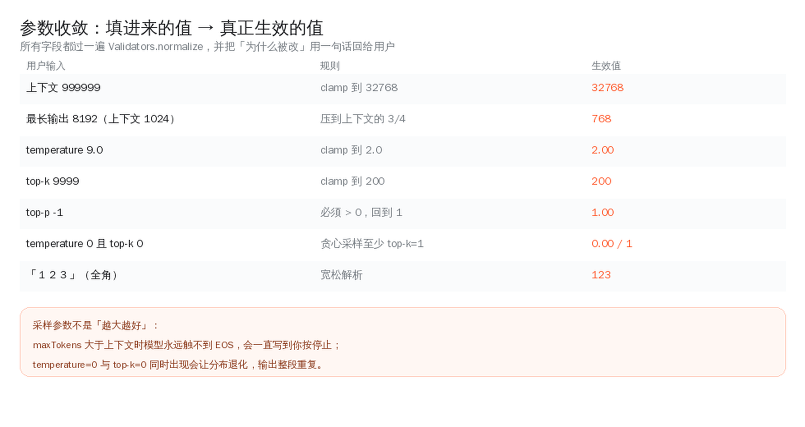

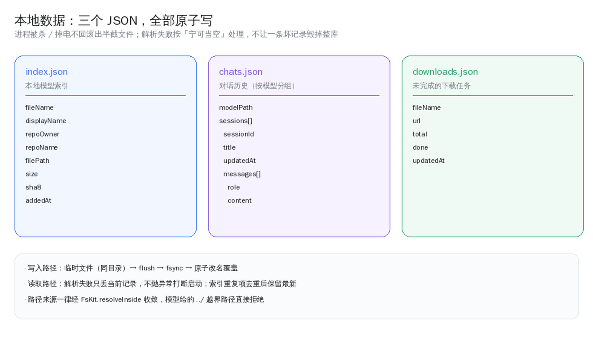

### 10.2 Integration points (not decoration)

| Location | Change |
|---|---|
| `ChatActivity` | default context derived from device memory on first entry; the parameter dialog goes through `Validators` and echoes why a value was corrected; status bar shows mean / P90; new menu items "outline of this reply" and "inference performance" |
| `ChatActivity.buildSystemPrompt` | now uses `PromptTemplate`; small models automatically get the compact tool docs |
| `DownloadCenter` | space decisions moved to `StorageGuard`; GGUF verification moved to `FsKit.sniff` (reads the header, not the extension) |
| `LocalModelsActivity` | audits index vs disk on entry, reporting ghosts / orphans / empties once |
| `WebSearch` | `fetch_url` gained intranet blocking; body truncation is now UTF-8-safe |
| `AgentTools` | `fetch_url` goes through the unified whitelist check |

### 10.3 CI and engineering

- `verify` / `build` split into two jobs, the fast one first;
- native build cache (`app/.cxx`) added: a second build drops from ~40 minutes to a few;
- artifact verification step: `apksigner` prints the cert, `aapt2` prints ABI and version; debug
  signatures are rejected on tags;
- concurrency group: a new push to the same branch cancels the old run;
- documentation grew from 34 KB to this handbook plus four focused documents and 13 illustrations.

### 10.4 Version numbers

`versionCode 12 → 13`, `versionName 2.4.1 → 2.5.0`. The minor digit jumped because a module layer was
added.

## 10.5 What v2.6.0 added

v2.6.0 is about language, not features:

- **The whole app is English/Chinese bilingual**, with an in-app switch (About → Language) that calls
  `recreate()` instead of restarting the process, so a loaded model and a running download survive.
- **`values/` is now English** and Chinese moved to `values-zh/`; `MissingTranslation` is back on in
  Lint, turning bilingual support into a build-time constraint.
- **Copy that cannot reach a `Context`** (prompts, tool docs, tool results, errors) goes through
  `i18n/Lang`, set at the same moment the resources switch language — there is never a
  "English UI with Chinese prompts" half-state.
- **All 10 long-form documents are bilingual**; every page has a language switch at the top.
- `versionCode 13 → 14`, `versionName 2.5.0 → 2.6.0`.

An honest note: the 21 illustrations still carry Chinese labels. Re-rendering them is redraw work,
not translation work, and it is tracked separately.

## 11 Frequently asked questions

**Q: Model loading fails with "backend not registered"?**
`useLegacyPackaging` got turned off at packaging time. The tiered backends are separate `.so` files;
if they never reach disk, dlopen cannot find them. See the note in 5.3.

**Q: Answers drift, especially after several turns?**
First check whether it is a small model (≤2B) — their multi-turn memory is genuinely weak. If it
used to be fine and then misaligned, check the position alignment of KV prefix reuse (5.2). v2.4.2
fixed one bug of this kind.

**Q: Chinese output gets cut into mojibake?**
Either the `llama_token_to_piece` buffer is too small, or the UTF-16 conversion widened byte by byte.
The bridge cuts on whole characters; see item 5 in 5.1.

**Q: I pressed stop and tools kept running?**
A bug before v2.4.2: the loop only checked cancellation during generation. Every safe point is
checked now.

**Q: Install says "app not installed" / cannot overwrite?**
Signature mismatch. The v1.2 build was debug-signed, so it had to be uninstalled first. Since v1.3
everything is release-signed and can overwrite.

**Q: Why no GPU?**
The Vulkan / OpenCL backends need `glslc` and friends, which the build environment does not have.
CPU-only is the pragmatic choice right now, documented under "known limitations" rather than forgotten.

**Q: Can it download non-GGUF files?**
In-app download only handles `.gguf` (others go to the system browser), because that is what the
built-in engine can load.

**Q: Downloads are slow / keep dropping?**
Resume depends on the server supporting `Range`: if it does, we continue from the offset; if not, we
start over. ModelScope 302-redirects some files to a CDN, and `Range` survives the redirect.

**Q: Search result quality is meh?**
Search goes through public result pages (DuckDuckGo, then Bing), with no API key, so it is subject
to anti-scraping. Quality and freshness are whatever the sources give.

**Q: Where are chats stored, and are they uploaded?**
`filesDir/chats.json`, in the app-private directory. Not uploaded; gone on uninstall.

## 12 Cheat sheet

### 12.1 Endpoints

| Item | Value |
|---|---|
| Model list | `https://www.modelscope.cn/api/v1/dolphin/models` (PUT) |
| Model detail | `https://www.modelscope.cn/api/v1/models/{ns}/{name}` |
| File download | `https://www.modelscope.cn/api/v1/models/{ns}/{name}/repo?FilePath=...` |
| Website | `https://www.modelscope.cn/models` |

### 12.2 Key constants

| Constant | Value | Location |
|---|---|---|
| `UI_FLUSH_MS` | 40 | `LlamaEngine` |
| `MAX_ROUNDS` | 8 | `ChatActivity` |
| `DEFAULT_CTX` | 8192 | `ChatActivity` |
| `MAX_RESULT` | 6000 characters | `AgentTools` |
| `SAFETY_BYTES` | 256 MB | `StorageGuard` |
| `SAFETY_MARGIN_KB` | 320 MB | `MemoryBudget` |
| terminal timeout | 60 s | `Shell` |
| output truncation | 200K characters | `TerminalActivity` |

### 12.3 Common commands

```bash
./gradlew testDebugUnitTest        # unit tests (99)
./gradlew lintDebug                # Lint (abortOnError)
./gradlew assembleDebug            # debug APK
./gradlew assembleRelease          # release APK (R8 + resource shrinking)
./gradlew :app:dependencies        # dependency tree
git tag v2.6.0 && git push --tags  # trigger the Release pipeline
```

### 12.4 Diagnostic order

1. model fails to load → read `nativeLastError()` in the UI first, then check the `.so` extraction
   issue from 5.3;
2. generation misbehaves → `adb logcat -s LlamaEngine LlamaBridge`;
3. download misbehaves → `adb logcat -s DownloadCenter`;
4. tools do not run → is the tool card in the bubble marked "denied" / "unmatched"?
5. UI is garbled → try `./gradlew clean` first to rule out stale incremental output.

---

## Appendix B · Glossary

| Term | Meaning |
|---|---|
| GGUF | llama.cpp's model file format, holding weights plus metadata (quant type, vocabulary, chat template) |
| Quantisation | compressing weights from 16 bits to 4–8. `Q4_K_M` is the common speed/quality balance |
| KV cache | the attention key/value cache; grows linearly with context and is the largest extra memory cost on a phone |
| Prefill | the phase that processes the input prompt; usually far faster than per-token decode |
| Prefix reuse | reusing KV already computed in the previous round and decoding only the new tokens |
| Instruction-set tiers | multiple CPU backends built for one ABI, with the best selected at runtime via HWCAP |
| HWCAP | CPU capability bits exposed by Linux in `/proc/self/auxv` |
| Atomic write | write a temp file then rename, guaranteeing no half-written file is ever visible |
| Ghost entry | a record that exists in the index but not on disk |
| R8 | Android's code shrinker / obfuscator; renames methods, which inherently conflicts with JNI |

---

_This document is maintained alongside the code. If something does not match reality, send a PR._

## Appendix A · API cheat sheet

Public entry points by package. Signatures are extracted straight from source, so when code changes
without the docs, this section is the first to give it away.

### `com.mscope.browser` · top level: UI and data layer

The list screen, the detail screen, web fallback mode, and the ModelScope API access and degradation
strategy.

#### `DetailActivity.java`

**DetailActivity** — model detail screen: basic information + model files (a `.gguf` can be downloaded
in-app and chatted with directly) + a Markdown description.

#### `Format.java`

**Format** — shared display formatting: sizes, counts. Previously duplicated across LocalModel /
ModelFile / LocalModelsActivity; unified here.

```java
public static String size(long bytes);
public static String sizeOrDash(long bytes);
public static String count(long n);
```

#### `MainActivity.java`

**MainActivity** — the model list screen: paged browsing + search + sorting + facet filtering.

#### `ModelAdapter.java`

**ModelAdapter** — adapter for the model list.

```java
public VH onCreateViewHolder(@NonNull ViewGroup parent, int viewType);
public int getItemCount();
```

#### `ModelApi.java`

**ModelApi** — ModelScope data access layer (every endpoint confirmed by measurement). List: PUT /api/v1/dolphin/models body: {"PageSize":N,"PageNumber":P,"Name":"keyword","SortBy":"D…

```java
public static class Page;
public static class Facet;
public static String http(String method, String url, String body) throws IOException;
public static Page listModels(int page, int pageSize, String keyword, String sortBy, String order, String filterCategory, String filterValue);
public static ModelItem getModelDetail(String namespace, String name) throws Exception;
public static List<ModelFile> listFiles(String namespace, String name) throws Exception;
public static String downloadUrl(String namespace, String name, String filePath) throws Exception;
public static String facetLabel(String group);
```

#### `ModelFile.java`

**ModelFile** — one file inside a model repository.

```java
public String displayName();
public String dir();
public String sizeText();
```

#### `ModelItem.java`

**ModelItem** — one ModelScope model record. Fields match the Data structure returned by ModelScope /api/v1/models/{ns`/{name`.

```java
public String displayName();
public String fullName();
public String webUrl();
public String createdText();
public String updatedText();
public static ModelItem from(JSONObject o);
public static long toLong(Object v);
```

#### `Ui.java`

**Ui** — targetSdk 35+ forces edge-to-edge layout; this handles it in one place: disable the system's automatic handling, then apply the status bar / navigation bar / IME insets as root padding so content is never hidden behind system bars.

```java
public static void edgeToEdge(Activity activity, View root);
```

#### `WebActivity.java`

**WebActivity** — web fallback mode: load modelscope.cn directly, so every model stays browsable under any circumstance.

---

### `com.mscope.browser.core` · core: the pure-logic foundation layer (new in v2.5.0)

Algorithms and validation with no dependency on the Android framework; all covered by JVM unit tests.

#### `FsKit.java`

**FsKit** — filesystem utilities: path convergence, atomic writes, container-format sniffing, disk inventory. There is exactly one core rule: **every write must first converge inside the root**. Agent-generated paths come from the model, and a single `../../shared_prefs/x.xml` escapes;

```java
public static File resolveInside(File root, String rel);
public static boolean writeAtomic(File target, byte[] data);
public static boolean writeAtomic(File target, String text);
public static String readText(File f, int maxBytes);
public static final class Magic;
public static Magic sniff(File f);
public static final class DirStat;
public static DirStat statDir(File dir, String relPrefix);
public static List<File> listSorted(File dir);
public static boolean deleteTree(File f, File root);
```

#### `MarkdownOutline.java`

**MarkdownOutline** — extract a heading outline from Markdown, giving long replies a navigation map. Local small models often write 2000–3000 characters in one go, and scrolling back to find a section on a phone is miserable.

```java
public static final class Heading;
public static List<Heading> extract(String markdown);
public static boolean worthOutline(String markdown);
```

#### `MemoryBudget.java`

**MemoryBudget** — the "how large can the context be" estimator. Running llama.cpp on a phone, the expensive part is the KV cache rather than the weights: it grows linearly with "context length × layers × head dimension" and must be resident in one piece. Handing the user a 32768 input box without saying whether it fits

```java
public static final class Snapshot;
public static Snapshot parseMeminfo(String text);
public static long estimateExtraKb(int ctxTokens, boolean kvQuantized);
public static int suggestCtx(Snapshot mem, long modelBytes, boolean kvQuantized, int fallback);
public static String explain(Snapshot mem, long modelBytes, int chosenCtx);
public static Snapshot read();
```

#### `PerfStats.java`

**PerfStats** — rolling statistics for inference performance. A single tok/s number jitters a lot (background work, thermal throttling and scheduling all contribute), so showing only the last one is close to useless. This keeps the last N samples and reports mean and P90,

```java
public static final class Sample;
public synchronized void add(Sample s);
public synchronized void clear();
public synchronized int size();
public synchronized List<Sample> snapshot();
public synchronized double lastTps();
public synchronized double meanTps();
public synchronized double percentileTps(double p);
public synchronized long meanPrefillMs();
public synchronized boolean degraded();
public synchronized String summary();
public synchronized String advice();
```

#### `PromptTemplate.java`

**PromptTemplate** — templating and assembly of the system prompt. Prompts used to be scattered string constants in ChatActivity, so swapping models meant editing code; here "role + tool docs + output conventions" are split into composable fragments, with a compact variant for small models:

**Preset** — the preset templates.

```java
public static String body(Preset preset);
public static String toolSection(String toolList, boolean minimal);
public static String compose(String userPrompt, Preset preset, String tools, List<String> memory);
public static List<String> sanitizeMemory(List<String> memory);
public static Preset guessPreset(String modelName);
public static double guessBillionParams(String name);
public static boolean wantsCompactTools(String modelName);
```

#### `StorageGuard.java`

**StorageGuard** — storage inspection: say things plainly before an action that will eat hundreds of MB, such as downloading or loading a model. The easiest trap on a phone is not a failed download but **downloading successfully into a full disk**: once the partition is full, the atomic rename, the index write and even the KV allocation all fail, surfacing as a string of bizarre errors.

```java
public static final class Check;
public static Check check(long freeBytes, long needBytes, long alreadyHave);
public static long freeBytes(File dir);
public static final class Finding;
public static final class Entry;
public static List<Finding> audit(List<Entry> entries, List<Entry> existing);
public static String summarize(List<Finding> findings);
public static String human(long b);
```

#### `TextKit.java`

**TextKit** — text helpers with no business logic. Each one exists to fix a specific trap: UTF-8 truncation (token boundaries cutting a Chinese character in half), file-name sanitising (a model-generated title containing /\:*?"<>| cannot be written to disk),

```java
public static String trimUtf8(String s, int maxBytes);
public static boolean endsWithCompleteChar(byte[] bytes, int len);
public static String safeFileName(String raw, int maxBytes);
public static String shortHash(String s, int hexLen);
public static String sha256Hex(String s);
public static int roughTokens(String s);
public static List<String> sentences(String text);
public static boolean looksComplete(String text);
```

#### `Validators.java`

**Validators** — input validation: close the gap between what a user can type and what the engine accepts. Inference parameters look harmless, yet one wrong value turns sampling into repeated words or crashes outright: temperature=0 together with top-k=0 makes softmax divide by zero,

```java
public static final class Sampling;
public static String normalize(Sampling s);
public static int clamp(int v, int min, int max);
public static float clamp(float v, float min, float max);
public static int parseInt(String s, int def);
public static float parseFloat(String s, float def);
public static String cleanQuery(String q, int maxLen);
public static String safeUrl(String url);
public static boolean isPrivateHost(String host);
public static String hostOf(String url);
```

---

### `com.mscope.browser.agent` · agent: agent capabilities

Tool protocol parsing, tool execution, the real shell, the workspace, web search and preview.

#### `AgentTools.java`

**AgentTools** — the tool set the agent can call: local terminal (real shell), web search, workspace files, web preview. Each result is fed back to the model as tool_result, so the return value is always "text meant for the model" — errors come back as text too instead of exceptions, letting the model correct itself.

**Host** — opening a web preview needs a UI action, so the host supplies the callback (runs on the main thread).

```java
public static Set<String> names();
public static boolean risky(String name);
public static String describe(boolean web, boolean files, boolean shellOn);
public String exec(ToolCall c);
public static String summary(ToolCall c);
```

#### `HtmlPreviewActivity.java`

**HtmlPreviewActivity** — preview HTML generated in the workspace: loaded from a local file:// URL, with scripts, styles and relative assets working.

```java
public static void start(android.content.Context ctx, String relPath);
```

#### `Shell.java`

**Shell** — local terminal: really executes /system/bin/sh commands in the phone's own environment. The working directory is pinned to the app workspace, so commands can only touch the app-private directory (Android sandbox; no root, no permission required). stdout and stderr are captured merged;

```java
public static class Out;
public File cwd();
public Out run(String command);
```

#### `TerminalActivity.java`

**TerminalActivity** — local terminal: executes /system/bin/sh commands directly (a real shell), with the working directory pinned to the app workspace. Commands run on a background thread and output returns to the UI; the Android sandbox limits it to the app-private directory, so no root and no permissions are needed.

#### `ToolCall.java`

**ToolCall** — parse "tool calls" out of a model reply. Local GGUF models do not always ship a function-call template, so this does not rely on native capabilities; instead it recognises the several shapes models habitually emit:

```java
public String arg(String key, String def);
public String arg(String[] keys, String def);
public static List<ToolCall> parse(String text, Set<String> known);
public static String strip(String text, Set<String> known);
public static String stripThinking(String text);
```

#### `WebSearch.java`

**WebSearch** — toggleable web search: fetch public search result pages and parse titles / links / snippets. No API key required, works out of the box. Primarily DuckDuckGo's lite HTML version (simple structure, no anti-bot redirects), falling back to Bing web results. Both failing raises an exception,

```java
public static class Result;
public static List<Result> search(String query, int limit) throws IOException;
public static String format(List<Result> results);
public static String fetchPage(String url, int maxChars) throws IOException;
public static boolean allowedForFetch(String url);
```

#### `Workspace.java`

**Workspace** — the app-private workspace: files created by the model and the user both land here (filesDir/workspace). Every path is normalised and forced inside the workspace root, so escapes like `../` are rejected.

```java
public static class Entry;
public File root();
public File resolve(String rel);
public String relOf(File f);
public static String normalize(String rel);
public boolean exists(String rel);
public boolean isDir(String rel);
public List<Entry> list(String relDir);
public String readText(String rel) throws IOException;
public File writeText(String rel, String content) throws IOException;
public void appendText(String rel, String content) throws IOException;
public boolean delete(String rel);
public File mkdir(String rel) throws IOException;
public long totalSize();
```

#### `WorkspaceActivity.java`

**WorkspaceActivity** — workspace file management: browse / create / preview / share / delete. Everything lives in the app-private workspace, and tapping an .html file opens the local preview directly.

---

### `com.mscope.browser.llama` · llama: inference and chat

llama.cpp's JNI declarations, session management, the chat screen and history persistence.

#### `ChatActivity.java`

**ChatActivity** — chat with a local GGUF model: llama.cpp streaming generation, Markdown rendering, interruptible, with automatic history persistence.

```java
public static void start(Context ctx, LocalModel m);
```

#### `ChatMessage.java`

**ChatMessage** — one chat message.

```java
public static ChatMessage tool(String title, String kind, String content);
public boolean isUser();
public boolean isTool();
public boolean isAssistant();
```

#### `ChatStore.java`

**ChatStore** — chat history persistence. Sessions are small, so writing each one whole into a single JSON file is the simplest reliable option. Each model may have several sessions, ordered by update time descending; only the most recent {@link #MAX_PER_MODEL` are kept per model.

```java
public static class Session;
public synchronized List<Session> list(String modelPath);
public synchronized Session latest(String modelPath);
public synchronized Session create(String modelPath);
public synchronized void save(Session s);
public synchronized void delete(String id);
```

#### `LlamaBridge.java`

**LlamaBridge** — native interface declarations for llama.cpp, implemented in app/src/main/cpp/llama_bridge.cpp.

**TokenCallback** — streaming callback: invoked once per token piece.

```java
public static native String nativeSupported();
public static native String nativeBackendInfo();
public static native String nativeLastError();
public static native long nativeInit(String modelPath, int nCtx, int nThreads, int nThreadsBatch, String backendDir);
public static native void nativeFree(long handle);
public static native void nativeReset(long handle);
public static native void nativeCancel(long handle);
public static native int nativeContextSize(long handle);
public static native int nativeCachedTokens(long handle);
public static native int nativeCountTokens(long handle, String text);
public static native String nativeBuildPrompt(long handle, String[] roles, String[] contents);
public static native String nativeGenerate(long handle, String[] roles, String[] contents, int maxTokens, float temp, float topP, int topK, int seed, TokenCallback callback);
public static native String nativeVersion();
```

#### `LlamaEngine.java`

**LlamaEngine** — llama.cpp session management: a singleton with single-threaded serial generation, avoiding concurrent access to one context. A few performance-related conventions:

```java
public static class Params;
public static LlamaEngine get();
public boolean isLoaded();
public boolean isLoading();
public boolean isGenerating();
public LocalModel currentModel();
public String backendInfo();
public int contextSize();
public int cachedTokens();
public synchronized void load(LocalModel model, int nCtx, String backendDir, LoadListener listener);
public void unload();
public void reset();
public void cancel();
public void generate(List<ChatMessage> messages, Params params, StreamListener listener);
public static String version();
```

---

### `com.mscope.browser.local` · local: local models

The download centre, the foreground service, the local model index and the model library screen.

#### `DownloadCenter.java`

**DownloadCenter** — app-level download centre: serial GGUF downloads (so they do not fight over bandwidth), with progress, cancellation, resume and integrity verification. To raise the success rate:

```java
public static class Task;
public static DownloadCenter get(Context ctx);
public void addListener(Listener l);
public void removeListener(Listener l);
public Task task(String localPath);
public boolean start(LocalModel model, String url);
public void cancel(String localPath);
```

#### `DownloadService.java`

**DownloadService** — the foreground service during downloads, so large files are not reclaimed when the app goes to the background. The service itself does not download (that happens in {@link DownloadCenter`'s pool); it only owns the foreground notification.

```java
public static void start(Context ctx, String text, int pct);
public static void update(Context ctx, String text, int pct);
public static void stop(Context ctx);
public int onStartCommand(Intent intent, int flags, int startId);
```

#### `LocalModel.java`

**LocalModel** — one GGUF model already downloaded to the device.

```java
public String quant();
public String repoFullName();
public String displayName();
public String sizeText();
```

#### `LocalModelStore.java`

**LocalModelStore** — the local model library: model files and the index live in the app-private directory, needing no storage permission.

```java
public File dir();
public File fileOf(String fileName);
public synchronized List<LocalModel> list();
public synchronized void add(LocalModel m);
public synchronized void remove(LocalModel m);
public long totalSize();
public long freeSpace();
public static boolean isExternalMounted();
```

#### `LocalModelsActivity.java`

**LocalModelsActivity** — local model library: see downloaded GGUFs and their size, and open offline chat or delete with one tap.

---
