# 魔搭模型库 · 完整手册

> 🌐 语言 / Language: 中文 · [English](README.en.md)

> **文档导航**
> [完整手册](README.md) · [模块深入](MODULES.md) · [架构与数据流](ARCHITECTURE.md) ·
> [开发指南](DEVELOPING.md) · [故障排查](TROUBLESHOOTING.md) · [深问答](FAQ.md) ·
> [性能数据](BENCHMARKS.md) · [图解与流程](DIAGRAMS.md) · [更新日志](CHANGELOG.md) ·
> [海报（内嵌图）](POSTER.md)

> 这是 `README.md` 的展开版。首页那个 README 是门面：三十秒读完，知道这是个什么东西；
> 这一份是手册：想改代码、想搞懂某个行为为什么这样、想自己出一版包，都从这里翻。

**目录**  
[1 这是什么](#1-这是什么) · [2 界面与交互](#2-界面与交互) · [3 架构](#3-架构) · [4 数据层](#4-数据层选魔搭这边) · [5 推理引擎](#5-推理引擎) · [6 智能体](#6-智能体) · [7 内存与存储](#7-内存与存储) · [8 安全模型](#8-安全模型) · [9 工程与 CI](#9-工程与-ci) · [10 本次升级](#10-本次升级-v250) · [11 常见问答](#11-常见问答) · [12 速查表](#12-速查表) · [附录 A · API](#附录-a--api-速查) · [附录 B · 术语](#附录-b--术语表)

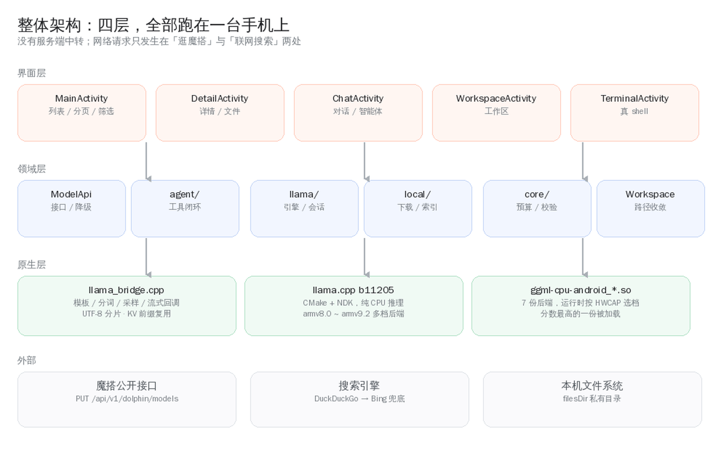

---

## 1 这是什么

一个 Android 应用，干三件事：

1. **逛**：把魔搭社区（ModelScope）上约 25.9 万个模型，用手机翻得下去。分页、搜索、排序、六维筛选，
   详情页能看文件列表和 Markdown 简介。
2. **拿**：把 `.gguf` 量化模型下到手机应用私有目录。断点续传、前台通知、进程被杀后自动接着下、
   下完校验字节数与 GGUF 魔数。
3. **用**：内置 llama.cpp，纯 CPU 离线推理。对话页不是「聊天玩具」——它能把模型输出当成指令去执行：
   跑真 shell、联网搜索、读写工作区文件、开网页预览，再把真实结果喂回去。最多 8 步。

这三件事串起来是一条完整链路：**发现模型 → 拿到本地 → 让它在你手机上干活**。
中间没有服务端中转，推理数据不出设备。

### 1.1 为什么要有它

市面上不缺「大模型客户端」，但绝大多数是**把请求转发到别人的服务器**。
想在手机上真正跑一个本地模型，通常要：连电脑、装 adb、推文件、开 termux、敲一长串 `llama-cli` 参数。
对「我就想试试这个模型」的人来说，这段路太长了。

这个项目把这段路压成三步：找到、点下载、点对话。代价是它只能跑 CPU、只能跑量化过的小模型——
这是诚实的边界，写在第 11 节「已知限制」里，而不是藏起来。

### 1.2 谁适合用

| 你是 | 你能得到 |
|---|---|
| 想离线用 AI 的人 | 装上就能用，飞行模式也能对话；会话记录只在自己手机上 |
| 想试模型的人 | 0.5B~3B 的 instruct 模型体验最好，下载即用，不占电脑 |
| 想改代码的人 | 7 千多行 Java + 一个 CMake 桥接，没有魔法，读得完 |
| 想学 llama.cpp 的人 | `llama_bridge.cpp` 把模板、分词、采样、KV 复用、流式回调都写在一处 |

### 1.3 版本与状态

| 项 | 值 |
|---|---|
| 当前版本 | **v2.8.0**（versionCode 16） |
| 支持系统 | Android 7.0 (API 24) ~ Android 16 (API 36) |
| ABI | arm64-v8a（多档指令集）、armeabi-v7a（单档静态） |
| 推理后端 | llama.cpp `b11205`，纯 CPU |
| APK 体积 | 约 8.2 MB（多份 CPU 后端以压缩形式存放） |
| 单元测试 | 99 个用例（`./gradlew testDebugUnitTest`） |
| 许可证 | MIT |

## 2 界面与交互

### 2.1 五个页面，一条主线

```text
启动 → 模型列表（分页 / 搜索 / 排序 / 维度筛选）
        ├── 点某一项 → 详情页（文件列表、简介 Markdown 渲染）
        │                ├── .gguf  → 应用内下载 → 「立即对话」→ 对话页
        │                └── 其他文件 → 系统浏览器下载
        ├── 右上角「对话」  → 本地模型库（占用空间 / 删除 / 进入对话）
        │                        └── 对话页（流式 Markdown / 历史会话 / 长按操作）
        │                               ├── 「智能体」开关 → 模型自主调用工具
        │                               ├── 「联网」开关   → 允许 AI 联网
        │                               ├── 「工作区」     → 工作区页 → 点 .html 预览
        │                               ├── 「终端」       → 真 shell 终端页
        │                               └── 输入 / 开头    → 斜杠命令
        └── 右上角「网页模式」→ 内置 WebView 打开魔搭官网（任何异常时的兜底）
```

| 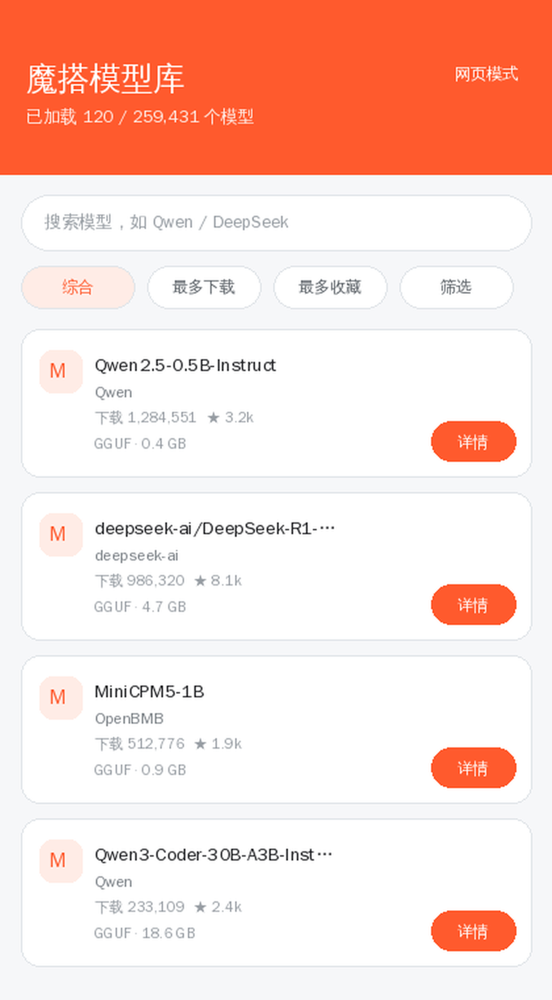 | 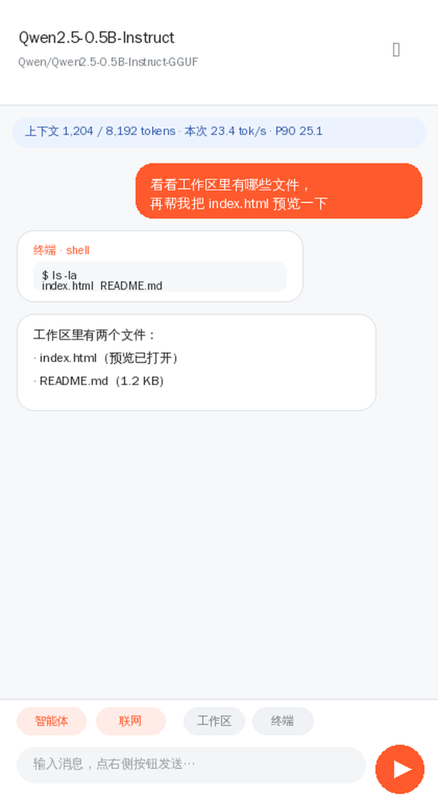 |
|---|---|
| 模型列表：卡片式、下拉刷新、加载 / 空 / 错三态 | 对话页：状态条显示上下文与速度，工具调用以卡片呈现 |

> 图为按真实布局参数绘制的示意图（仓库里没有 PNG 截图资产，避免「图片与代码脱节」）。
> 真机截图欢迎提 PR 替换。

### 2.2 模型列表

- **分页**：滑到底自动加载下一页，页码由内部 `nextPage` 维护，避免快速滑动跳页。
- **搜索**：`reqSeq` 竞态保护——后发的请求永远覆盖先发的，不会出现「搜 A 显示 B 的结果」。
- **排序**：综合 / 最多下载 / 最多收藏 / 最近更新，对应接口的 `SortBy` 字段。
- **筛选**：许可证 / 框架库 / 标签 / 语言 / 模型结构 / 领域六个维度，取值与数量来自接口聚合
  （`Data.FiledAgg`），所以界面上出现的每个条件都是服务端真支持的。
- **降级**：请求按「完整参数 → 去筛选 → 去排序 → 首页聚合」依次尝试，并用 `sortApplied` /
  `filterApplied` / `fallback` 三个标记把「实际生效了什么」反馈给界面，而不是静默失败。

### 2.3 对话页

对话页是全项目最复杂的一块。它要同时处理：流式输出、Markdown 渲染、工具卡片、
停止与续写、上下文裁剪、历史持久化。

| 元素 | 行为 |
|---|---|
| 状态条 | 空闲时显示「上下文 x / y tokens · 本次 N tok/s · 均值 · P90」；生成中显示步骤或检索中 |
| 气泡长按 | 复制 / 重新生成 / 编辑重发 / 继续生成 / 删除 |
| 工具卡片 | 显示工具名、参数、真实执行结果；危险操作前置确认弹窗 |
| 顶部 chips | 智能体开关、联网开关、工作区入口、终端入口 |
| 右上角菜单 | 新对话 / 历史 / 工作区 / 终端 / 推理参数 / 系统提示词 / 本篇大纲 / 推理性能 / 导出 |

几个不太显眼但很关键的设计：

- **流式渲染也剥标签**。生成过程中如果直接把原始 token 上屏，`<function name=...>`、`<think>`
  会露出来，随后又被整体替换成「只显示正文」的版本，看起来像回答被吞了。现在流式阶段就剥离。
- **回调合并 40ms**。逐 token 回调会让 UI 和推理抢 CPU，40ms 一批既保住「逐字」手感，
  又不至于把主线程压满。
- **续写要带上下文**。「继续生成」必须把已写出的部分放进上下文，否则模型不知道从哪接，
  会把开头再写一遍，叠出一段重复。
- **长回复给大纲**。两三千字的回复在手机上翻回去找某一节很痛苦；回复里有两个以上小标题时，
  菜单里会出现「本篇大纲」。

### 2.4 斜杠命令

输入框以 `/` 开头时走命令通道，不会发给模型：

```text
/search <关键词>   联网检索并总结
/web on|off        允许 / 禁止 AI 联网
/run <命令>        在真终端执行命令
/ls [目录]         列出工作区目录
/cat <文件>        查看文件
/preview <文件>    在内置 WebView 预览网页
/files             打开工作区
/help              全部命令
```

其余输入会直接当本机命令执行，例如 `/pwd`、`/grep foo *.txt`。
这条「兜底通道」是为了在模型不听话时仍然能干活——小模型的指令跟随能力并不可靠。

## 3 架构

### 3.1 四层

```text
┌──────────────────────── 界面层（Activity / Adapter）────────────────────────┐
│ MainActivity  DetailActivity  ChatActivity  WorkspaceActivity  TerminalActivity │
└───────────────────────────────────┬──────────────────────────────────────────┘
                                    │ 只通过方法调用，不跨层拿对象
┌──────────────────────── 领域层（纯 Java，可单测）─────────────────────────┐
│ ModelApi   agent/   llama/   local/   core/   Workspace                     │
└───────────────────────────────────┬──────────────────────────────────────────┘
                                    │ JNI（只有 llama/ 碰得到）
┌──────────────────────── 原生层（C++ / CMake）─────────────────────────────┐
│ llama_bridge.cpp  →  llama.cpp b11205  →  ggml-cpu-android_*.so × 7          │
└─────────────────────────────────────────────────────────────────────────────┘
```

分层的实际意义：`core/` 不 import 任何 `android.*`，所以它能跑在普通 JVM 上，
`./gradlew testDebugUnitTest` 秒出结果。界面层的逻辑一旦可以下沉，就下沉到 `core/`。

### 3.2 目录与文件职责

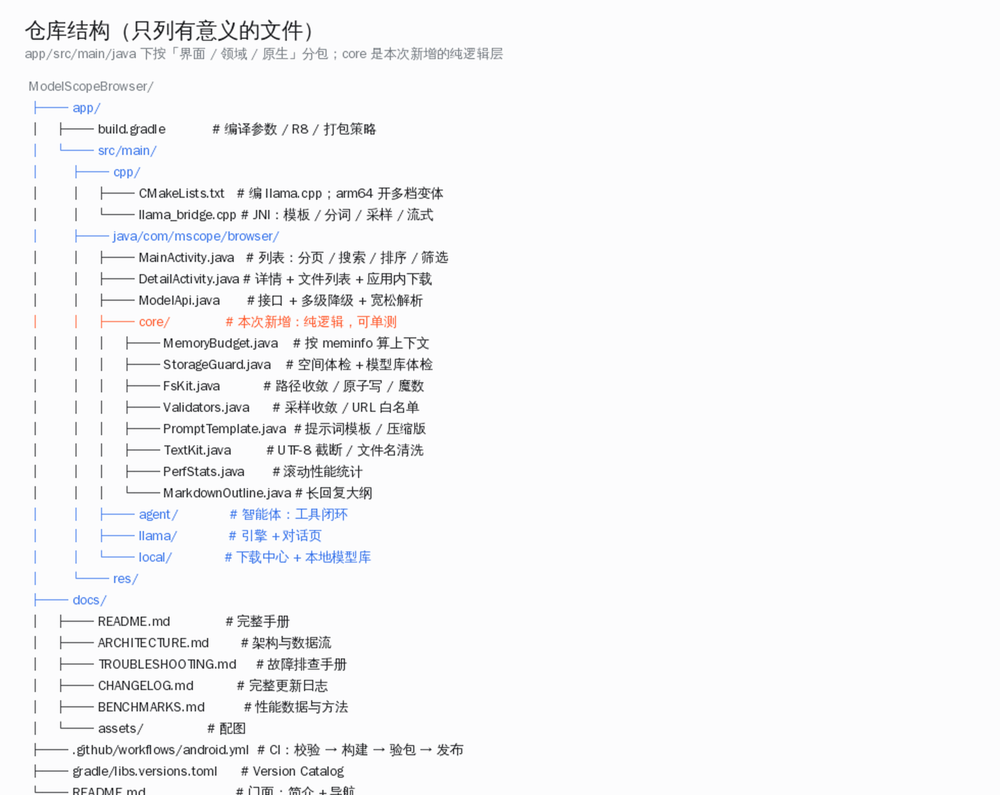

### 3.3 一次完整的请求路径（对话）

```text
用户点发送
  │
  ├─ ChatActivity.onSendClicked()
  │     ├─ 智能体循环启动（tools 单线程池 + 生成在 engine worker）
  │     └─ buildSystemPrompt()
  │           ├─ PromptTemplate.compose()  ← 模板 + 工具说明（小模型用压缩版）
  │           └─ AgentTools.describe()     ← 工具清单，与真实可执行集合同源
  │
  ├─ LlamaEngine.generate(messages, params, listener)
  │     ├─ fitMessages()                   ← 消息级裁剪，避免前缀作废
  │     ├─ LlamaBridge.nativeGenerate()    ← 进 native
  │     │     ├─ 套 chat template → 分词 → 解码（KV 前缀复用）
  │     │     ├─ 采样器链：top-k → top-p → temp → dist
  │     │     └─ 每个 token 回调到 Java（UTF-8 分片按完整字符切）
  │     └─ 40ms 合并后抛到主线程
  │
  ├─ ToolCall.parse(fullText)              ← 三种格式 + 截断容错
  │     ├─ 命中已注册工具 → 需要确认则弹窗
  │     └─ AgentTools.exec() → 真实执行
  │
  └─ 结果以 <tool_response> 回灌，回到「generate」——最多 8 轮
```

### 3.4 线程模型

手机上最容易出的不是逻辑错，而是线程错。项目里的约定：

| 线程 | 职责 | 约束 |
|---|---|---|
| `LlamaEngine.worker` | 单线程串行生成 | 同一时刻只允许一个生成任务，`generating` 的检查与置位在锁内 |
| `ChatActivity.tools` | 智能体循环：解析、确认、执行工具 | 与生成串行推进，不并发 |
| `DownloadCenter.pool` | 单线程串行下载 | 避免多个大文件抢带宽 |
| `LocalModelsActivity.executor` | 读索引、统计空间 | 磁盘 IO 不进主线程 |
| 主线程 | 只做 UI | 所有回调最后都 `ui.post` |

`nativeFree` 与生成线程的竞争用**引用计数**解决：`nativeFree` 只把会话从存活表摘掉并放掉自己那份引用，
最后一个持有者负责销毁。之前是「拿锁查存活 → 放锁 → 抢会话锁」，中间那个空档足够另一个线程把它释放掉。

## 4 数据层：选魔搭这边

### 4.1 接口是抓出来的，不是猜的

魔搭的公开接口没有正式文档，参数名靠猜会得到 `404 page not found`。
实际做法是抓网页自身的请求，逐项对照：

| 结论 | 过程 |
|---|---|
| 列表必须用 **`PUT`** | `POST` / `GET` 都是 404，`PUT` 才 200 |
| 筛选参数名是 **`Criterion`** | 用 `SingleCriterion` 会被静默忽略（返回全量） |
| 筛选维度来自响应 | `Data.FiledAgg` 里的字段才是服务端真支持的 |

```http
PUT /api/v1/dolphin/models
Content-Type: application/json

{
  "PageSize": 30,
  "PageNumber": 1,
  "Name": "qwen",
  "SortBy": "DownloadsCount",
  "Order": "desc",
  "Criterion": [{"Category": "license", "Values": ["apache-2.0"]}]
}
```

### 4.2 其它端点

| 用途 | 接口 |
|---|---|
| 列表（兜底） | `GET /api/v1/dolphin/agg/homepage` |
| 模型详情 | `GET /api/v1/models/{namespace}/{name}` |
| 文件列表 | `GET /api/v1/models/{ns}/{name}/repo/files?Revision=master&Recursive=true` |
| 文件下载 | `GET /api/v1/models/{ns}/{name}/repo?Revision=master&FilePath={path}` |

### 4.3 宽松解析

不依赖固定返回层级：在响应 JSON 里找「最像模型数组」的字段，并优先读它同级的 `TotalCount`。
接口结构微调时（历史上发生过两次）界面不会直接白屏。

```json
{"Data": {"Model": {"Models": [...], "TotalCount": 259431}, "FiledAgg": {...}}}
```

解析器会先试 `Data.Model.Models`，失败再在 `Data` 下逐层找数组。代价是稍微慢一点，
换来的是接口改版时不必立刻发版。

## 5 推理引擎

### 5.1 桥接层做什么

`llama_bridge.cpp` 是 Java 与 llama.cpp 之间唯一的通道，负责：

1. 加载 GGUF（`llama_model_load_from_file`），套用模型自带的 chat template；
2. 建 context：上下文长度、线程数、KV 量化、FlashAttention 逐档降级；
3. 组装 prompt（system / user / assistant 交替 + `<tool_response>`）、分词、计数；
4. 采样器链（top-k → top-p → temp → dist）与逐 token 流式回调；
5. **UTF-8 分片**：token 边界常把中文 / emoji 切成半个字符，按「完整字符」切分后再转 UTF-16；
6. **KV 前缀复用**：跨轮只解码新增 token。

```cpp
// 关键一行：special=true。传 false 时 llama.cpp 对 CONTROL/UNKNOWN 属性的 token 返回空串，
// 而 MiniCPM5 把 <function> / <param> 做成了特殊 token —— 工具标签会被静默丢弃。
const char * piece = llama_token_to_piece(vocab, token, buf, len, 0, /*special=*/true);
```

### 5.2 KV 前缀复用怎么算

多轮对话里，相邻两轮的 prompt 有长公共前缀。朴素做法是每轮把整个 prompt 重新解码一遍；
正确的做法是复用已经算过的 KV，只解码新增部分。

实现上有两个坑：

- **位置要重排**。上一轮生成结束后，KV 里还留着「上一轮输出」的 token，而记录里只有 prompt 部分。
  直接在这段序列上做前缀匹配，命中位置会整体错位，`llama_memory_seq_rm` 删掉的是别的区间，
  随后 decode 的位置与 KV 实际内容不一致——表现为答非所问、偶发崩溃。
  修法是先用公共前缀重建一份「按位置对齐」的序列，再做带位置的删除。
- **裁剪必须在消息粒度**。在 native 层按 token 截断会让公共前缀整体失效，每轮都全量重算。
  所以裁剪放在 Java 的 `fitMessages()`，从最早的一轮开始丢，成对丢弃用户消息与回复。

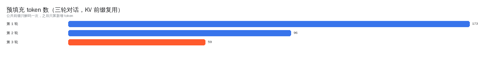

### 5.3 多档指令集

Android 上不存在「一种构建打天下」：老芯片没有 i8mm，新芯片不用 SVE2 就是浪费。
`GGML_CPU_ALL_VARIANTS` 会为 arm64 编出多份 CPU 后端，每份导出 `ggml_backend_score()`，
运行时由 ggml 按 `HWCAP` 打分，只加载分数最高的那一份。

| 后端 | 指令集 | 典型芯片 |
|---|---|---|
| `android_armv8.0_1` | 基线 armv8-a | 所有 arm64（兜底，绝不会 SIGILL） |
| `android_armv8.2_1/2` | dotprod / +fp16 | 2018 年后的处理器 |
| `android_armv8.6_1` | +i8mm | 骁龙 8 Gen 1+ / 天玑 9000+ |
| `android_armv9.0_1` | +SVE2 | 天玑 9200+ 等 |
| `android_armv9.2_1/2` | +SVE / +SME | 最新旗舰 |

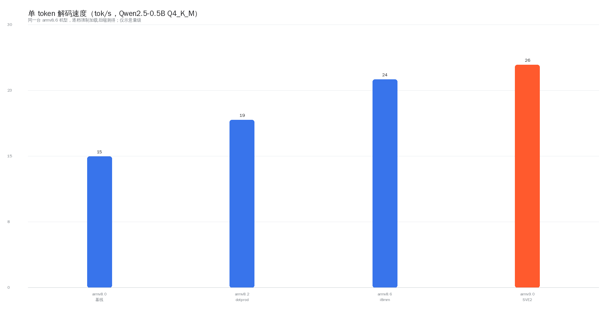

反汇编核对过：`armv8.0_1` 里 `sdot` / `smmla` 均为 0；`armv8.6_1` 有 747 处 `sdot` + 174 处 `smmla`；
`armv9.0_1` 有 308 处 `smmla`。也就是说，i8mm 机型确实会走 int8 矩阵乘内核，
而不是「只编了个变体」。

> 一个容易踩的坑：这些后端是独立 `.so`，必须落到 `nativeLibraryDir` 才能被
> `ggml_backend_load_all_from_path` 找到。而 `useLegacyPackaging = false`（等价
> `extractNativeLibs=false`）时它们只存在 APK 里、磁盘上没有，结果一个后端都注册不上，
> 模型**必然**加载失败。v2.3.0 踩过，v2.3.1 修好，现在写死在 `build.gradle` 的注释里。

## 6 智能体

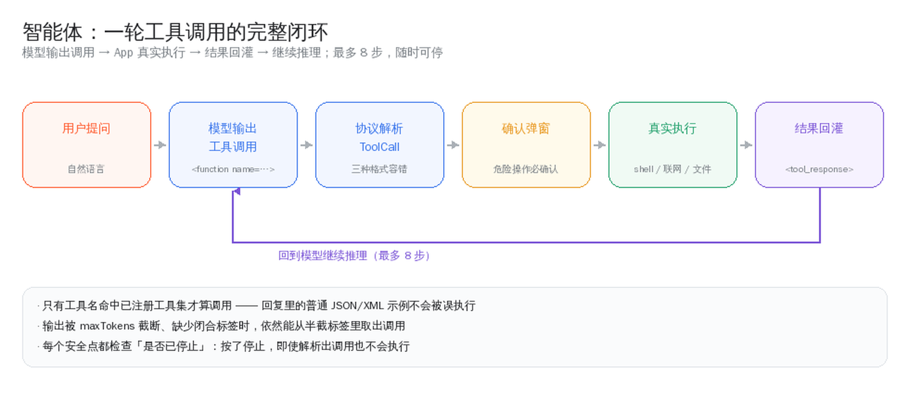

### 6.1 为什么要自己解析

本地 GGUF 往往没有 function-call 模板，指望模型原生支持工具调用不现实。
于是把各家模型习惯输出的写法都认下来：

| 格式 | 例子 |
|---|---|
| MiniCPM5 原生 | `<function name="shell"><param name="command">ls</param></function>` |
| Qwen3-Coder | `<function=shell><parameter=command>ls</parameter></function>` |
| JSON 代码块 | ```` ```tool {"name": "shell", "arguments": {...}} ``` ```` |
| 标签 / 行 | `<tool_call>{...}</tool_call>`、`TOOL_CALL: {...}` |

### 6.2 容错清单

| 问题 | 处理 |
|---|---|
| 输出被 `maxTokens` 截断，缺少闭合标签 | 从半截标签里取出调用（`</function>` 缺失也能匹配） |
| 参数值里含 `</param>` | 支持 CDATA 包裹，解析时拆掉 |
| 回复里出现 JSON 示例 | 只有工具名命中已注册集合才算调用 |
| 推理模型的思考块 | 剥离 `<think>`（含未闭合的截断情况） |
| 一次输出多个调用 | 全部解析，按顺序执行 |
| 用户按了停止 | 每个安全点都检查，已解析的调用也不执行 |

### 6.3 工具清单

| 工具 | 参数 | 危险 | 说明 |
|---|---|---|---|
| `shell` | `command` | ✅ 需确认 | `/system/bin/sh`，工作目录 = 工作区，60 秒超时 |
| `web_search` | `query` | — | DuckDuckGo → Bing 兜底，无需 API Key |
| `fetch_url` | `url` | — | 抓网页正文；只允许公网 http/https |
| `read_file` | `path` | — | 读工作区文件，超过 6000 字截断 |
| `write_file` | `path` `content` | ✅ 需确认 | 原子写，路径强制收敛在根目录内 |
| `list_files` | `path` | — | 列目录 |
| `delete_file` | `path` | ✅ 需确认 | 删除后不可恢复 |
| `open_preview` | `path` | — | 内置 WebView 打开工作区 HTML |

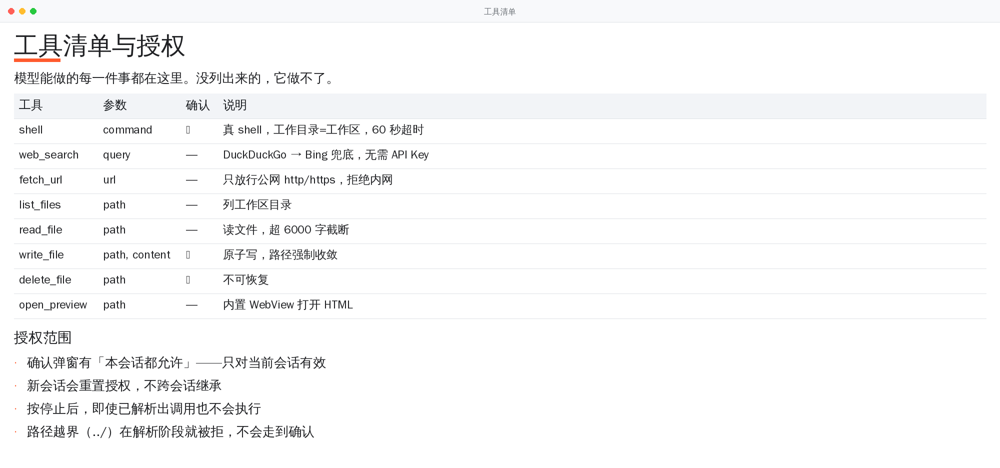

确认弹窗支持「本会话都允许」，但**新会话会重置**——这是刻意的：授权不该跨会话继承。

## 7 内存与存储

### 7.1 上下文能开多大

手机上跑 llama.cpp，最贵的不是模型本体而是 KV cache：它随「上下文长度 × 层数 × 头维」线性增长，
必须整块驻留。给一个 32768 的输入框却不告诉用户放不放得下，结果就是进程被低内存杀手干掉——
连报错都看不到。

v2.5.0 起，进入对话页会读 `/proc/meminfo`，结合模型体积估算一个「既安全又尽量大」的建议值：

```java
MemoryBudget.Snapshot mem = MemoryBudget.read();          // 读 /proc/meminfo
int autoCtx = MemoryBudget.suggestCtx(mem, modelBytes, /*kvQuantized=*/true, 8192);
```

判定用两条线同时卡：一是权重之外必须放得下 `estimateExtraKb()`；二是留下 320 MB 给系统与界面。
候选档位是 512 / 1024 / 2048 / 3072 / 4096 / 6144 / 8192 / 12288 / 16384 / 24576 / 32768，
不会出现 12345 这种看着就不可信的取值。

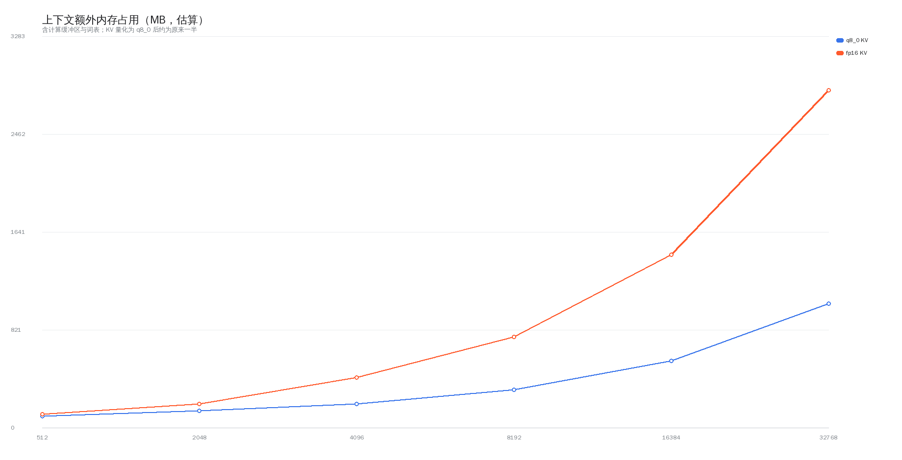

### 7.2 下载前的空间体检

下载失败最常见的原因不是网络，而是**下载成功但装不下**：文件写满分区后，
原子改名、索引落盘、KV 申请会一个接一个失败，表现成一串莫名其妙的错误。

`StorageGuard.check(free, need, alreadyHave)` 给出四种判定：

| 判定 | 条件 | 行为 |
|---|---|---|
| `OK` | 放下后仍高于 256 MB 安全水位 | 正常开始 |
| `TIGHT` | 放得下但会低于安全水位 | 开始，但提示「下载后仅剩 X」 |
| `INSUFFICIENT` | 放不下 | 直接拒绝，并说清「还差多少」 |
| `CRITICAL` | 剩余低于 128 MB 硬下限 | 直接拒绝，建议先删模型 |

### 7.3 模型库体检

索引与磁盘会不同步——历史版本的并发写留下了三种垃圾：

| 类型 | 症状 |
|---|---|
| 幽灵条目 | 索引里有、磁盘上没有：点进去报「文件不存在」 |
| 孤儿文件 | 磁盘上有、索引里没有：白占空间，删不掉 |
| 空壳文件 | 0 字节：下载中断的遗留 |

`StorageGuard.audit()` 做交叉比对，模型库页进页面时顺手体检一次，只在发现问题且与上次不同时提示。

### 7.4 原子写

所有落盘都走同一个模式：**临时文件 → flush → fsync → 改名覆盖**。
这不能防止所有问题，但能保证「进程被杀 / 掉电」不会留下半截文件——要么是旧的，要么是新的。

## 8 安全模型

本地模型是**不可信输入源**：它的输出会变成命令、路径、URL。所以每一处都要设闸。

| 入口 | 风险 | 措施 |
|---|---|---|
| 文件路径 | `../../shared_prefs/x.xml` 越界 | `FsKit.resolveInside`：canonical path 前缀比较，软链接穿越也被挡 |
| 写入 | 半截文件破坏索引 | 原子写 + fsync |
| shell | 执行任意命令 | 前置确认弹窗 + 工作目录固定 + 60 秒超时 + 输出截断 |
| 网页抓取 | 探测本机服务（SSRF） | `Validators.safeUrl` 只放行 http/https；`isPrivateHost` 拒绝 localhost / 内网 / `.local` |
| 网页预览 | `fetch('file:///…/chats.json')` 读走对话历史 | 关掉 `allowUniversalAccessFromFileURLs`；相对资源仍正常 |
| 下载文件 | 错误页被当成模型 | 校验字节数 + 读文件头确认 GGUF 魔数（不是只看后缀） |
| R8 混淆 | JNI 按字符串找方法名，被重命名就崩 | `proguard-rules.pro` 显式 keep `TokenCallback` 及所有实现的 `onToken` |

其中 R8 那条值得单独说：**编译期无法验证**。`assembleRelease` 通过并不代表运行可用，
v2.1 就是因为这个在线上崩了（`no non-static method "...onToken(Ljava/lang/String;)V"`）。
现在的 CI 会校验签名与产物，但 JNI 符号仍需人工复核——这条写在「已知限制」里。

## 9 工程与 CI

### 9.1 流水线

```text
push / PR / tag
   │
   ├─ job verify（快）
   │     ├─ ./gradlew testDebugUnitTest
   │     └─ ./gradlew lintDebug
   │     └─ 上传测试与 Lint 报告
   │
   └─ job build（慢，needs: verify）
         ├─ 补装 SDK：platform 36 / build-tools 36 / ndk 27.2 / cmake 3.22.1
         ├─ 缓存 app/.cxx 与 CMake 产物
         ├─ 配置签名（缺 Secrets 且是 tag → 直接失败，不产出 debug 签名包）
         ├─ assembleDebug + assembleRelease
         ├─ 校验 APK：apksigner 打印证书、aapt2 打印 ABI 与版本号
         ├─ 上传 artifact: apk
         └─ 仅 tag：重命名 + 创建 Release（附 APK）
```

`verify` 与 `build` 拆成两个 job 的理由很实际：native 编译要 20~40 分钟，
一个拼写错误不该等这么久才发现。

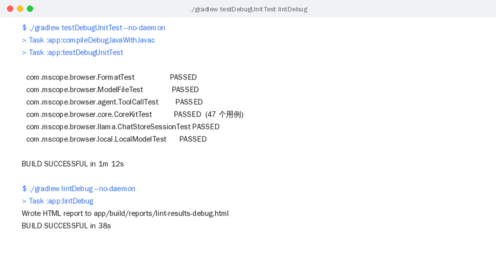

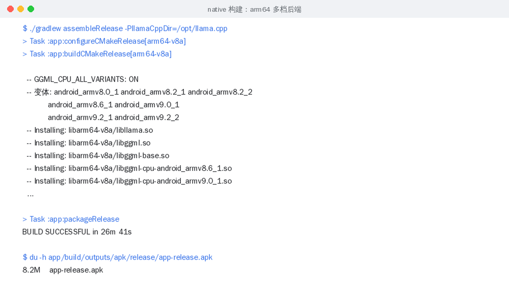

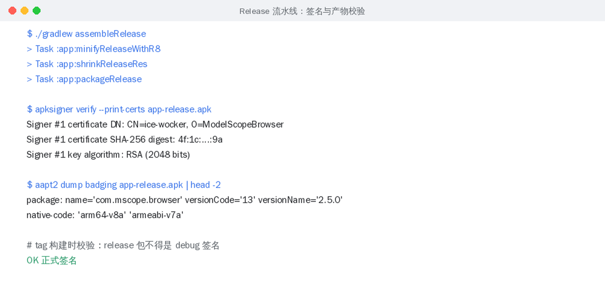

### 9.2 签名的历史教训

v1.2 的 Release 包是在 CI 未配签名时静默回退成 **debug 签名**的产物，导致用户无法覆盖安装。
现在的规则是：**tag 构建缺 Secrets 就直接失败**，并在报错里写清楚去哪配。

| Secret | 说明 |
|---|---|
| `KEYSTORE_BASE64` | `base64 -w0 release.keystore` 的结果 |
| `KEYSTORE_PASSWORD` | storePassword |
| `KEY_ALIAS` | 密钥别名 |
| `KEY_PASSWORD` | keyPassword |

### 9.3 本地构建

```bash
# 环境：JDK 17、Android SDK(platform 36 / build-tools 36 / ndk 27.2.12479018 / cmake 3.22.1)
export JAVA_HOME=/path/to/jdk17
echo "sdk.dir=/path/to/android-sdk" > local.properties

# 首次编译会拉取 llama.cpp（约 50 MB）；本地已有源码时指定路径可加速
./gradlew assembleDebug   -PllamaCppDir=/path/to/llama.cpp
./gradlew assembleRelease -PllamaCppDir=/path/to/llama.cpp

# 单元测试与 Lint
./gradlew testDebugUnitTest
./gradlew lintDebug
```

`app/build.gradle` 里几个不能随便动的点：

| 配置 | 值 | 原因 |
|---|---|---|
| `useLegacyPackaging` | `true` | 多档后端要释放到 `nativeLibraryDir` 才能被 dlopen |
| `minSdk` | 24 | 低于 24 的部分 API（如 `File#toPath`）不可用，且实测覆盖率极低 |
| `abiFilters` | arm64-v8a, armeabi-v7a | 只打包真机常见 ABI，控制体积与编译时间 |
| `minifyEnabled` / `shrinkResources` | `true` | v2.1 起开启，APK 20.6 MB → 11.6 MB |
| `cppFlags` | `-O3` | 桥接层只调 API，不含 SIMD 内核，因此刻意不加 `-march` |

## 10 本次升级（v2.5.0）

v2.4.2 是「把看起来能用、偶尔不对的地方钉死」；v2.5.0 是「把该有但一直没有的东西补上」。

### 10.1 新增 `core/` 纯逻辑层

| 文件 | 解决什么 |
|---|---|
| `MemoryBudget` | 上下文开多大由设备内存决定，而不是写死 8192 让低内存机型被 LMK 杀掉 |
| `StorageGuard` | 下载前把「放不放得下」算成一句人话；顺带做模型库体检 |
| `FsKit` | 路径收敛、原子写、魔数嗅探、目录统计，收口到一处 |
| `Validators` | 采样参数收敛、宽松数字解析、URL 白名单、内网判定 |
| `PromptTemplate` | 提示词模板化，按模型规模自动选压缩版工具说明 |
| `TextKit` | UTF-8 安全截断、文件名清洗、token 粗估、句子切分 |
| `PerfStats` | 滚动统计均值 / P90，明显劣化时给一句可操作的建议 |
| `MarkdownOutline` | 长回复的标题大纲 |

这些全部不 import `android.*`，因此能在 JVM 上直接单测——新增 47 个用例，总数 87；v2.6.0 补 12 个本地化用例，共 99；v2.7.0 再补 58 个（工具注册表、`apply_patch`、`PathGuard`、`Bm25`、`DiffKit`、SSE 解析等）共 157；v2.8.0 补 32 个（原生工具调用解析、`apply_patch` 唯一性、`Content-Range`），共 **189**。

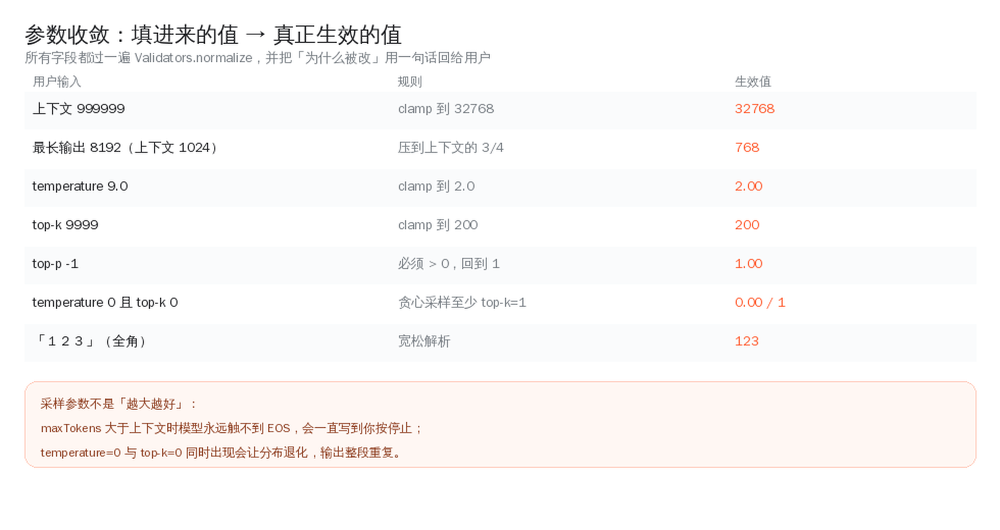

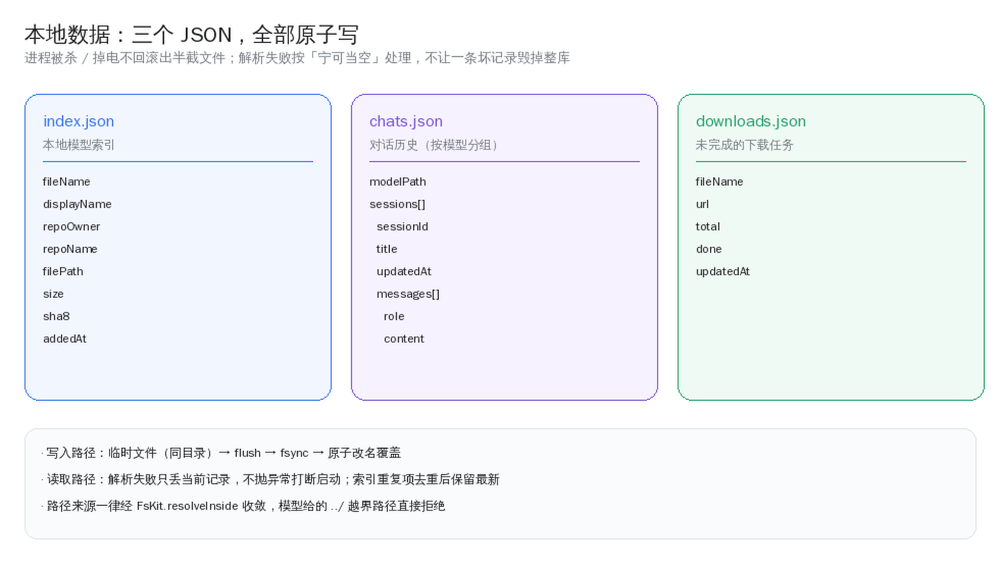

### 10.2 接入点（不是摆设）

| 位置 | 变化 |
|---|---|
| `ChatActivity` | 首次进入按设备内存定默认上下文；参数弹窗走 `Validators` 并把修正原因回显；状态条显示均值 / P90；菜单新增「本篇大纲」与「推理性能」 |
| `ChatActivity.buildSystemPrompt` | 改用 `PromptTemplate`，小模型自动用压缩版工具说明 |
| `DownloadCenter` | 空间判定换 `StorageGuard`；GGUF 校验换 `FsKit.sniff`（读文件头而非后缀） |
| `LocalModelsActivity` | 进页面顺手体检索引与磁盘，发现幽灵 / 孤儿 / 空壳时提示一次 |
| `WebSearch` | `fetch_url` 增加内网拦截；正文截断改为 UTF-8 安全截断 |
| `AgentTools` | `fetch_url` 走统一白名单判定 |

### 10.3 CI 与工程

- `verify` / `build` 拆成两个 job，快的先跑；
- 新增 native 构建缓存（`app/.cxx`），二次构建从 ~40 分钟降到几分钟；
- 新增产物校验步骤：`apksigner` 打印证书、`aapt2` 打印 ABI 与版本；tag 上拒绝 debug 签名；
- 并发组：同分支新推送取消旧运行；
- 文档从 34 KB 扩到完整手册（本页）+ 四份专题文档 + 13 张配图。

### 10.4 版本号

`versionCode 12 → 13`，`versionName 2.4.1 → 2.5.0`。minor 位跳了，因为新增了模块层。

## 10.5 v2.6.0 补了什么

v2.6.0 不新增功能，只做语言：

- **应用本身中英双语**，「关于 → 语言」可切；切换走 `recreate()` 而不是重启进程，已加载的模型与
  正在进行的下载都不会丢。
- **`values/` 改为英文**，中文迁到 `values-zh/`；Lint 的 `MissingTranslation` 开回来，
  双语从「自觉」变成构建期约束。
- **拿不到 `Context` 的文案**（提示词、工具说明、工具结果、错误）统一走 `i18n/Lang`，
  与资源换语言是同一次动作 —— 不会出现「英文界面 + 中文提示词」的半截状态。
- **10 份长文档全部双语**，每页顶部可互切。
- `versionCode 13 → 14`，`versionName 2.5.0 → 2.6.0`。

一句实话：21 张配图里的文字仍是中文，重画是绘图工作量而不是翻译工作量，单独列着。

## 11 常见问答

**Q：模型加载失败，提示「后端未注册」？**  
打包时 `useLegacyPackaging` 被关掉了。多档后端是独立 `.so`，不落盘就 dlopen 不到。见 5.3 的提示框。

**Q：问答答非所问，尤其多轮之后？**  
先确认是不是小模型（≤2B）——它们的多轮记忆本身就弱。如果之前正常、突然错位，
检查 KV 前缀复用的位置对齐（5.2）。v2.4.2 修过一次同类问题。

**Q：中文输出被截断成乱码？**  
`llama_token_to_piece` 的 buffer 太小，或者转 UTF-16 时按字节加宽。
桥接层按「完整字符」切分处理，见 5.1 第 5 条。

**Q：按了停止，工具还在跑？**  
v2.4.2 之前的 bug：循环只在生成阶段检查取消。现在每个安全点都检查。

**Q：安装时提示「应用未安装」/ 无法覆盖？**  
签名不一致。v1.2 的包是 debug 签名，需先卸载。从 v1.3 起统一正式签名，可互相覆盖。

**Q：为什么不用 GPU？**  
Vulkan / OpenCL 后端需要 `glslc` 等工具链，构建环境不具备。纯 CPU 是当前务实的选择，
这条写在「已知限制」里，不是忘了。

**Q：能下非 GGUF 文件吗？**  
应用内下载只处理 `.gguf`（其它走系统浏览器），因为只有它能被内置引擎加载。

**Q：下载很慢 / 断线？**  
续传依赖服务端支持 `Range`。支持则从断点继续，不支持则从头下。
魔搭对部分文件会 302 到 CDN，重定向后 `Range` 仍有效。

**Q：搜索结果质量一般？**  
搜索走的是公开搜索结果页（DuckDuckGo → Bing 兜底），没有 API Key，受反爬策略影响。
结果质量与时效由来源决定。

**Q：会话记录存在哪？会上传吗？**  
`filesDir/chats.json`，应用私有目录。不上传，卸载即删。

## 12 速查表

### 12.1 端口与地址

| 项 | 值 |
|---|---|
| 模型列表 | `https://www.modelscope.cn/api/v1/dolphin/models`（PUT） |
| 模型详情 | `https://www.modelscope.cn/api/v1/models/{ns}/{name}` |
| 文件下载 | `https://www.modelscope.cn/api/v1/models/{ns}/{name}/repo?FilePath=...` |
| 官网 | `https://www.modelscope.cn/models` |

### 12.2 关键常量

| 常量 | 值 | 位置 |
|---|---|---|
| `UI_FLUSH_MS` | 40 | `LlamaEngine` |
| `MAX_ROUNDS` | 8 | `ChatActivity` |
| `DEFAULT_CTX` | 8192 | `ChatActivity` |
| `MAX_RESULT` | 6000 字符 | `AgentTools` |
| `SAFETY_BYTES` | 256 MB | `StorageGuard` |
| `SAFETY_MARGIN_KB` | 320 MB | `MemoryBudget` |
| 终端超时 | 60 秒 | `Shell` |
| 输出截断 | 200K 字符 | `TerminalActivity` |

### 12.3 常用命令

```bash
./gradlew testDebugUnitTest        # 单测（189 个）
./gradlew lintDebug                # Lint（abortOnError）
./gradlew assembleDebug            # debug 包
./gradlew assembleRelease          # release 包（R8 + 资源压缩）
./gradlew :app:dependencies        # 依赖树
git tag v2.8.0 && git push --tags  # 触发 Release 流水线
```

### 12.4 排错顺序

1. 模型加载失败 → 先看界面给的 `nativeLastError()`，再看 5.3 的 `.so` 释放问题；
2. 生成异常 → `adb logcat -s LlamaEngine LlamaBridge`；
3. 下载异常 → `adb logcat -s DownloadCenter`；
4. 工具不执行 → 看气泡里的工具卡片是不是「拒绝 / 未命中」；
5. 界面错乱 → 先 `./gradlew clean` 再试，排除增量编译残留。

---

## 附录 B · 术语表

| 术语 | 说明 |
|---|---|
| GGUF | llama.cpp 的模型文件格式，含权重与元数据（量化类型、词表、chat template） |
| 量化 | 把权重从 16 位压到 4~8 位。`Q4_K_M` 是速度/质量常见的平衡点 |
| KV cache | 注意力机制的键值缓存，随上下文线性增长，是手机上最大的额外内存开销 |
| 预填充 | 处理输入 prompt 的阶段，通常比逐 token 解码快得多 |
| 前缀复用 | 复用上一轮已算过的 KV，只解码新增 token |
| 多档指令集 | 同一 ABI 编出多份 CPU 后端，运行时按 HWCAP 选最优 |
| HWCAP | Linux 在 `/proc/self/auxv` 暴露的 CPU 能力位 |
| 原子写 | 写临时文件再改名，保证不会留下半截文件 |
| 幽灵条目 | 索引里有、磁盘上没有的记录 |
| R8 | Android 的代码压缩 / 混淆工具，会重命名方法，与 JNI 天然冲突 |

---

_本文档随代码一起维护。发现与现实不符的地方，直接提 PR 改。_

## 附录 A · API 速查

按包列出公开入口。签名直接从源码抽取，改代码忘了改文档时，这一节会最先露馅。

### `com.mscope.browser` · 顶层：界面与数据层

列表页、详情页、网页兜底模式，以及魔搭接口的访问与降级策略。

#### `DetailActivity.java`

**DetailActivity** — 模型详情页：基本信息 + 模型文件（.gguf 可应用内下载并直接对话）+ Markdown 简介。

#### `Format.java`

**Format** — 通用展示格式化：体积、计数。原先在 LocalModel / ModelFile / LocalModelsActivity 各有一份，这里统一。

```java
public static String size(long bytes);
public static String sizeOrDash(long bytes);
public static String count(long n);
```

#### `MainActivity.java`

**MainActivity** — 模型列表主界面：分页浏览 + 搜索 + 排序 + 按维度筛选。

#### `ModelAdapter.java`

**ModelAdapter** — 模型列表适配器。

```java
public VH onCreateViewHolder(@NonNull ViewGroup parent, int viewType);
public int getItemCount();
```

#### `ModelApi.java`

**ModelApi** — 魔搭 ModelScope 数据访问层（接口均经实测确认）。 列表：PUT /api/v1/dolphin/models body: {"PageSize":N,"PageNumber":P,"Name":"关键字","SortBy":"D…

```java
public static class Page;
public static class Facet;
public static String http(String method, String url, String body) throws IOException;
public static Page listModels(int page, int pageSize, String keyword, String sortBy, String order, String filterCategory, String filterValue);
public static ModelItem getModelDetail(String namespace, String name) throws Exception;
public static List<ModelFile> listFiles(String namespace, String name) throws Exception;
public static String downloadUrl(String namespace, String name, String filePath) throws Exception;
public static String facetLabel(String group);
```

#### `ModelFile.java`

**ModelFile** — 模型仓库中的一个文件。

```java
public String displayName();
public String dir();
public String sizeText();
```

#### `ModelItem.java`

**ModelItem** — 一条魔搭模型记录。字段与 ModelScope /api/v1/models/{ns`/{name` 返回的 Data 结构一致。

```java
public String displayName();
public String fullName();
public String webUrl();
public String createdText();
public String updatedText();
public static ModelItem from(JSONObject o);
public static long toLong(Object v);
```

#### `Ui.java`

**Ui** — targetSdk 35+ 会强制边到边（edge-to-edge）布局，这里统一处理： 关闭系统自动适配 → 把状态栏/导航栏/输入法的 Insets 作为根布局内边距，避免内容被系统栏遮挡。

```java
public static void edgeToEdge(Activity activity, View root);
```

#### `WebActivity.java`

**WebActivity** — 网页兜底模式：直接加载魔搭官网，保证任何情况下都能浏览全部模型。

---

### `com.mscope.browser.core` · core：纯逻辑基础层（本次新增）

不依赖 Android 框架的算法与校验，全部有 JVM 单测覆盖。

#### `FsKit.java`

**FsKit** — 文件系统工具：路径收敛、原子写、容器格式嗅探、磁盘清单。 核心约定只有一条：**任何写操作都必须先收敛到根目录内**。智能体生成的路径来自模型， 一个 `../../shared_prefs/x.xml` 就能越界；

```java
public static File resolveInside(File root, String rel);
public static boolean writeAtomic(File target, byte[] data);
public static boolean writeAtomic(File target, String text);
public static String readText(File f, int maxBytes);
public static final class Magic;
public static Magic sniff(File f);
public static final class DirStat;
public static DirStat statDir(File dir, String relPrefix);
public static List<File> listSorted(File dir);
public static boolean deleteTree(File f, File root);
```

#### `MarkdownOutline.java`

**MarkdownOutline** — 从 Markdown 文本里抽标题大纲，给「长回复」加一张导航图。 本地小模型经常一口气写两三千字，手机上翻回去找某一节很难受。

```java
public static final class Heading;
public static List<Heading> extract(String markdown);
public static boolean worthOutline(String markdown);
```

#### `MemoryBudget.java`

**MemoryBudget** — 上下文窗口的「能开多大」估算器。 手机上跑 llama.cpp，最贵的不是模型本体而是 KV cache：它随「上下文长度 × 层数 × 头维」 线性增长，而且必须整块驻留内存。给用户一个 32768 的输入框却不告诉他放不放得下，

```java
public static final class Snapshot;
public static Snapshot parseMeminfo(String text);
public static long estimateExtraKb(int ctxTokens, boolean kvQuantized);
public static int suggestCtx(Snapshot mem, long modelBytes, boolean kvQuantized, int fallback);
public static String explain(Snapshot mem, long modelBytes, int chosenCtx);
public static Snapshot read();
```

#### `PerfStats.java`

**PerfStats** — 推理性能的滚动统计。 单次 tok/s 抖动很大（后台任务、散热降频、系统调度都会影响）， 只显示最后一次数字基本没有参考价值。这里保留最近 N 次，给出均值与 P90，

```java
public static final class Sample;
public synchronized void add(Sample s);
public synchronized void clear();
public synchronized int size();
public synchronized List<Sample> snapshot();
public synchronized double lastTps();
public synchronized double meanTps();
public synchronized double percentileTps(double p);
public synchronized long meanPrefillMs();
public synchronized boolean degraded();
public synchronized String summary();
public synchronized String advice();
```

#### `PromptTemplate.java`

**PromptTemplate** — 系统提示词的模板与拼装。 以前提示词散落在 ChatActivity 的字符串常量里，模型一换就得改代码；这里把 「角色 + 工具说明 + 输出约定」拆成可组合的片段，并给出一个针对小模型的压缩版：

**Preset** — 预设模板。

```java
public static String body(Preset preset);
public static String toolSection(String toolList, boolean minimal);
public static String compose(String userPrompt, Preset preset, String tools, List<String> memory);
public static List<String> sanitizeMemory(List<String> memory);
public static Preset guessPreset(String modelName);
public static double guessBillionParams(String name);
public static boolean wantsCompactTools(String modelName);
```

#### `StorageGuard.java`

**StorageGuard** — 存储巡检：在「下载 / 加载模型」这类会吃掉几百 MB 的动作之前，先把话说明白。 手机上最容易踩的坑不是下载失败，而是**下载成功但装不下**：文件写满分区， 后续的原子改名、索引落盘、甚至 KV 申请都会失败，表现成一串莫名其妙的错误。

```java
public static final class Check;
public static Check check(long freeBytes, long needBytes, long alreadyHave);
public static long freeBytes(File dir);
public static final class Finding;
public static final class Entry;
public static List<Finding> audit(List<Entry> entries, List<Entry> existing);
public static String summarize(List<Finding> findings);
public static String human(long b);
```

#### `TextKit.java`

**TextKit** — 与业务无关的文本小工具。 都是为了修一类具体的坑：UTF-8 截断（token 边界把中文切成半个字符）、 文件名清洗（模型生成的标题带 /\:*?"<>| 直接写盘会失败）、

```java
public static String trimUtf8(String s, int maxBytes);
public static boolean endsWithCompleteChar(byte[] bytes, int len);
public static String safeFileName(String raw, int maxBytes);
public static String shortHash(String s, int hexLen);
public static String sha256Hex(String s);
public static int roughTokens(String s);
public static List<String> sentences(String text);
public static boolean looksComplete(String text);
```

#### `Validators.java`

**Validators** — 输入校验：把「用户能填的东西」与「引擎能接受的东西」之间的鸿沟补上。 推理参数看着无害，填错一个值就能让采样变成重复词或直接崩： temperature=0 与 top-k=0 同时出现会让 softmax 除零，

```java
public static final class Sampling;
public static String normalize(Sampling s);
public static int clamp(int v, int min, int max);
public static float clamp(float v, float min, float max);
public static int parseInt(String s, int def);
public static float parseFloat(String s, float def);
public static String cleanQuery(String q, int maxLen);
public static String safeUrl(String url);
public static boolean isPrivateHost(String host);
public static String hostOf(String url);
```

---

### `com.mscope.browser.agent` · agent：智能体能力

工具协议解析、工具执行、真 shell、工作区、网页检索与预览。

#### `AgentTools.java`

**AgentTools** — 智能体可调用的工具集：本机终端（真 shell）、联网搜索、工作区文件、网页预览。 每个工具的执行结果都会作为 tool_result 回灌给模型，所以返回值统一是「给模型看的文本」， 出错也返回文本（而不是抛异常），让模型能自行纠错。

**Host** — 打开网页预览需要界面动作，由宿主回调（在主线程执行）。

```java
public static Set<String> names();
public static boolean risky(String name);
public static String describe(boolean web, boolean files, boolean shellOn);
public String exec(ToolCall c);
public static String summary(ToolCall c);
```

#### `HtmlPreviewActivity.java`

**HtmlPreviewActivity** — 预览工作区里生成的 HTML：本地 file:// 加载，支持脚本、样式与相对资源。

```java
public static void start(android.content.Context ctx, String relPath);
```

#### `Shell.java`

**Shell** — 本机终端：真正执行 /system/bin/sh 命令，用手机本机环境运行。 工作目录固定在应用工作区，所以命令只能读写应用私有目录（Android 沙箱限制，无需 root、 也不需要任何权限）。stdout 与 stderr 合并捕获；

```java
public static class Out;
public File cwd();
public Out run(String command);
```

#### `TerminalActivity.java`

**TerminalActivity** — 本机终端：直接执行 /system/bin/sh 命令（真 shell），工作目录固定在应用工作区。 命令在后台线程执行，输出回到界面；受 Android 沙箱限制，只能访问应用私有目录， 无需 root、也不需要任何权限。

#### `ToolCall.java`

**ToolCall** — 从模型回复里解析「工具调用」。 本地 GGUF 模型不一定带 function-call 模板，所以这里不依赖模型原生能力，而是把各家模型 习惯输出的几种写法都认下来：

```java
public String arg(String key, String def);
public String arg(String[] keys, String def);
public static List<ToolCall> parse(String text, Set<String> known);
public static String strip(String text, Set<String> known);
public static String stripThinking(String text);
```

#### `WebSearch.java`

**WebSearch** — 开关式联网检索：抓取公开搜索结果页并解析出标题 / 链接 / 摘要。 不依赖任何 API Key，开箱即用。主用 DuckDuckGo 的轻量 HTML 版（结构简单、无反爬跳转）， 失败时退回 Bing 网页结果。两个来源都失败会抛异常，

```java
public static class Result;
public static List<Result> search(String query, int limit) throws IOException;
public static String format(List<Result> results);
public static String fetchPage(String url, int maxChars) throws IOException;
public static boolean allowedForFetch(String url);
```

#### `Workspace.java`

**Workspace** — 应用私有工作区：模型与用户创建的文件都落在这里（filesDir/workspace）。 所有路径都会做规范化并强制限制在工作区根目录内，`../` 之类的越界访问会被拒绝。

```java
public static class Entry;
public File root();
public File resolve(String rel);
public String relOf(File f);
public static String normalize(String rel);
public boolean exists(String rel);
public boolean isDir(String rel);
public List<Entry> list(String relDir);
public String readText(String rel) throws IOException;
public File writeText(String rel, String content) throws IOException;
public void appendText(String rel, String content) throws IOException;
public boolean delete(String rel);
public File mkdir(String rel) throws IOException;
public long totalSize();
```

#### `WorkspaceActivity.java`

**WorkspaceActivity** — 工作区文件管理：浏览 / 新建 / 预览 / 分享 / 删除。 所有内容都在应用私有工作区内，点 .html 直接进本地预览。

---

### `com.mscope.browser.llama` · llama：推理与对话

llama.cpp 的 JNI 声明、会话管理、对话页与历史持久化。

#### `ChatActivity.java`

**ChatActivity** — 与本地 GGUF 模型对话：llama.cpp 流式生成、Markdown 渲染、可中断，历史会话自动持久化。

```java
public static void start(Context ctx, LocalModel m);
```

#### `ChatMessage.java`

**ChatMessage** — 一条对话消息。

```java
public static ChatMessage tool(String title, String kind, String content);
public boolean isUser();
public boolean isTool();
public boolean isAssistant();
```

#### `ChatStore.java`

**ChatStore** — 对话历史持久化。会话都不大，直接整份写成单个 JSON 文件最简单可靠。 每个模型可有多个会话，按更新时间倒序排列；同一模型只保留最近 {@link #MAX_PER_MODEL` 条。

```java
public static class Session;
public synchronized List<Session> list(String modelPath);
public synchronized Session latest(String modelPath);
public synchronized Session create(String modelPath);
public synchronized void save(Session s);
public synchronized void delete(String id);
```

#### `LlamaBridge.java`

**LlamaBridge** — llama.cpp 的 native 接口声明，实现在 app/src/main/cpp/llama_bridge.cpp。

**TokenCallback** — 流式回调：每个 token 片段都会调用一次。

```java
public static native String nativeSupported();
public static native String nativeBackendInfo();
public static native String nativeLastError();
public static native long nativeInit(String modelPath, int nCtx, int nThreads, int nThreadsBatch, String backendDir);
public static native void nativeFree(long handle);
public static native void nativeReset(long handle);
public static native void nativeCancel(long handle);
public static native int nativeContextSize(long handle);
public static native int nativeCachedTokens(long handle);
public static native int nativeCountTokens(long handle, String text);
public static native String nativeBuildPrompt(long handle, String[] roles, String[] contents);
public static native String nativeGenerate(long handle, String[] roles, String[] contents, int maxTokens, float temp, float topP, int topK, int seed, TokenCallback callback);
public static native String nativeVersion();
```

#### `LlamaEngine.java`

**LlamaEngine** — llama.cpp 会话管理：单例、单线程串行生成，避免并发访问同一个 context。 性能相关的几处约定：

```java
public static class Params;
public static LlamaEngine get();
public boolean isLoaded();
public boolean isLoading();
public boolean isGenerating();
public LocalModel currentModel();
public String backendInfo();
public int contextSize();
public int cachedTokens();
public synchronized void load(LocalModel model, int nCtx, String backendDir, LoadListener listener);
public void unload();
public void reset();
public void cancel();
public void generate(List<ChatMessage> messages, Params params, StreamListener listener);
public static String version();
```

---

### `com.mscope.browser.local` · local：本地模型

下载中心、前台服务、本地模型索引与模型库页。

#### `DownloadCenter.java`

**DownloadCenter** — 应用级下载中心：串行下载 GGUF（避免抢带宽），支持进度、取消、断点续传与完整性校验。 为提高成功率：

```java
public static class Task;
public static DownloadCenter get(Context ctx);
public void addListener(Listener l);
public void removeListener(Listener l);
public Task task(String localPath);
public boolean start(LocalModel model, String url);
public void cancel(String localPath);
```

#### `DownloadService.java`

**DownloadService** — 下载期间的前台服务：让大文件在应用退到后台时不被系统回收。 服务本身不执行下载（下载在 {@link DownloadCenter` 的线程池里），只负责前台通知。

```java
public static void start(Context ctx, String text, int pct);
public static void update(Context ctx, String text, int pct);
public static void stop(Context ctx);
public int onStartCommand(Intent intent, int flags, int startId);
```

#### `LocalModel.java`

**LocalModel** — 一个已下载到本机的 GGUF 模型。

```java
public String quant();
public String repoFullName();
public String displayName();
public String sizeText();
```

#### `LocalModelStore.java`

**LocalModelStore** — 本地模型库：模型文件与索引都放在 App 私有目录，无需任何存储权限。

```java
public File dir();
public File fileOf(String fileName);
public synchronized List<LocalModel> list();
public synchronized void add(LocalModel m);
public synchronized void remove(LocalModel m);
public long totalSize();
public long freeSpace();
public static boolean isExternalMounted();
```

#### `LocalModelsActivity.java`

**LocalModelsActivity** — 本地模型库：查看已下载的 GGUF、占用空间，一键进入离线对话或删除。

---
