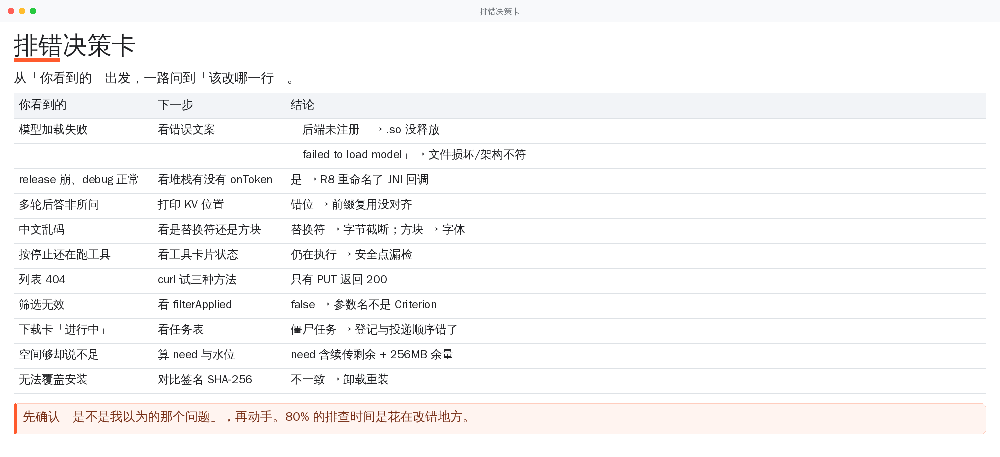

# Troubleshooting Handbook

> 🌐 Language / 语言: English · [中文](TROUBLESHOOTING.md)

Indexed by "the symptom you see". Every entry says: how to confirm, why it happens, how to fix.



> In a hurry? Read the card first, then dig into the details below.

## Fast triage

| Symptom | Most likely cause | Jump to |
|---|---|---|
| Model loading always fails | the per-tier backend `.so` files were never extracted | [1](#1-model-fails-to-load) |
| Loads fine in debug, crashes in release | R8 renamed the JNI callback | [2](#2-release-crashes-on-load-debug-is-fine) |
| After several turns the answers stop making sense | KV prefix reuse is positionally misaligned | [3](#3-multi-turn-chat-starts-answering-the-wrong-thing) |
| Chinese turns into mojibake / gets cut | UTF-8 slicing or transcoding | [4](#4-chinese-output-is-mangled-or-truncated) |
| Tapped stop, tools keep running | not every cancellation point is checked | [5](#5-pressed-stop-and-tools-still-execute) |
| Tool calls degrade into fragments | `special=false` swallowed the special tokens | [6](#6-tool-calls-turn-into-fragments) |
| Model list returns 404 | the endpoint requires PUT | [7](#7-model-list-returns-404) |
| Filters are ignored | the parameter is not `Criterion` | [8](#8-filter-conditions-are-ignored) |
| Download sticks forever | task registered after dispatch | [9](#9-download-always-shows-in-progress) |
| Says "not enough space" when there clearly is | temp files and headroom are counted | [10](#10-insufficient-space-even-though-there-is-room) |
| Preview page reads private files | `allowUniversalAccessFromFileURLs` | [11](#11-the-preview-page-can-read-app-private-files) |
| Release APK will not install over the old one | signature mismatch | [12](#12-cannot-overwrite-on-install) |

## 1. Model fails to load

**Read the error the UI gives you first.** `nativeLastError()` distinguishes "no backend
registered" from "the model file is broken".

```bash
adb logcat -s LlamaBridge LlamaEngine
# keywords: backendCount=0 / load model failed / unknown model architecture
```

**If you see "backend count is 0"**:

```bash
# check whether the .so files really landed in nativeLibraryDir
adb shell ls -l /data/app/*/com.mscope.browser-*/lib/arm64/
```

No `libggml-cpu-android_*.so` there means this is it. The root cause is
`useLegacyPackaging = false` (equivalent to `extractNativeLibs=false`): the `.so` files exist
only inside the APK, not on disk, while `ggml_backend_load_all_from_path` dlopens them by path.

Fix: keep `packaging { jniLibs { useLegacyPackaging = true } }` in `app/build.gradle`. Do not touch it.

## 2. Release crashes on load, debug is fine

```text
java.lang.RuntimeException: no non-static method
  "com.mscope.browser.llama.LlamaBridge$TokenCallback.onToken(Ljava/lang/String;)V"
```

The native side looks the method up by **string** via
`GetMethodID(cbClass, "onToken", "(Ljava/lang/String;)V")`, so the moment R8 renames
`onToken` the lookup fails. Nothing at compile time catches this — `assembleRelease`
succeeding proves nothing about runtime.

Fix: `proguard-rules.pro` keeps `TokenCallback` and the `onToken` of **every implementation**.
Any new JNI callback needs a matching keep rule, and the resulting dex should be checked by hand:

```bash
unzip -o app-release.apk classes.dex -d /tmp/dex
# use dexdump / jadx to confirm the onToken symbol survived
```

## 3. Multi-turn chat starts answering the wrong thing

**Symptom**: the first two turns are fine, from the third turn the answers drift, with
occasional crashes.

**Cause**: after a round finishes, the KV cache still holds the *previous round's output*
tokens while the bookkeeping only records the prompt. Matching a prefix against that
sequence lands at the wrong offset, `llama_memory_seq_rm` removes the wrong range, and from
then on decode positions no longer agree with the actual KV contents.

**Confirm**: print `llama_memory_seq_pos_max` after several turns and compare it with the
expected position.

**Fix**: rebuild a position-aligned sequence from the common prefix first, then do a
position-aware removal. See the KV reuse section of `llama_bridge.cpp`.

## 4. Chinese output is mangled or truncated

Three different diseases:

| Symptom | Cause | Handling |
|---|---|---|
| Chinese turns into `????` or tofu boxes | widening with `std::u16string(s.begin(), s.end())`, byte by byte | do a real UTF-8 → UTF-16 conversion |
| A glyph is cut in half at a fixed boundary | the token boundary lands inside a multi-byte UTF-8 sequence | split on whole characters (same logic as `TextKit.endsWithCompleteChar`) |
| Emoji vanish entirely | out-of-BMP characters took the 16-bit path | handle at `codePointAt` level |

Unit tests cover "truncating at any byte offset never produces a replacement character" —
`CoreKitTest.trimUtf8_neverCutsThroughChar`.

## 5. Pressed stop and tools still execute

**Cause**: the agent loop only checked cancellation during *generation*. Once generation was
interrupted, the tool calls already parsed for that round still ran — including real commands.

**Fix**: check `stoppedBy(gen)` at every safe point (after parsing, before confirmation,
before execution); pressing stop inside the confirmation dialog also suppresses that tool.

## 6. Tool calls turn into fragments

**Symptom**: the bubble contains debris like `name="web_search">` with no opening tag, and no
tool ever runs.

**Cause**: `llama_token_to_piece` was called with `special=false`. llama.cpp returns an empty
string for tokens attributed `CONTROL` / `UNKNOWN`, and MiniCPM5 makes `<function>` /
`<param>` special tokens — so the tag headers were silently dropped.

**Fix**: pass `special=true` (which is what llama.cpp's own server / CLI do).

## 7. Model list returns 404

**Confirm**:

```bash
curl -i -X POST https://www.modelscope.cn/api/v1/dolphin/models -d '{"PageSize":1}'   # 404
curl -i -X GET  https://www.modelscope.cn/api/v1/dolphin/models                          # 404
curl -i -X PUT  https://www.modelscope.cn/api/v1/dolphin/models -d '{"PageSize":1}'   # 200
```

The endpoint only accepts `PUT`. Some corporate gateways block PUT; in that case the app
falls back to aggregated data from the home page (with the `fallback` flag set), and there is
still "web mode" as a last resort.

## 8. Filter conditions are ignored

The parameter name is **`Criterion`** (an array), not `SingleCriterion` — the latter is
silently ignored by the server, which then returns everything. Facet values come from
`Data.FiledAgg` in the response, so whatever the UI offers is guaranteed to be supported
server-side.

## 9. Download always shows "in progress"

**Cause**: `start()` dispatched the task before registering it. A single-threaded pool can
finish `run()` and remove the task before the first half of the code even executes; the
entry is then put back, leaving a zombie task that shows "downloading" while not a single
byte moves. The other flavour: cancellation took an early-return branch that bypassed
`tasks.remove()`, so the task sticks in the table and that file can never be tapped again.

**Fix**: register with `putIfAbsent` *before* dispatching; cancellation goes through the main
path (checked once before the request is made) so `finish()` always runs.

## 10. "Insufficient space" even though there is room

`StorageGuard` does not simply compare "free > file size":

```text
need = total length - already downloaded     (only the remainder when resuming)
free - need ≥ 256 MB                         (safety waterline)
free ≥ 128 MB                                (hard floor)
```

The headroom is deliberate: after the download comes an atomic rename and an index write, and
the system itself needs space for page cache.

## 11. The preview page can read app-private files

**Cause**: `allowUniversalAccessFromFileURLs = true`, while the preview renders HTML written
by the model. A single `fetch('file:///data/data/com.mscope.browser/files/chats.json')` was
enough to read the chat history and send it off.

**Fix**: turn it off. Relative `` / `<script>` / `<link>` still work, so the actual
preview use case is unaffected.

## 12. "Cannot overwrite" on install

Signatures do not match. Check:

```bash
apksigner verify --print-certs installed.apk | grep SHA-256
apksigner verify --print-certs freshly-downloaded.apk | grep SHA-256
```

The v1.2 release APK was debug-signed (the silent fallback when CI had no Secrets), so the old
app had to be uninstalled first. A tag build without Secrets now fails outright, so that kind
of artifact can no longer be produced.

## 13. Generation suddenly got slow

Look at the status bar first: since v2.5.0 it shows this run / mean / P90, and warns when the
current run is far below the session mean.

| Cause | Symptom | Handling |
|---|---|---|
| More threads than available cores | per-decode time collapses from 28 ms to 3952 ms (thread barrier spinning) | take the real core count from `Cpus_allowed_list` |
| Physical batch too large | ~311 MB compute buffer, heavy GC pressure | `n_ubatch` 512 → 128, buffer ~78 MB |
| Background work / thermals | overall tok/s drops | kill background apps, drop one context tier |
| Context too large | prefill slows down, memory gets tight | lower it to the recommended value |

## 14. Collecting diagnostics

When filing an issue, please attach:

```bash
adb shell getprop ro.product.model
adb shell getprop ro.build.version.release
adb shell cat /proc/meminfo | head -3
adb shell cat /proc/cpuinfo | grep -m1 "Hardware\|model name"
adb logcat -d -s LlamaEngine LlamaBridge DownloadCenter AgentTools ToolCall > log.txt
```

Also: the model file name (including quantisation), the context setting, and whether agent
mode was on.
